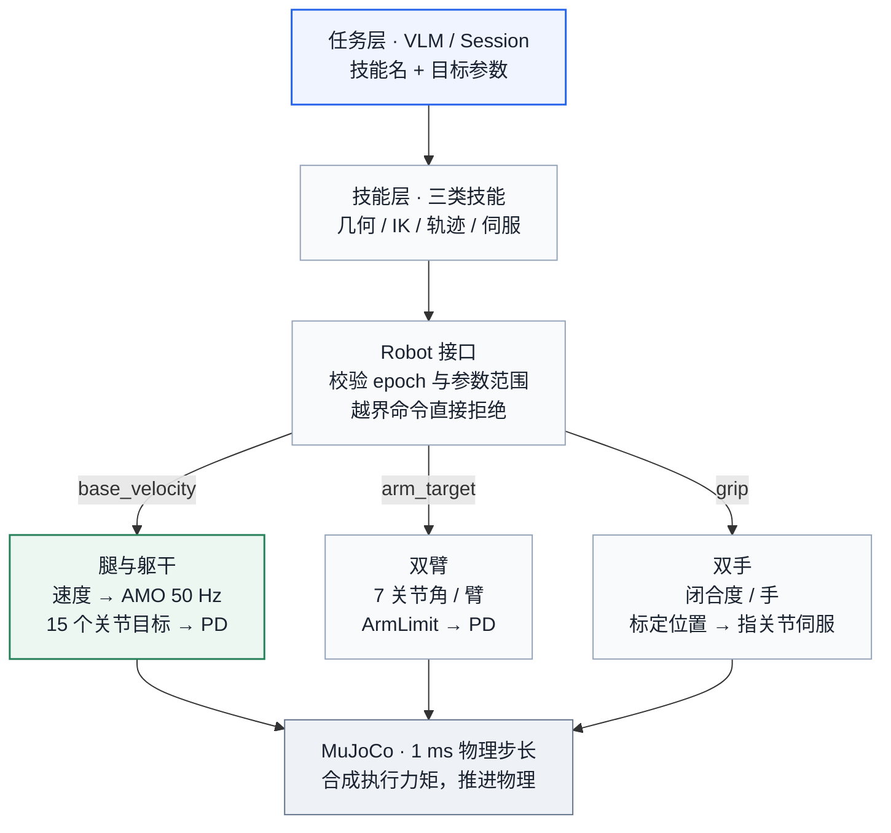
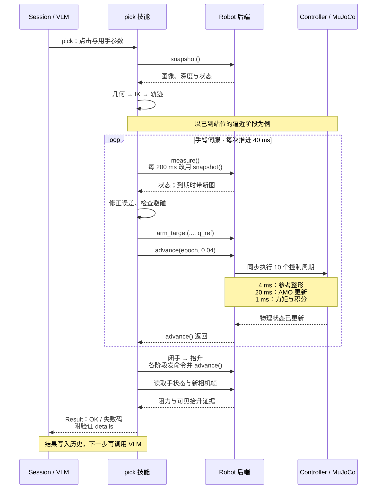

# HomeBody 仿真复现报告

> **入库说明（2026-11-23 补录）**  
> 1. **成稿与修订**：§一~§四 成稿于 2026-10-27 ~ 10-28，并于 11-03 ~ 11-04 随 17×3＝51 场波次修订（§二 已更新为 51 场口径，见第 3 条）；§五「SONIC 全身动作」为 11-04 增补。文件最后保存于 2026-11-05，§5.6 的在研状态为当日进度。  
> 2. **证据等级**：本报告沿用其自带图例（§1.4：实现事实 E1、配置值 E2、解释与归纳 E3，配 C1–C11 源码／配置索引），与周时间线的通用定义（E1＝源码行号实证…）不同，以文内图例为准。  
> 3. **口径提示**：原「三、详细分析」与「四、结论」仍按早期 9 场会话口径书写，而 §二 已更新为 51 场；入库时原样保留，未代作者改写。  
> 4. **媒体**：正文引用的 mp4、截图与 HTML 版报告未随仓库上传，相关路径仅作现场索引。  
> 5. **脱敏**：入库扫描仅将节点名与远端家目录路径替换为泛称（共 4 行），其余逐字保留；原件留存于本地原件区同周 `homebody/` 目录。

- 项目：HomeBody — A Humanoid That Explores, Remembers, and Acts on Its Own（Stanford TML，2026-09）
- 复现范围：开源代码的 **SIM 仿真部分**（MuJoCo + Unitree G1 + VLM 决策回路），不含真机与 Real2Sim 采集
- 复现时间：2026-10-27 ~ 10-28；环境：远程 GPU 节点（conda env `homebody`，Python 3.11 / MuJoCo 3.11 / torch CPU）
- 决策模型：DeepSeek V4.1 Flash（华为云 ModelArts MAAS，OpenAI 兼容端点）；另有一场用 ZCode 子 agent（GLM）经中继通道充当决策者作对照
- 证据：远程 GPU 节点实验目录下的 `runs/session-*`（含全部决策记录与物理日志）；本地 `runs/` 目录有全部交付视频

---

## 一、系统架构

### 1.1 核心主张

HomeBody 的实验设计是：**在「System 2」（VLM）与底层控制之间不设学习型的 VLA 策略层**，让前沿 VLM 通过结构化 tool-call 直接编排一个可复用技能库。VLM 只当调度器（每步一次调用），技能通过显式几何与伺服生成命令，底层 AMO 步态策略负责行走与平衡。我们要验证的正是这条链路可以被任意 VLM 替换驱动。

### 1.2 决策回路：LLM 的输入与输出

每一步（`session/session.py` 的 `run_task` 循环）：

**输入 = 一段 prompt + 4 张图。** prompt 七段（`Session.prompt()`）：

1. 通用指令（`vlm/agent_prompt.md`，26 行，不含任何场景专属词）；
2. 技能清单：每技能一行契约 + 拒绝码列表；
3. **初始场景记忆**：扫描时的语义先验（实体标签、可搬动标记、地图锚点坐标、外观/位置描述），并明示「非实时清单，物体可能已被移动」；
4. 双手状态（free / HOLDS / grasp uncertain）；
5. 任务指令原文；
6. 当前观测数字：base_pose `[x, y, yaw]` + `map_click_from_world` 仿射（世界坐标→地图点击换算）；
7. 最近 24 步历史（位姿、决策、技能结果含失败码）。

4 张图：① 头部相机 RGB；② 深度预览；③ 静态占据地图（蓝箭头=机器人位姿）；④ 深度自顶向下投影（躯干系俯视图）。**模型拿不到任何真值**：无实时物体位姿、无仿真器状态、无评分目标——选目标靠在图上点击（0–1000 归一化坐标）。

**输出 = 恰好一个结构化决策**（强制 schema，`vlm/provider.py` 的 `Decision`）：

```json
{"text": "一句看到了什么、为何这样决定",
 "skill": "navigate | pick | place | done",
 "arguments_json": "{\"point_normalized_1000\": [512, 340]}"}
```

### 1.3 技能库全景

仓库里其实有**两套技能注册表**，共用同一契约（`skills/contract.py`：PROMPT / NEEDS / FAILURES，prepare-execute-abort 生命周期，一次执行以一个声明过的失败码结束）：

**A. SIM 技能（我们复现激活的，模型可调用）**——注册于 `skills/registry.py`，只有 3 个加一个收尾用的 done。模型层的全部动作空间就是「去哪、抓啥、放哪」：

| 技能 | 模型给什么 | 内部做什么（经典控制） | 主要拒绝码 |
|---|---|---|---|
| **navigate** | 地图点击 goal（站位）+ facing（下一步操作点），或世界坐标；可选 snap | 占据图路由→AMO 步行→定位验证到达 | NO_ROUTE / STALL / ARRIVAL_NOT_VERIFIED / CARRY_CLEARED |
| **pick** | RGB 图上物体中部一个像素 + 左/右手 | 走近→深度规划抓取→逼近→闭手→抬起→验证持有→收到胸前 | NO_GRASP / UNREACHABLE / TARGET_MOVED / ARM_NOT_REACHED / LIFT_NOT_VERIFIED |
| **place** | 俯视图释放点 / RGB 支撑面像素 / 躯干坐标，任一 | 对中放置并用观测验证结果 | NOT_HOLDING / SURFACE_CHANGED / PLACEMENT_NOT_VERIFIED |
| done | summary | 判定完成/不可完成，会话结束（真伪由评分器裁决） | — |

**各技能的契约原文、输入输出与拒绝码逐条说明**（契约即每轮随 prompt 下发的 PROMPT 原文；拒绝码解释来自代码实际抛出点，「实测消息」摘自我们 12 场会话的记录）：

**navigate 契约原文**：`navigate: goal_map_1000 and facing_map_1000, [x, y] on image 3: goal, the floor where to stand; facing, the spot to work on next: the object to pick, or where the held object should land, inside a surface rather than at its edge. goal_xy_m and facing_xy_m take world [x, y] instead. With snap (default true) the robot stands square to the mapped edge on the goal side of the facing point, at least 0.46 m from it, straight ahead or in front of hand ("left" or "right") when given; with snap false it stands exactly at goal, turned toward facing. A held object is carried low in front of the body and sweeps across the surface the robot walks up to, and can push objects already on it.`

- 输入：`goal_map_1000`（图③点击 0–1000）或 `goal_xy_m`（世界坐标米）＝站位；`facing_map_1000`/`facing_xy_m`＝下一步操作点（要求在表面内部）；`snap`＝true（默认，自动贴边站正、与 facing 保持≥0.46m，可给 "left"/"right" 站到手前方）/false（精确站位）。
- 拒绝码：`NO_ROUTE`（三种情形：snap 无贴边合规站位／snap 距离内无空位／路线无碰撞通路；实测「No collision-free route to requested base stance」）；`STALL`（行走持续无进展）；`TIMEOUT`（超导航时限未验证到达）；`ARRIVAL_NOT_VERIFIED`（停稳后位置/朝向与要求差过大，消息带实际差值）；`CARRY_CLEARED`（持物行走后复查发现物体已脱离，需重新 pick）；`HOLD_UNCERTAIN`（持有证据不足，需对原目标重跑 pick 复核）。

**pick 契约原文**：`pick: point_normalized_1000 [x, y], a pixel in the middle of the object's body in image 1; hand "right" (default) or "left". Walks to a grasp stance when needed, grasps the object and lifts it into a carry pose in front of the body; OK means it is held. A held object keeps the robot farther from furniture. With both hands loaded the robot may be unable to turn or back out, and a held object can be dragged out of the hand.`

- 输入：`point_normalized_1000`＝图①上物体中部的像素（技能用可见深度反投影成 3D 目标）；`hand`＝left/right。
- 内部自愈不上报：逼近阶段的 COLLISION/TARGET_LOST 换路径重试，上限内不惊动模型。
- 拒绝码：`NO_GRASP`（没有任何抓取候选通过「几何宽度＋可达＋下降净空」三道门；点到背景时 width=0 直接失败，实测「No grasp passed visible-depth geometry, reach and clearance gates: {'width': 0, …}」）；`UNREACHABLE`（最近合规站位仍够不到，消息带差多少米，实测「pre-grasp point is 0.84 m below the shoulder…」）；`HAND_OCCUPIED`（该手已有 verified 持有物）；`CALIBRATION_MISSING`（缺夹爪标定，仿真不出现）；`TARGET_MOVED`（目标几何执行中移出捕获范围，典型是持物扫桌碰走）；`ARM_NOT_REACHED`（伺服超时掌未收敛，实测「Measured palm did not converge before the servo deadline」）；`LIFT_NOT_VERIFIED`（闭手抬升后电流阻力＋可见抬升证据不足，持有存疑）。另继承 navigate 全部码与携带恢复组（CARRY_CLEARED / HOLD_UNCERTAIN / RETRY_REQUIRED）。

**place 契约原文**：`place: hand, the holding hand, and one destination. release_point_1000 [x, y] on image 4, or x_ahead_m and y_left_m in the torso frame, releases the object's centre there at the current hand height plus delta_z_m (within ±0.15 m), and it drops onto what lies below. point_normalized_1000 [x, y], a pixel on a support surface in image 1, sets the object down release_height_m above it (0.1 to 0.35 m, default 0.1). Either way the object is centred on the point: on another object it is stacked on top, and near an edge it can tip off. The palm reaches about 0.55 m ahead of the torso, less when raised…`

- 输入（三种目的地三选一）：`release_point_1000`（图④释放点，物体中心落至该处，配 `delta_z_m`，适合扔桶）；`x_ahead_m`/`y_left_m`（躯干系米，配 `delta_z_m`）；`point_normalized_1000`（图①支撑面像素，在其上方 `release_height_m` 处放下，适合上台面）；`hand` 必填。
- 拒绝码：`INVALID_ARGUMENT`（给了不止一种形式／支撑面点击误配 delta_z_m／点击是背景，实测「Click is background; no visible target selected」）；`NOT_HOLDING`（该手无持有记录）；`SURFACE_CHANGED`（支撑面附近已无可见深度）；`COLLISION`（臂到释放姿态的路径被观测障碍挡住，含手里 payload，实测「The arm path to the selected release pose is blocked…」）；`ARM_NOT_REACHED`；`RELEASE_NOT_VERIFIED`（手指未测到张开，物体可能还在手里）；`OUTCOME_UNKNOWN`（释放后无法判断下落与静止结果）；`PLACEMENT_NOT_VERIFIED`（分离与可见沉降证据不齐、不能确认放稳——投掷偏了最常见的返回码，实测「separation from the hand and visible settling were not both observed」）。

**done**：输入 `{"summary": "…"}`，会话立即结束，summary 原样记入 `outcome.model_claim`。没有拒绝码、不做物理验证，真伪由评分器事后裁决——我们正是用 model_claim 对照评分结果才发现 4 场宣称与事实不符。

**通用拒绝码**（COMMON_FAILURES，任何技能都可能返回）：`CANCELLED`（操作者中止）；`STALE_EPOCH`（决策依据的观测属于旧场景世代）；`STALE_OBSERVATION`（执行中缺新传感器包）；`INVALID_ARGUMENT`（参数不合法/点击落空）；`TARGET_LOST`（目标从证据中消失且非手臂遮挡）；`ACTION_REJECTED`（底层安全拒绝）；`PHYSICS_INVALID`（摔倒或求解器无效，唯一终止整场的码，我们出现 2 次）；`COLLISION`（臂路径与障碍相交）。

**B. REAL2SIM / 探索技能（真机 G1 探索会话用，SIM 不激活）**——注册于 `real2sim/exploration/skills.py`，共 9 个：模型可调的 6 个（`pick_point` 地图点击行走、`look_at` 原地转身面向、`update_region` 证据准入的任务区域多边形、`ask_operator` 向操作员提问、`request_help` 请求帮助、`explored` 按视觉证据合同验收探索完成）+ 内部的 3 个（`walk_route` 经典路线、`survey` 原地转圈采图、`departure_recovery` 行走被拒后的恢复）。本复现不涉及。

**pick 的内部管线**（代码实际阶段名，`skills/pick.py`）：走到抓取站位（需要时）→ 从新站位用可见深度规划抓取（宽度拟合的抓取候选 → 可达性过滤 → 选最优）→ 逼近（沿抓取路径跟随 → 对齐到目标上方 → 下降；碰撞/丢目标自动重规划，上限次数后放弃）→ 张手 → 闭手 → 加压 → 抬升 → **验证持有**（手部关节阻抗 + 可见抬升双重校验）→ 收臂回位。持物状态存入 carry 记录，供 place 与 prompt 的「Hands now」使用。

**navigate 的内部管线**（`skills/navigate.py`）：先倒退清空转身空间 → 沿静态占据图路线行走 → 转到站位朝向 → 收近到站位 → 用定位位姿**验证到达**；snap 模式自动贴着地图边缘站正、与操作目标保持 0.46m 安全距离（正对或左手前/右手前）。持物时额外做 carry 检查——这也是「持物扫过桌面会碰倒东西」被如实建模的地方。

**place 的内部管线**（`skills/place.py`）：检查持有 → 接近支撑面/释放点 → 下降 → 释放 → 检查释放 → 收回 → 回臂 → **验证放置**（释放后回读物体实际位置）。

关键机制：**有界局部重试 + 失败反馈**——技能内部的小失败不惊动模型（自己换方案重试），重试耗尽或验证失败才返回失败码，作为下一步历史喂回 VLM。每回合上限默认 80 步（我们设 24/60），机器人摔倒（`physics_invalid`）则整场终止。

### 1.4 本体、执行栈与控制链路

VLM 只选择技能和目标；技能把目标变成速度、关节角与手的闭合度；底层控制器持续跟踪这些命令。**任务决策、动作生成、力矩执行是三个不同层次，不能用一条“模型 → 机器人”的箭头概括。** 以下说明对应本次 SIM 代码；实现事实标 E1，配置值标 E2，解释与归纳标 E3。

> **先记住三条通路：**走路 = 几何导航 → 速度指令 → AMO 步态 → PD；伸臂 = 抓放几何 → IK / 轨迹与伺服 → 关节角 → PD；手指 = 闭合度 → 标定关节位置 → 位置伺服。AMO 是这里的学习型运动模块，双臂与手指由显式控制逻辑驱动。[E1，C2–C5]

#### 3.1 谁决定什么：三个层次、两种反馈

| 层次 | 输入 → 输出 | 什么时候更新 |
|---|---|---|
| **任务决策：VLM / Session** | 任务、图像、历史 → 一次 `navigate` / `pick` / `place` 或 `done`；参数是站位、点击位置等目标 | 每个决策步调用模型；43 s 是本批实测的墙钟中位延迟，不是控制周期 |
| **动作生成：技能 / motion** | 目标与当前观测 → `base_velocity`、`arm_target`、`grip`；执行结束后返回 `Result` | 按技能阶段循环；手臂伺服默认每 40 ms 更新一次，导航等阶段用各自周期 |
| **执行：Controller / MuJoCo** | 速度、臂角、闭合度 → 下身目标、臂 / 指目标与最终执行力矩 → 新物理状态 | 控制参考每 4 ms 更新；AMO 每 20 ms 推理；物理每 1 ms 积分 |

**任务反馈**发生在技能结束后：`Result` 与新观测进入后续 prompt，由 VLM 决定下一步。**伺服反馈**发生在技能执行中：技能读状态、计算误差、更新命令，局部失败可在预算内重试，无需每 40 ms 再问模型。`measure()` 读当前位姿、关节与手状态；`snapshot()` 额外渲染 RGB、深度与实例标签，供几何计算、避碰和验证使用。[E1，C2、C5、C7；层次归纳 E3]

**图 1 · 命令向下分成腿、臂、手三条通路**



本图只展开命令与执行路径。状态经 measure / snapshot 回到技能，技能结果再回到任务层；这两种反馈的时间位置见图 2。advance 是推进仿真的调用，不是一条电机控制通路。依据：C1–C5 [E1]。

#### 3.2 从“抓这个”到“手掌到位”，中间怎么算

1. **把像素变成三维目标。**例如 VLM 输出 `pick([795, 325], right)`，坐标先按约定换算成图像像素，再用当前深度、相机参数与坐标变换取得目标点云；点击本身不是手掌坐标，也不是关节角。[E1，C7]
2. **把目标变成可达、无碰撞的抓取方案。**技能从可见几何生成候选抓姿，检查宽度、可达性与路径；距离过远时先计算接近站位并调用导航，走近后重新规划。[E1，C7]
3. **把手掌目标变成 7 个关节角。**逆运动学（IK）求解“哪些关节角能让手掌到达目标位姿”；轨迹生成与重定时安排途经姿态和运动速度。逼近阶段再用当前手掌误差做阻尼雅可比伺服，并非一次 IK 解完就盲走到底。[E1，C5、C9]
4. **把关节角变成力矩。**`arm_target` 只设置期望角度；Controller 先做目标整形，再用位置误差与关节速度计算 PD 力矩。物理推进后，实测角度通常仍有误差，下一轮继续修正。[E1，C2、C3]
5. **到位后闭手、抬升，再验证。**`grip` 设置闭合目标，实际手指运动随 `advance` 发生。反复的手部阻力证据与当前可见抬升共同支持“确实拿住”；不能把“已发送闭合命令”当成抓取成功。[E1，C7]

双臂在每个物理子步使用 `τ = Kp · (q_ref − q) − Kd · q̇`：`q_ref` 是门控后的目标角，`q` 与 `q̇` 是实测角度与角速度；前项拉近位置误差，后项抑制运动速度，最终力矩再做执行器限幅。**发出目标 ≠ 立即到位**，这正是技能必须读回状态的原因。[E1，C3；公式解释 E3]

`place` 复用手臂运动与伺服通路，把目标换成释放位姿，随后执行开手、撤离和放置验证。`navigate` 则在技能层做路线与朝向计算，只把身体坐标系速度 `[vx, vy, wz]` 交给底层；技能没有直接设置腿部关节的接口。[E1，C2、C7、C10]

#### 3.3 一个 40 ms 的手臂伺服周期，底下发生了什么

以下频率按**仿真时间**计，是不同任务的更新间隔，而非互相串联的独立线程。`advance(epoch, 0.04)` 会同步推进 10 个 4 ms 控制周期；每周期包含 4 个 1 ms 物理子步。稳态下，这 40 ms 内还会触发 2 次 AMO 推理。[E1，C2、C3；E2，C8]

| 间隔 / 频率 | 更新的对象 | 不要混淆 |
|---|---|---|
| **1 ms · 1000 Hz** | MuJoCo 积分；身体各电机的 PD 力矩按最新关节状态重算 | 力矩重算比控制参考更新更快 |
| **4 ms · 250 Hz** | ArmLimit 臂参考 / 增益、手指位置参考；检查是否轮到 AMO | 这是参考整形周期；不是每 4 ms 都重新跑 IK |
| **20 ms · 50 Hz** | AMO 根据本体状态、速度指令与历史更新下身关节目标 | AMO 网络输出目标偏移；不直接输出这里的电机力矩 |
| **40 ms · 25 Hz** | 手臂伺服或关节轨迹流更新下一条 `arm_target` | 这是手臂相关循环的默认值，并非所有技能统一频率 |
| **200 ms · 5 Hz** | 臂循环在需要时刷新相机帧，其间使用较轻的状态读数 | 仅指该循环的定期重感知；其他阶段也可请求新帧 |
| **每个决策步** | VLM 根据任务、观测与历史选择下一技能 | 推理墙钟延迟不属于上述控制频率 |

> **模型思考时机器人仍在控制。**Session 的 heartbeat 在等待 provider 时置零底盘速度、以 20 ms 小段继续推进物理；Controller 与 AMO 仍负责站立。模型回复慢会拉长任务耗时，但不等于腿部控制暂停。[E1，C6；含义归纳 E3]

**图 2 · 一次 pick：技能内部循环，完成后才回到模型**



图中省略了需走近时的导航与具体重试分支。重感知位于伺服循环内：默认每 200 ms 刷新，其间读 measure；闭手和抬升也必须推进物理。Result 无论成功或失败都回到 Session，摔倒则终止本场。依据：C2、C3、C5、C7 [E1]。

#### 3.4 接口校验与控制限幅，各自解决什么问题

**入口检查合法性，控制器约束执行过程。**`ActionLimits` 对错误 epoch、非有限数值、非法范围等直接抛出 `ActionRejected`，不会把任意越界值悄悄改成合法值。合法臂目标进入 Controller 后，才由 `ArmLimit` 逐周期做增益爬坡、速率与关节范围限制，以及基于 effort 的目标偏差约束；最终执行力矩还受 actuator 范围限制。[E1，C1、C3]

| Robot 命令 | 技能提供什么 | 后端如何处理 |
|---|---|---|
| `base_velocity` | 身体坐标系前向 / 侧向速度（m/s）及转率（rad/s） | 校验速度范围；续期后交给步态控制。超过 0.20 s 仿真时间未续期，推进时清零速度 [E1 C1–C2；E2 C8] |
| `arm_target` | 指定侧手臂的 7 个目标角（rad） | 校验角度范围；设置参考，经 ArmLimit 整形与 PD 跟踪 [E1 C1–C3] |
| `grip` | 指定侧手的闭合度，0 为张开、1 为闭合，允许配置内额外 squeeze | 映射到每手 7 个指关节的标定位置，按固定速率更新位置参考 [E1 C1–C3] |
| `advance` | 推进时长：整控制周期，0 &lt; t ≤ 1 s | 执行控制与物理步进；检查速度超时和物理有效性 [E1 C1–C2] |
| `stop` | 停止当前运动的请求 | 底盘置零、臂保持当前门控参考；不主动打开手，也不替代物理推进 [E1 C2–C3] |

每条命令都携带 `epoch`，场景重置后旧命令会被拒。技能通过 `NEEDS` 声明所需接口，Runner 在执行前核查接口是否可用；这是能力检查，不应描述成“权限超时”。[E1，C1、C7]

#### 3.5 学习模型与显式控制的边界

**AMO 学习的是下身动作生成。**网络输出 15 维动作，经裁剪、缩放并加到默认姿态上，形成腿与躯干的关节目标；双臂 14 维目标来自技能，拼入统一命令。该 SIM Controller 显式关闭 gravity feedforward，不能把 AMO 写成“网络直接输出腿部力矩 / 非零前馈力矩”。[E1，C3、C4]

**“不用 VLA”指中间没有端到端视觉动作策略。**顶层 VLM 仍是学习模型，底层 AMO 也包含 policy network 与 adapter；准确表述应是“本地连续控制中的学习模块为 AMO”，不能据一个模型加载文件便断言“全栈只有一个神经网络”。抓放中的几何、IK、轨迹、碰撞检查和伺服为显式算法。[E1，C3–C5、C9；架构归纳 E3]

> **SIM 的感知边界也要写明。**技能使用引擎渲染的深度与实例标签，而非只凭 RGB 完成全部感知。模型的图像输入、技能可读观测、离线评分器的数据是三种不同的数据面；本节描述的是 SIM 执行链路，不能直接当作真机感知能力的证明。[E1，C2；边界解释 E3]

**本体与验收：**Unitree G1 为 29 个身体关节加双手指关节，场景为 `src_kitchen`。独立物理评分器读取录制的 `physics.jsonl`，逐物体检查终态；它不属于实时控制回路，也不把终态评分回传给技能。技能返回 OK 与整场任务 passed 是两种判定。[E1，C11；0.1 s 物理记录周期为 E2，C8]

**源码与配置依据（本地版本）**

| 索引 | 依据 | 核实内容 |
|---|---|---|
| C1 · E1 | `src/homebody/primitives/actions.py:15–74` | epoch、参数范围与拒绝机制 |
| C2 · E1 | `src/homebody/backends/mujoco.py:198–255` | 五条命令、推进、超时与观测 |
| C3 · E1 | `src/homebody/backends/controller.py:54–79, 98–117, 153–176` | ArmLimit、关闭前馈、参考更新与子步力矩 |
| C4 · E1 | `vendor/holosoma_inference/g1_control/amo.py:207–233, 423–455` | policy / adapter 加载、15 维动作与目标映射 |
| C5 · E1 | `src/homebody/motion/arm.py:27–39, 62–72, 104–143, 280–286` | 状态 / 图像更新、臂伺服与闭手推进 |
| C6 · E1 | `src/homebody/session/session.py:169–185, 205–212` | 模型等待期间的 heartbeat |
| C7 · E1 | `src/homebody/skills/pick.py:62–114, 143–232, 298–365`；`skills/contract.py:213–244` | 准备、走近、抓取、验证与结果回填（contract 同属 src/homebody） |
| C8 · E2 | `src/homebody/session/config.py:13–69`；`configs/simulation.toml` | 默认频率与 SIM 覆盖项；不是运行日志测量 |
| C9 · E1 | `src/homebody/helpers/kinematics.py:74–115`；`helpers/trajectory.py:111–135` | IK 与阻尼雅可比伺服（trajectory 同属 src/homebody） |
| C10 · E1 | `src/homebody/skills/navigate.py`；`src/homebody/skills/place.py` | 导航与放置各阶段实现 |
| C11 · E1 | `evaluation/evaluate.py`；`src/homebody/backends/mujoco.py:327–353` | 独立评分与物理记录数据面 |

### 1.5 我们对基础设施的改造

原版 provider 只有 codex/claude-code CLI 与 OpenAI/Anthropic 官方 API 四种，且 API 地址硬编码。我们按仓库的扩展点（新 provider 类 + `PROVIDERS` 注册 + `MODELS` 行）新增三个：

- `glm`：bigmodel 的 Anthropic 兼容端点（备用于 GLM 官方 API）；
- `compat`：任意 OpenAI 兼容端点（本报告的 DeepSeek 走此通道；将来 NPU 上 vLLM 起的服务同样适用）。因多数兼容端点不支持 `response_format: json_schema` 强制，改为 prompt 内嵌 JSON 契约 + **容错解析**（剥代码围栏、把嵌套的 `arguments_json` 对象重新序列化、把漂移的 `arguments` 键名归一）；
- `relay`：文件交换中继（prompt+图落盘，等待外部决策者写回 `decision.json`）——用于「子 agent 当大脑」的对照实验，也是无 API 时的调试通道。

另修复/新增：`tools/smooth_video.py`（按 `events.jsonl` 真实时间戳重建正确配速视频）；4 路并发运行脚本（实测 8 核节点负载 4.0、内存余 15G，决策等待期 CPU 闲置，并发边际成本≈0）。

### 1.6 真实一轮的输入与输出（通关场 #5 实录）

以下全部来自 swapped 通关场的原始记录（`runs/session-20261028T075553Z-31ba43f4`），非示意。

**任务**：Put the cartons on the middle island and throw the coffee bags in the recycling bin.

**第 0 步发给模型的 prompt（14.6 KB + 4 图）的七段结构，逐段摘录**：

- 通用指令（节选）：「Decide from this prompt and the four attached images only: 1. the head camera's RGB image; 2. its depth preview… 3. the static map of fixed obstacles… 4. this view's depth projected from above into the robot's torso frame…」+ 点击坐标定义 + 「The initial-scene memory … is not a live inventory」
- 技能契约（节选 pick 行）：「pick: point_normalized_1000 [x, y], a pixel in the middle of the object's body in image 1; hand "right" (default) or "left". Walks to a grasp stance when needed… Refusals: HAND_OCCUPIED, NO_GRASP, UNREACHABLE, …」
- 初始场景记忆（原文 3 条，注意锚点是世界坐标）：「Sideways orange-juice carton (portable) at [1.04, 1.45]…」「Brown wrapped parcel A (portable) at [3.71, 3.75]…」「Freestanding blue recycling bin (portable) at [2.05, -2.7]…」（共 19 个实体）
- 双手状态：「the left hand is free; the right hand is free」
- 当前观测数字：`{"base_pose": [3.891, 3.282, 2.274], "map_click_from_world": [[75.7, 0, 223.0], [0, -56.8, 476.7]]}`
- 最近步骤：`none`（第一步）
- 4 张图：头部 RGB（前方柜台上正是 parcel A）+ 深度预览 + 占据地图（蓝箭头=自己）+ 躯干系俯视深度图

**第 0 步模型的输出（原文）**——注意 DeepSeek 是思考型模型，content 之前还有 11,890 字符的内部推理（不计入决策）：

```json
{"text": "A brown wrapped parcel (coffee bag) sits on the back counter right in front of the robot, so I pick it up first to later drop in the recycling bin.",
 "skill": "pick",
 "arguments_json": "{\"point_normalized_1000\": [795, 325], \"hand\": \"right\"}"}
```

**输出校验与回填**：三个字段中 `skill` 必须恰为四者之一；`arguments_json` 是「字符串里装 JSON 对象」的双重编码，数字必须有限，否则整场 provider_error（DeepSeek 的三种格式漂移都发生在这个点上）。技能执行完回填历史的结果记录结构为 `{skill, code, message, details}`，code 只有 OK 或声明过的拒绝码；成功例：`{"skill": "pick", "code": "OK", "message": "Repeated hand resistance and current visible lift verified", "details": {"observed_top_rise": 0.138, "palm_rise": 0.174}}`；拒绝例：`{"skill": "navigate", "code": "NO_ROUTE", "message": "No collision-free route to requested base stance"}`。这条记录进入下一轮 prompt 的「Recent steps」段，是失败反馈的实体。第 0 步 prompt 的 14,600 字符全文见 HTML 版报告的折叠区。

**技能执行后回填历史的结果（原文）**：`OK — Repeated hand resistance and current visible lift verified`，附带物理细节 `observed_top_rise: 0.138m / palm_rise: 0.174m`（手阻 + 可见抬升双重验证通过）。

**失败反馈长什么样（同场第 1→2 步原文）**：第 1 步 navigate 到桶前站位被拒（`NO_ROUTE — No collision-free route to requested base stance`）；第 2 步的决策文本直接引用了这次失败：「**after the first stance failed** I will navigate to a wider clear stance east of the recycling bin before dropping it in」→ 换站位后 OK。第 15→16 步同理：place 因「observed payload [blocks the arm path]」返回 COLLISION，第 16 步改用更近、左偏 0.2m 的释放点重试成功，第 17 步 done。注意最后这次成功是恢复出来的：这场通关里两次 place 失败，救回来一次，剩下那次靠模型自己换释放点。

---

## 二、完成情况：一张表讲完全部测试

官方 17 任务，每任务先跑 1 次覆盖、再以 3 次重复统计（51 场，6 路并发）。决策模型 DeepSeek V4.1 Flash。

| 任务 | 考点 | 首轮 | 3 次重复 | 备注 |
|---|---|---|---|---|
| 01 default | 4 物体整理基准 | ✗ | 1/3 | 失分均为放置精度（近目标未稳） |
| 02 default_reworded | 换词鲁棒性 | ✗ | 2/3 |  |
| 03 swapped | 目的地对调 | ✓ | 1/3 | 早期另 2 次通关（累计 4 试 2 中） |
| 04 swapped_reworded | 对调＋换词 | ✗ | 1/3 |  |
| 05 the_other_carton_to_bin | 排除指代（非果汁的纸盒） | ✗ | 2/3 |  |
| 06 juice_to_table_by_bin | 空间关系指代 | ✓ | 2/3 |  |
| 07 carton_by_toaster | 单物体搬运 | ✓ | 3/3 | 稳定 |
| 08 swap_coffee_bags | 双物体互换 | ✗ | 2/3 |  |
| 09 after_breakfast | 换说法的排除指代 | ✓ | 2/3 |  |
| 10 juice_for_guest | 双重间接指代 | ✓ | 3/3 | 稳定 |
| 11 farther_bag | 相对指代（较远的包） | ✗ | 3/3 | 首轮败→重复 3/3（方差样本） |
| 12 conditional_juice | 条件指令（先验证前提） | ✓ | 1/3 | 首轮过→重复 1/3（方差样本） |
| 13 there_and_back | 展示后放回原位 | ✓ | 2/3 |  |
| 14 bags_to_rear_table | 双物体同目的地 | ✓ | 1/3 |  |
| 15 juice_to_front_table | 双物体异目的地 | ✓ | 3/3 | 稳定 |
| 16 cartons_to_corner_counter | 跨区长链（代表场 37 步） | ✓ | 3/3 | 稳定 |
| 17 moved_juice_to_bin | 错误记忆搜索（全库最难） | ✗ | 0/3 | 4 试全败；官方 Opus 2×29min 寻回 |
| **合计** | | **10/17** | **32/51 = 63%**（95% CI 49–75%） | |

**时间与成本**：含过程实验共 76 场有效会话、约 800 次决策调用、每场几分钱。模型推理等待占墙钟 56%（均值 51s/步；每步平均 6400 思考 token vs 决策 JSON 85 token），去掉等待后仿真 ≈1.1× 实时——瓶颈在模型不在仿真。17×3 波次墙钟 12.8h 由 6 路并发压至 4.3h（最大健康并发 = 6，内存约束 3.5GB/进程）。技能分布（早期 9 场）：navigate 70 / pick 46 / place 31 / done 9。

**统计外过程实验（12 场）**：无模型脚本基线 4/4（栈可信）；GLM 子 agent relay 对照一场 24 步失败（决策回路模型无关 + 涌现行为样本）；DeepSeek 单任务一场 6 步弃权（韧性对照）；2 场步态摔倒、3 场格式解析事故（驱动容错解析加固，此后 60+ 场零失败）。

## 三、详细分析

先交代取证方法。物体终态全部来自评分器逐场输出；「是否被拿起过」用物理日志判定（遍历该物体全部 0.1s 采样，最大高度相对初始位置抬升超过 0.15m 记为被拿起过）；done 自述与事实的比对取自各场 `outcome.json` 的 `model_claim` 与评分结果。

### 3.1 物体级终态矩阵（按各自任务的目标评分）

| 场次 | parcel_left | parcel_corner | juice_carton | red_white | 通过 |
|---|---|---|---|---|---|
| #1 relay 果汁→桶 | — | — | ✅ 桶内 | — | ❌† |
| #2 ds 果汁→桶 | — | — | ❌ 从未移动 | — | ❌ |
| #3 default | ✅ 岛 | ✅ 岛 | ✅ 桶 | ❌ 桶外 | ❌ |
| #4 default_reworded | ✅ 岛 | ❌ 未轮到 | ❌ 桶外 | ❌ 桶外 | ❌ |
| #5 swapped | ✅ 桶 | ✅ 桶 | ✅ 岛 | ✅ 岛 | ✅ |
| #6 swapped_reworded | ✅ 桶 | ✅ 桶 | ❌ 岛外 | ❌ 岛外 | ❌ |
| #7 swapped 重跑 | ✅ 桶 | ✅ 桶 | ✅ 岛 | ✅ 岛 | ✅ |
| #8 swapped 重跑 | ✅ 桶 | ✅ 桶 | ❌ 未拿起 | ✅ 岛 | ❌ |
| #9 swapped 重跑 | ✅ 桶 | ✅ 桶 | ❌ 未拿起 | ✅ 岛 | ❌ |

（— 表示不在该场任务范围内。）

任务相关的未到位共 9 个：果汁盒 5 次（1 次整场弃权、2 次拿起后放偏、2 次从未拿起）、红白盒 3 次（全部拿起后放偏）、parcel_corner 1 次（步数耗尽没轮到）。物体级成功率 21/30。「咖啡包→桶」8 次全部成功；果汁盒是全局最弱的单一物体，两种任务方向上都失手过。

### 3.2 一处修正：relay 场其实完成了物体目标

初版报告把 #1 记为 0/1，原因是我们用 default 四物体目标去评了一个单物体任务（评分器在 stderr 给过任务不匹配的警告，被漏看了）。按其自身目标重评：果汁盒终态在桶内、带支撑接触、静止 159 秒、无扰动，判负的唯一依据是 `task_status=step_limit`，评分政策要求会话以 done 收尾。

也就是说，机器人已经把纸盒弄进了桶（最后一次抓取尝试期间被带入），而决策者不知道——它的第 24 步还在计划重新抓起「地上的」纸盒。它的世界模型滞后于物理事实。

这让两种决策源的失败方式构成一对镜像：GLM 做成了但没宣告（也不核对成果），DeepSeek 宣告了但经常没做成（3.3）。

### 3.3 失败集中在三个环节

| 环节 | 次数 | 证据 |
|---|---|---|
| 放置/投掷落点偏（拿起但终态不在目标） | 5 | #3 红白盒在手中 634 个采样后落点偏出桶的 bounds；#4 果汁盒/红白盒、#6 果汁盒/红白盒同类 |
| 抓取放弃（物体从未离地） | 4 | #2 整场 6 步弃权；#4 的 parcel_corner 在 28 步里没轮到（14 次 pick 都给了别的物体）；#8/#9 的果汁盒各只尝试 1 次抓取就转向其他物体 |
| done 自述与事实不符 | 4 场 | #3/#4/#6 宣称「全部完成」，实际 3/4、1/4、2/4；#8 的自述只列了 3 个物体，还写着「landings unverified」，仍然收尾 |

第三类与第二类部分重叠：#8/#9 属于「少做一个物体，然后交一份缩水的完成报告」。程度也有差别——#4 的「全部完成」与事实差距最大（1/4），#8 至少没把果汁盒算进去。

点击精度是第一类的共因。模型在图上选的释放点与物体实际落点之间有系统性偏差，通关场 #5 的两次 place 失败同源，靠第 16 步的偏移重试救回。

### 3.4 两种「大脑」对比（修正版）

| | GLM 子 agent（relay） | DeepSeek V4.1 Flash |
|---|---|---|
| 规划 | 站位与朝向点选择合理 | 同样合理，善用世界坐标与 snap 语义 |
| 失败反馈利用 | 强：换站位重试、推移清障 | 中：会用失败码换策略，但不用在 done 判定上 |
| 完成判定 | 从不宣告 done，24 步磨满 | 4 场宣告 done，3 场与事实不符 |
| 物理结果 | 物体目标实际达成 | 物体级 70% |

### 3.5 与论文预期的对照

论文只验证过 Astra/Opus 级模型。我们在 Flash 档得到 25–50% 的任务通过率、物体级 70%，失败集中在放置精度、抓取韧性和完成判定，规划与编排没有出过结构性错误。这与论文的说法相容，并把差距落到了具体环节上。

---

## 四、结论

先说总判断。复现是成立的：环境、技能库、决策回路、评分器全部按原样跑通，且接口不挑决策源——GLM 子 agent 和 DeepSeek 接入时都没改一行框架代码。DeepSeek V4.1 Flash 能把四物体任务从头组织到尾（两次独立通关），但 9 场里 7 场败在放置落点、抓取韧性和完成判定上，没有一场是输在规划。样本不大（同任务最多 4 次），下面的比率当参考看，不作统计结论。

**已验证的事实**（括号内是证据位置）：

1. 仿真栈可信：无模型脚本 4/4（`tools/check_manipulation` 输出与评分记录）。
2. 接口模型无关：两个决策源接入只改环境变量；155 次调用在解析加固后零格式失败（各场 `decisions/step-*/status.json`）。
3. DeepSeek 任务通过率：default wave 1/4；swapped 4 试 2 中，两次通关是独立轨迹（`session-…-31ba43f4`、`-f225e374`）。
4. 物体级成功率 21/30；「咖啡包→桶」8/8；果汁盒 5/9 未到位，是最弱的单一物体（终态矩阵见 3.1）。
5. relay 场的物体目标实际达成，判负仅因 step_limit（`--only` 重评输出＋末帧物理位置在桶 bounds 内，见 3.2）。
6. 时间结构：模型等待占墙钟 56%（中位 43s/步）；去掉等待，仿真约 1.1 倍实时（`status.json` 聚合）。
7. 两条工程事实：接国产/自托管模型的主要成本是结构化输出格式漂移（DeepSeek 一家就有三种漂移，容错解析层应作为标配，事故与加固记录见各场 `decision-error` 与 `vlm/compat.py`）；回放视频速度要按事件时间戳重建，不能信任容器帧率（`tools/smooth_video.py`）。

**我们的判断**（解读，不是测量）：

1. 这个档位的瓶颈不在规划，在放置精度、抓取韧性和完成判定。前两者共享一个上游（视觉定位精度），后者是行为习惯：不核对结果就下结论。
2. 两个低成本实验值得做：done 前强制复核上一轮的验证类失败码；NO_GRASP 后要求至少换两个站位再放弃。若通过率因此抬升，说明差距在行为约束而非能力，提示工程就能补；若无效，才需要换更强的模型。
3. relay 场的教训对我们自己也成立：agent 汇报的状态可能滞后于物理事实，验收要看传感器数据，不能只听汇报。这条已经在本次报告修订中兑现过一次。

**局限**：swapped n=4，摔倒统计 n=12，单场景、单任务族、单模型。两场摔倒是步态策略的固有随机性，不是决策层的错。

**下一步**：批量重复统计（4 路并发基础设施已备，每场几分钱）；GLM 官方 key 到位后补第三条对照线；Qwen-VL 经 vLLM-ascend 上 910B3 走同一 compat 通道；以及上面两个提示工程实验。

主线复现冻结（`freeze/homebody-20261104`，即 `6f7bbb8`）之后，我们在 `codex/sonic-interface` 分支上接入第二条执行路线：NVIDIA GEAR-SONIC 全身跟踪策略，让同一个 VLM 编排框架可以指挥 G1 跳整段舞。这部分是复现之外的扩展，单独成章（见五）。

---

## 五、扩展：SONIC 全身动作（让机器人跳舞）

### 5.1 做了什么

主线的技能库只有 navigate / pick / place，动作全部由「几何规划 + IK + 局部伺服 + AMO 步态」这条链完成。我们在这条链旁边接入了第二条执行路线：NVIDIA GEAR（GR00T-WholeBodyControl）发布的 **SONIC G1 全身跟踪策略**，并注册成一个新技能 `perform_motion`。VLM 的用法不变——每步仍只输出一个结构化决策，但它现在可以让机器人完整跳出一段舞蹈：

```json
{"text":"接下来跳完整 Macarena。","skill":"perform_motion","arguments_json":"{\"motion_id\":\"macarena\"}"}
```

两个前提保证了这段实验不影响主线：实验跑在**隔离会话**里（注册表只有 `perform_motion` 和 `done`，默认 AMO、navigate / pick / place 都不加载），主线代码的默认行为零改动；资产按 96 个文件的 SHA256 清单固定（XML、mesh、ONNX 权重、观测配置、五组动作参考、PD 标定），启动物理前逐文件校验，线上权重更新也不会被悄悄换入。

### 5.2 SONIC 是什么，和 AMO 什么关系

SONIC 是一对 50 Hz 的 ONNX 网络（`model_encoder.onnx` 与 `model_decoder.onnx`，SHA256 固定）：

- **encoder** `[1,1762] → [1,64]`：把「未来 46 帧（约 0.92 s）的参考动作窗口」——关节位置、关节速度、根朝向 6D——压缩成 64 维 latent token；
- **decoder** `[1,994] → [1,29]`：输入 64 维 token + 最近 10 帧本体历史（角速度、关节角、关节速度、上一拍 action、重力方向），输出 29 个身体关节的 raw action。

raw action 不是力矩：目标角 = `default_positions + action_scale × raw`，再经发布版 PD 标定（kp 99.1/40.2/28.5/14.3、kd 6.3/2.6/1.8/0.9 四档，按 actuator 力矩限幅）变成关节力矩写进 MuJoCo，每个 50 Hz tick 走 4 个 5 ms 物理子步。

它和 AMO 是**同构的两条路线**，不是上下游：

| | AMO（主线） | SONIC（本扩展） |
|---|---|---|
| 职责 | 行走与平衡，只会按速度向量走 | 全身 29 关节跟踪任意参考动作 |
| 输入 | 命令线速度/角速度 + 本体观测 | 未来 46 帧参考窗口 + 10 帧本体历史 |
| 输出 | 关节目标（同一套 default+scale+PD 语义） | 关节目标（同一套 default+scale+PD 语义） |
| 能力边界 | 走路、转向、承载 | 跳舞、深蹲、踢腿、转圈，参考给到哪跟到哪 |
| 来源 | UCSD OpenTeleVision 团队 RL 步态策略 | NVIDIA GEAR 全身跟踪策略（ONNX release） |

技能层照旧不产生关节角：`perform_motion` 只收一个目录 ID，连续参考由动作层提供，64 维 token 由 SONIC 自己的 encoder 生成。VLM 不需要也不应该知道 29 个关节角的存在。

### 5.3 实现思路：从「跳个舞」到 29 个关节角

信号链分五层，每层输入输出如下：

| 层 | 输入 | 输出 | 频率 |
|---|---|---|---|
| VLM（Session） | 任务文本 + 4 张观测图 + 动作目录（ID/描述/时长）+ 上一步结果 | `perform_motion(motion_id)` 或 `done` | 每段动作一次 |
| 技能 `perform_motion` | `motion_id`、执行 epoch | phase 机 `preparing→executing→settling→completed`；Result 附 job_id、帧进度、tracking | 阻塞至完成 |
| 参考组装 `compose_reference` | 目录 clip + 实测姿态/朝向/位置 | 拼接后的连续 50 Hz 参考（进入 2 s + 原动作全帧 + 退出 2 s + 保持 1 s） | 每段一次 |
| SONIC 策略 | 未来 46 帧窗口 + 10 帧本体历史 | raw action `[1,29]` | 50 Hz |
| SonicBackend / MuJoCo | 目标角 = default + scale×raw，实测关节角/速度 | PD 力矩（actuator 限幅内）→ 4×5 ms 物理子步 | 50 Hz × 4 |

几个关键设计：

1. **参考组装不丢帧**：进入段用 Hermite 样条从**实测**当前姿态过渡到动作首帧（避免起始突跳），退出段同样回到中性站姿；中间原动作的每一帧原样保留，关节速度连续。朝向与 XY 原点对齐当前机器人所在位置，根高沿用参考。
2. **实测跟踪即验收**：执行期间每个主段帧累计关节误差与根高误差，`completed` 时对照预注册阈值（joint RMSE < 0.35 rad、根高误差 P95 < 0.20 m、帧数完整、无摔倒/warning）判定 success，随 Result 一起回流给 VLM。失败码只有 `TRACKING_LOST / TIMEOUT`（外加通用失败码）。
3. **独占式安全边界**：SONIC 会话里 `base_velocity` 只接受全零、`arm_target` 与 `grip` 直接拒绝——全身 29 个电机由 SONIC 独占，14 个手指关节保持张开。单线程物理 owner、epoch 校验、非零力矩清零锁存等主线安全机制全部沿用；中途取消会走同一条力矩过渡路径回到站姿，而不是瞬移。
4. **启动即真实**：只在 `reset()` 初始化 qpos；之后动作启动、切换、取消全部由真实接触动力学与力矩完成。启动时用 10 帧实测站姿 prime 策略历史并空跑 1 s 真实控制 warmup。

### 5.4 跑了什么，结果如何

**15 段连续验收（脚本编排，5 动作 × 3 次，只初始化一次）**——全部通过，无摔倒、无 solver warning：

| 动作 | 帧数/时长 | joint RMSE 范围 (rad) | 根高误差 P95 最大 (m) |
|---|---|---|---|
| dance_party | 497 帧 / 9.92 s | 0.16995–0.17035 | 0.0540 |
| squat | 424 帧 / 8.46 s | 0.12854–0.12926 | 0.1540 |
| kick | 165 帧 / 3.28 s | 0.12650–0.12709 | 0.0418 |
| macarena | 1375 帧 / 27.48 s | 0.12967–0.13002 | 0.0148 |
| turn | 455 帧 / 9.08 s | 0.11165–0.11174 | 0.0130 |

含进入/退出/保持的整条参考路径合计 **RMSE 0.1206 rad、根高 P95 0.0477 m**。

**真实 VLM 闭环（GPT-6 Astra，经 codex provider 中继）**：任务「先跳一段 party dance，然后踢右腿，最后转一圈。请按顺序执行，每段成功后再继续，全部完成后结束。」——4 次决策 `dance_party → kick → turn → done`，三段全部 OK 且与预期序列一致（`task_verified=true`），42.5 s 仿真，整条路径 RMSE 0.1126 rad。更早一场五段版（party dance → 下蹲 → 踢右腿 → 完整 Macarena → 顺时针转一圈）六次决策 5/5 OK，89.6 s 仿真，RMSE 0.1170 rad。第一轮真实决策原文（`runs/sonic-runtime/vlm-provider-final/turn-001-113457/decision.json`）：

```json
{
  "text": "先执行 party dance，确认成功后再踢右腿。",
  "skill": "perform_motion",
  "arguments_json": "{\"motion_id\": \"dance_party\"}"
}
```

prompt 里注入的动作目录长这样（节选）：`[{"motion_id": "kick", "description": "a right-leg kick sequence", "duration_seconds": 3.28}, {"motion_id": "macarena", "description": "a complete Macarena dance …", "duration_seconds": 27.48}, …]`——VLM 拿到的是语义目录，不是文件路径。

**取消与安全测试**：5 类动作各在中点取消，全部经力矩过渡回到站姿，2 s 后根高 0.7619–0.7635 m、站姿 RMSE 0.04–0.08 rad；旧 epoch 命令全部被拒且 qpos/ctrl 不变。

**独立评分**：`score_trace()` 逐 50 Hz 样本对齐参考帧号与 20 ms 时间戳核验完整性、物理有效性与误差，进入/退出段也计入整条路径验收；`verify_agent_tasks()` 按 epoch/job_id 把实际动作序列与任务预期一一对应。评分器与执行器分立，录像均由真实物理运行重建并带逐帧 simulation time。

### 5.5 视频

| 视频 | 内容 | 规格 |
|---|---|---|
| `runs/sonic-runtime/vlm-final/motion.mp4` | **VLM 编舞闭环**：GPT-6 Astra 三次决策依次跳 dance_party → kick → turn，含动作间过渡与结束站定 | 42.6 s · 960×540 · 25 fps · 3.8 MB |
| `runs/sonic-runtime/acceptance-15motions/motion.mp4` | **15 段连续验收**：5 动作 × 3 次连跳（dance_party/squat/kick/macarena/turn），单次初始化 | 250.2 s · 960×540 · 25 fps · 24.5 MB |

两段都是实际物理运行的 observer 视角录像（非参考动画），HTML 版报告内嵌播放器可直接播放。

### 5.6 边界与在研方向

**这轮没做的**：不生成新动作——没有音乐节拍输入，没有自由文本→动作生成，只执行官方 retarget 运动库；没有跑原版 C++/DDS 部署链，Python runtime 是与部署版对齐（观测布局、joint order、PD、action 语义）的同权重 ONNX 实现；未做 NPU 适配。

**同分支在研**（`intent/` 模块，代码已落、正式验收未完成，不计入本报告结论）：文本→动作生成（ARDY 文本编码器 gated 未授权，已切 TextOp 备选并在测速度投影）、在线参考流 buffer 与异步 owner/worker、VLM 在线改写 trajectory。目标是让 VLM 不再只能点目录，而是描述一段动作、由生成模型实时产出 50 Hz 参考交给同一条 SONIC 跟踪链。FK 校准（URDF/MuJoCo 位置差 3.6e-7 m）与若干姿态诊断已通过；生成链联跑仍有速度超限与冗余 IK 分支跟踪差两处阻塞。

### 附：交付物索引

- 视频（本地 `runs/`）：**`tasks-smooth/` 17 条任务跟拍**（每任务一条代表场，24fps 正确配速，`01-default.mp4` ~ `17-moved_juice_to_bin.mp4`，16 条 SUCCESS 场 + moved_juice 的最长失败场）、历史流畅版 `wave-swapped-3of4-跟拍-24fps-正确配速.mp4`、唯一保留的输入视角 `wave-swapped-PASSED-头部相机.mp4`（机器人眼睛看到的画面）；**SONIC 扩展两段**：`sonic-runtime/vlm-final/motion.mp4`（VLM 编舞三段舞）、`sonic-runtime/acceptance-15motions/motion.mp4`（15 段连续验收）；早期不流畅素材已清理
- 代码改动（本地与远程 GPU 节点双份同步）：`vlm/compat.py`、`vlm/relay.py`、`vlm/catalog.py`、`session/config.py`、`tools/smooth_video.py`、`SETUP.md`、`README-GPT运行指南.md`；SONIC 扩展（本地 `codex/sonic-interface` 分支）：`skills/perform_motion.py`、`backends/sonic.py`、`sonic_policy.py`、`sonic_motion.py`、`sonic_evaluation.py`、`tools/sonic_run.py`、`tools/sonic_relay.py`、`guides/sonic-runtime.md`
- 原始证据：远程 GPU 节点实验目录下的 `runs/session-*`（决策录像 `decisions/step-*/`、物理日志 `physics.jsonl`、`events.jsonl`）；SONIC 扩展证据本地 `runs/sonic-runtime/`（含 VLM 每轮 prompt/图片/决策 `vlm-provider-final/turn-*/`、独立评分 JSON、取消测试）
