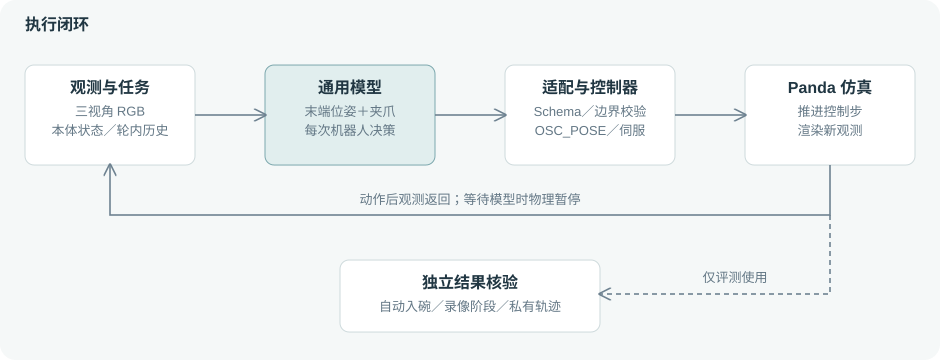
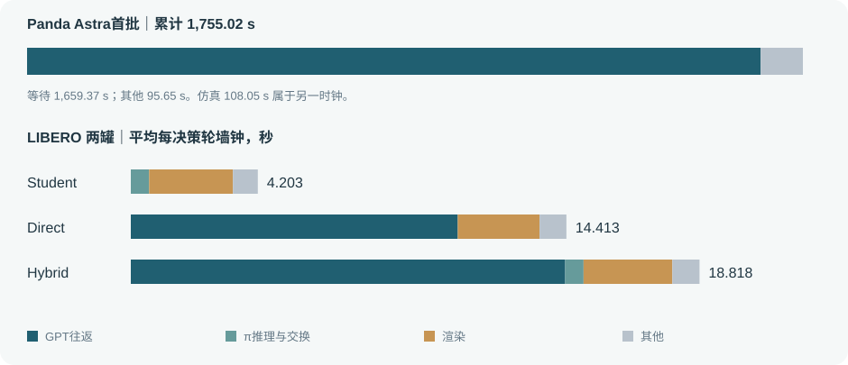
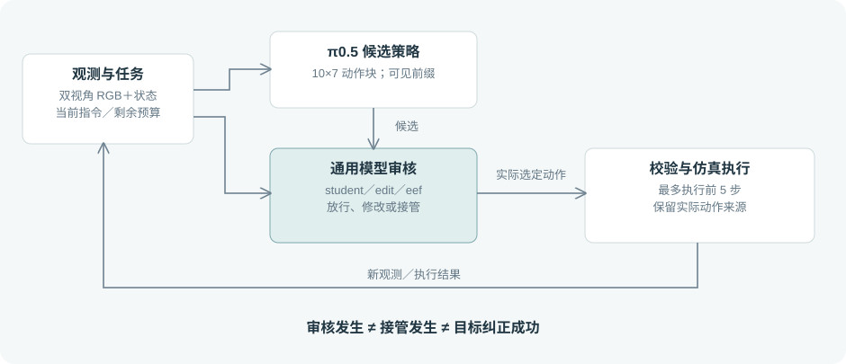
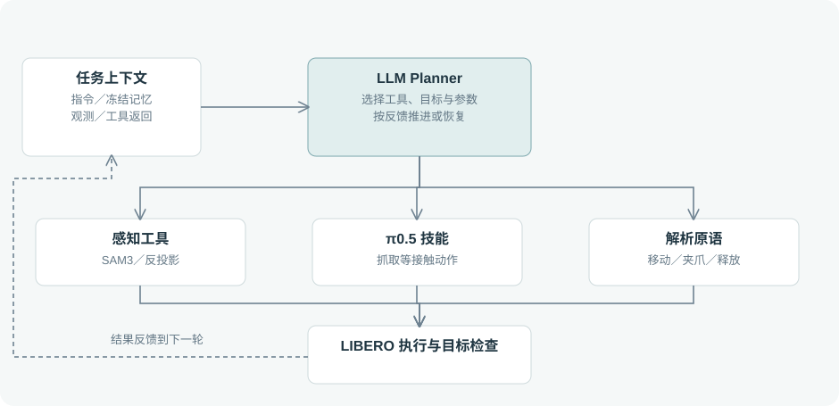
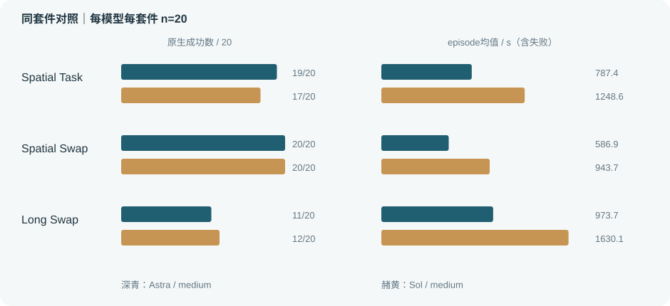
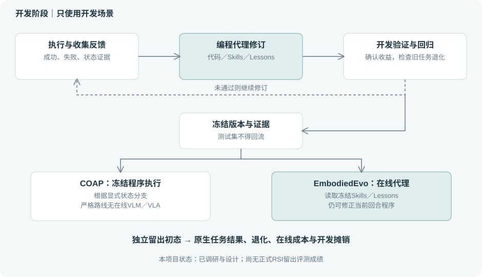
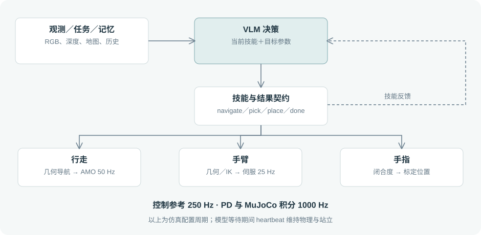
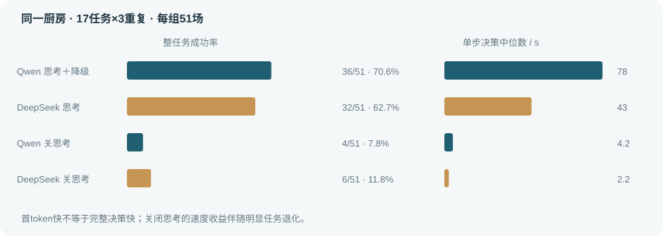
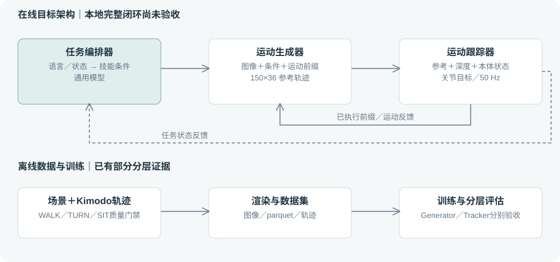

# 通用大模型对具身智能的影响

## 从机械臂操作到人形全身运动：控制、规划与经验复用的比较综述

**项目：embodied-ai｜报告版本：2.1｜成稿：2026-11-25｜实验资料截至：2026-11-23**

本文覆盖 Manipulation 的 Direct、Hybrid、Plan，以及 Locomotion 的 Direct（HomeBody）、Plan（HALO）。模型名称沿用项目记录中的配置标识；Astra 是通用大模型的一个实例，DeepSeek、Qwen、Sol 等实验同样纳入。RSI（递归自改进／跨任务经验复用）纳入方法综述与实验设计，项目尚无该路线的正式留出评测。本文重新整理、复算已有记录，没有重跑机器人实验。

## 摘要

通用大模型对具身智能的作用，取决于它接入控制链的哪一层。本文以 embodied-ai 项目中的仿真实验为依据，比较直接动作决策、动作审核、技能规划和人形分层运动四类技术分工，并按项目约定组织为五条在线控制路线，另考察跨回合改进的 RSI 路线。分析同时考察任务结果、可观测决策过程、时间开销和底层执行依赖。

机械臂 Direct 实验中，Astra 在两个独立五场批次的环境自动入碗判据下均为 5/5；逐步记录显示它能够发现抓空并重新抓取，但录像尚不能证明所有样本均达到稳定放置。Hybrid 在两个成功案例中全程放行专用策略，增加了逐轮审核等待；抽屉任务虽发生 13 次接管，仍未打开目标抽屉。RPent Plan 的 120 集对照中，Astra、Sol 分别成功 50/60、49/60；长任务成功数仅为 11/20、12/20，且相近成绩伴随明显不同的调用数和耗时。HomeBody 同协议换模型后，Qwen 与 DeepSeek 分别成功 36/51、32/51；关闭思考的补测降至 4/51、6/51。HALO 已获得合格生成轨迹与部分分层训练证据，但完整站姿起步、到座、承重坐稳与在线闭环尚未验证。[S01][S02][S04][S06][S10][S11][S13][S14]

这些结果支持一个有限但清晰的结论：**通用模型已经能改变目标选择、技能编排和反馈纠错，系统收益仍受可执行技能、物理状态验证和调用成本约束。** 现有证据不足以说明通用模型已替代高频控制器，也不足以从跨项目成功率推导模型的普遍排名。

**关键词：**具身智能；通用大模型；视觉语言模型；VLA；闭环控制；技能规划；经验复用；仿真评测。

**阅读路径。** 第1–2章界定问题与证据；第3–6章分析机械臂 Direct、Hybrid、Plan、RSI；第7–8章分析 HomeBody 与 HALO；第9–10章给出跨模式结论、改进路线与局限。附录保留媒体、核验记录与术语。

| 研究路线 | 最关键的本地观察 | 当前判断 |
|---|---|---|
| Manipulation Direct | Panda两批各5/5自动入碗，存在抓空重抓 | 已观察到反馈纠错；稳定终态仍需单独验收 |
| Manipulation Hybrid | 两项成功用例全放行；抽屉13次接管仍失败 | 接管接口成立，平均净收益未建立 |
| Manipulation Plan | RPent 50/60与49/60；长任务11/20与12/20 | 技能编排可用，长程衔接与成本仍是瓶颈 |
| Manipulation RSI | COAP／EmbodiedEvo调研与迁移设计 | 没有本地正式留出评测成绩 |
| HomeBody Direct | 思考配置36/51与32/51；关闭后4/51与6/51 | 任务层配置显著影响这批表现 |
| HALO Plan | 有合格源轨迹及部分训练／跟踪证据 | 站姿起步到承重坐稳、在线闭环未验收 |

表为阅读导引，分母、协议和证据等级在各章说明，不能横向排名。

## 1　研究问题与技术挑战

### 1.1 从“给出指令”到“完成物理目标”

具身任务要求语言意图最终成为可验证的物理状态。对于“把两个罐头放进篮子”，系统既要选对物体，又要形成可执行的抓取与搬运指令，并在动作后判断罐头是否真的进入目标区域。对于“坐到椅子上”，选中 sit 技能之后，还要完成接近、转身、接触与持续支撑。模型输出正确、控制器到达目标、任务最终成功，是三件需要分别检验的事。

本报告回答四个问题：**模型控制什么？效果怎样变化？时间花在哪里？失败发生在哪一层？** 每条结论都尽量关联到具体批次、任务、执行轨迹和判据，而不是只用最终成功率解释能力。

### 1.2 五项共同挑战

| 挑战 | 项目中的具体表现 | 本报告如何检验 |
|---|---|---|
| 视觉与物理状态不等价 | 夹爪闭合却没有抓住；模型宣告完成但落点不合格 | 对照动作后图像、物体轨迹和独立评分 |
| 决策与可执行性脱节 | 目标位姿尚未到达；抓取点不可达；导航路径被拒绝 | 区分目标命令、实测状态和技能返回码 |
| 长任务的阶段衔接 | 重复抓取、杯子插入受阻、上一步终态不适合下一步 | 按任务阶段复盘，统计恢复与无进展调用 |
| 推理等待与控制周期不匹配 | 一次高层决策需要数十秒，步态需持续更新 | 分离高层墙钟与底层控制周期，检查等待机制 |
| 成功和成本难以统一比较 | 自动成功、人工阶段分、recipe 状态和数据链验收混用 | 保留各自分母、判据与时间边界 |

### 1.3 相关技术脉络

SayCan 将语言模型给出的技能选择与机器人技能的可执行性结合，代表语言层规划与底层行为分工的思路。RT-2 将机器人动作编码进训练目标，代表把视觉语言预训练能力转化为动作策略的路线。π0.5 通过异构数据联合训练，研究视觉、语义与物理行为的泛化。[R01][R02][R03]

Inner Monologue 进一步把成功检测、场景描述等反馈用于在线重规划，使语言计划随执行结果更新。[R04] 本项目沿着上述分工，检验通用模型可以直接输出动作、审核已有策略，或在更高层组合技能。这里的 **Direct 工具控制不等于端到端 VLA 训练**；Hybrid 中的 π0.5 和 HALO 的运动生成／跟踪模块也不能归并为通用大模型自身的能力。相关工作用于解释技术位置，其论文成绩不进入本项目的实验统计。

### 1.4 代表工作如何连接到本项目

本报告采用问题导向的叙述性综述，选择能说明观测、动作接口、反馈和验证方式的工作；不声称穷尽文献或完成系统性元分析。2026年11月25日核对下表原论文或官方页面。项目记录的实验日期独立保留，不把论文提交日期当作本地实验日期。

| 工作与年份 | 核心设计 | 与本项目的关系 | 证据使用方式 |
|---|---|---|---|
| SayCan，2022 [R01] | 语言技能选择结合可执行性 | 解释 Plan 为什么需要技能约束 | 方法背景 |
| Inner Monologue，CoRL 2022／论文集2023 [R04] | 执行反馈进入下一次语言规划 | 解释失败恢复与完成核验 | 方法背景 |
| RT-2，2023；π0.5，2025 [R02][R03] | 视觉语言知识进入动作学习 | 区分通用模型调用与专用 VLA 执行 | 方法背景；π0.5为本地组件 |
| GPT-as-Policy／Astra具身评测，2026 [R05] | 比较数值动作与策略辅助 | 对应本地 Direct／Hybrid 接口 | 上游结果与本地结果分列 |
| Harness VLA，2026 [R06] | 冻结 VLA 接触技能与记忆引导工具编排 | RPent的技术来源 | 本地120集及专项测试 |
| COAP、EmbodiedEvo，2026 [R07][R08] | 把开发经验保存在代码或技能／经验库 | RSI的两种实现选择 | 原作者结果；本地只有调研与设计 |
| HomeBody，2026 [R09] | 可替换 VLM 直接调用人形技能 | 本地厨房仿真与模型替换 | 原系统与本地适配分开 |
| HALO，2026 [R10] | 语义编排、运动生成与高频跟踪 | 本地SIT链路复现 | 原项目架构；本地分层验收 |

**本文的贡献是证据重整与机制比较。** 将同一项目中分散的批次放回各自协议，连接“模型看到什么—改变了什么—环境实际发生什么”，并复算可取得的逐集统计。本文没有提出新控制算法，也没有新增机器人运行成绩。

## 2　研究范围与统一评测口径

### 2.1 五条在线路线与一条跨回合改进路线

| 场景／模式 | 模型的实际输出 | 底层主要执行者 | 反馈位置 | 本项目代表 |
|---|---|---|---|---|
| Manipulation · Direct | 末端目标、夹爪或短段动作 | OSC／IK／伺服控制器 | 动作段后重新观察 | Panda 入碗、LIBERO Direct、双臂补充 |
| Manipulation · Hybrid | 放行、修改、接管候选动作 | π0.5＋控制器 | 每个短动作段前审核、执行后观测 | GPT-as-Policy Hybrid |
| Manipulation · Plan | 感知／技能／工具选择及参数 | SAM3、π0.5、解析运动原语 | 技能或工具返回后 | RPent |
| Locomotion · Direct | 当前技能与目标参数 | 显式几何技能、AMO、PD | 技能结果与新观测 | HomeBody |
| Locomotion · Plan | 任务技能条件；下层生成运动计划 | 运动生成器、RL 跟踪器 | 多层不同频率闭环 | HALO |
| Manipulation · RSI | 修改程序、技能或诊断经验 | 冻结代码，或读取冻结经验的在线代理 | 开发轮的结果用于后续留出回合 | COAP／EmbodiedEvo调研 |

HomeBody 按项目约定归入 Locomotion Direct，但实际评测是人形移动操作，包含导航与抓放。其“直接”指 VLM 直接调用可复用技能，中间没有学习型 VLA 操作策略层；不表示模型直接输出腿部力矩。HALO 的 Plan 同时包括任务级编排与运动轨迹层规划，二者在本章之后分别描述。[S10][S12]

### 2.2 实验清单与证据覆盖

| 批次编号 | 已执行实验 | 规模与对照 | 可以支持什么 | 主要限制 |
|---|---|---|---|---|
| M-D1 | Panda 红块入碗 | GLM／DeepSeek／Qwen 各 20 场；Astra 首批 5 场 | 固定场景内动作决策、反馈利用 | 接入工具、并发和计量来源不同 |
| M-D2 | 入碗续测与模型档位对照 | seed 2005–2009；Astra、Sol medium／ultra、Luna 各 5 场 | 同初态下的现象对照 | 小样本；终态稳定性另审 |
| M-H1 | LIBERO 三路线 18 格 | 两任务×三条件×三路线，init 0 | 环境／指令变化下的初步覆盖 | 每格只有一次；原生与人工判定不同 |
| M-H2 | 三任务逐轮实录 | 两罐、微波炉、底层抽屉×三路线，共 9 回合 | 审核／接管、610 轮流程与分项计时 | 协议不同于 M-H1；π 随机状态未配对 |
| M-P1 | RPent Astra／Sol | 3 套件×10 任务×2 seeds×2 模型＝120 集 | 配对任务结果、调用和 episode 耗时 | 每任务仅两初态，特定执行栈 |
| M-P2 | RPent 深度计时 | t0／t9×2 seeds×2 模型＝8 集 | 工具、原语、渲染及请求成本归因 | 独立新批次，不能与 120 集重复计数 |
| M-P3 | RPent GLM／Flash／DeepSeek | 多个 20 集或 8 集专项 | 模式切换、思考配置、请求测量 | 判据、接口与计时粒度各异 |
| L-D1 | HomeBody 换模型与消融 | 17 任务×3 重复×2 模型×开／关思考＝204 场 | 同厨房任务集的换模型与配置效应 | 原始会话不在当前仓库；按报告转引 |
| L-P1 | HALO SIT 链路复现 | 生成、训练、回放、留出及盲评多个阶段 | 分层可运行性与局部失效机制 | 端到端坐稳与在线闭环未测 |

另以 DreamLab 四瓶任务作为 Direct 的外部动作策略对照，不将其不同接口、不同预算的结果混进 M-D1/M-D2。SONIC 扩展仅说明 HomeBody 执行层的可替换性，不加入厨房任务成绩。[S03][S05][S06][S09][S15][S16]

### 2.3 成功、失败与证据类型

本报告使用文字标签区分 **本次复算、归档实验记录、架构核查记录、解释／待验证**。各原报告的 E1／E2 定义并不一致，因此不直接合并其等级。

1. **物理／环境成功**：使用该批次冻结的原生谓词或独立评分器。Panda 自动入碗不能自动升格为持续稳定放置；LIBERO 的目标谓词也不当然包含松爪、静止等额外要求。
2. **局部技能结果**：pick 返回 false 可能表示某项局部阈值未满足；不能直接推出物体完全没有被抓起。技能返回 OK 同样不能替代最终目标评分。
3. **任务状态**：finish、done、recipe 写出与环境成功分开；模型自述只作为决策记录。
4. **基础设施异常**：按原协议选择有效 attempt；中断、SAM OOM、解析事故的耗费保留，不能悄悄计为任务失败或删除其成本。
5. **阶段验收**：HALO 的生成合格、数据链完整、预测改善、物理跟踪各有分母。数据文件合格不是机器人坐下成功。

### 2.4 统一耗时定义

| 指标 | 本文定义 | 使用边界 |
|---|---|---|
| 仿真时长 | 控制步推进的模拟时间 | 不是用户实际等待时间 |
| episode 墙钟 | 原实验规定的回合计时起止 | 是否含初始化／加载须逐批说明 |
| 控制循环时间 | 决策、执行、观测等循环区间之和 | 与 runner 墙钟可有差异 |
| 模型请求往返 | 客户端发起至响应／用量结束 | 包含通信、排队等，非纯推理 |
| TTFT | 对应采集器定义的首个有效事件延迟 | 首 thinking token 与首可见 JSON 不混用 |
| 可见输出窗口 | 首末可见分片之间的时间 | 非服务端完整 decode／thinking 时间 |
| 累计工作量 | 多回合或多设备各段时间之和 | 并发情况下不等于日历时长 |
| 卡时 | 生成／训练的设备时间消耗 | 与在线响应延迟分列 |

单回合分解首先使用不重叠区间；嵌套的 π 推理、物理、渲染等只用于解释父项。没有打点的阶段保留“未测”。累计输入 token 含重复历史，缓存输入是输入子集，reasoning token 是输出子集，均不得重复相加。[S01][S04][S07][S08]

### 2.5 归因与证据纳入规则

**纳入单位是实验批次，不是项目名称。** 同一任务的20集原批、5集续测、单集接口诊断、增加预算重跑，都保留独立身份；重复分析同一CSV不产生新样本。以可识别的任务、初态、预算、模型配置、成功判据和产物路径为纳入依据。周报摘要用于定位，数值尽量回到原报告或逐集表；无法访问的现场日志明确按归档转引。

**解释行为与估计因果效应分开。** 抓空后的动作变化可支持单条轨迹的恢复解释；要估计“有审核比无审核多成功多少”，还需要同初态、同候选动作、同随机状态与后续预算的分支对照。现有多数批次比较的是模型与适配器组成的完整系统。本文不把成功率差自动归因于模型规模、推理算法或硬件。

**资料快照固定。** 项目实证截止2026年11月23日，成稿与文献核对为11月25日。代码核查只涉及发表镜像的动作接口、门控和观测边界，不推定远端活动部署与镜像完全一致。参考资料提供来源指纹；正式机器人实验未重跑。[S19][S20][S23][S24]

## 3　Manipulation · Direct：从视觉反馈直接决定动作

### 3.1 挑战与实现思路

直接控制把目标解释、空间判断和下一动作决策交给通用模型。优势是任务接口灵活，模型能在看到失败后改变行动；代价是每次观察与决策都可能成为串行等待，且接触过程仍依赖控制器和观测质量。Panda 入碗可检验最基本的“观察—行动—验证—修正”，LIBERO 与双臂任务进一步检验阶段组合。

### 3.2 方案与架构

Panda 使用 robosuite、Panda 机械臂与 OSC_POSE 控制器。模型接收前方、侧方、腕部三路 224×224 图像、末端／夹爪／关节状态及轮内历史，通过 move_to 等工具给出绝对目标位姿与二值夹爪命令。适配器负责校验和推进仿真，再回传观测。模型不接收物体位置、抓持接触等私有真值；这些数据只供事后核验。[S01][S02]

每个 trial 使用独立 policy，会话在 trial 内保留历史，不从其他 trial 继承经验。原接入方式还包含文件信箱、读图和工具交互，因此“一次机器人决策”不等于“一次模型计量响应”。LIBERO Direct 则采用双视角和本体状态，每个 turn 返回一份结构化 JSON；不能把两个接口的单次延迟直接合并。[S01][S04]

### 3.3 测试方案与用例

**基础任务：红块入碗。** 固定初态库，每场最多 20 次决策、900 控制步；冻结限速和观测。成功以环境自动入碗为主表口径，另列人工阶段审核。先按共同 seed 2000–2004 对比，再列各自完整批次。续测使用 2005–2009，不能冒充旧五场重测。

**迁移用例：LIBERO 两罐入篮、杯入微波炉并关门、打开底层抽屉。** 分别考察多物体顺序、接触后的阶段切换、语言目标与候选位置区分。与 Student、Hybrid 使用同任务和初态，其结果在第4章统一比较。

**双臂补充：四瓶入桶。** 区分 Astra×Codex 单集、Astra-pilot、Dream-1 不同接法；同时保留阶段分和整集成功。预算变化和指令改写单独成批。[S09]

### 3.4 结果与效果分析

| 模型／配置 | 首五个共同 seed 的自动入碗 | 对应归档全批 | 续测 seed 2005–2009 |
|---|---:|---:|---:|
| Astra / medium | 5/5 | 首批 5/5 | 5/5 |
| Qwen3.8 Flash / 实际 xhigh | 1/5 | 4/20 | — |
| DeepSeek V4.1 Flash | 0/5 | 1/20 | — |
| GLM-5.3-Flash | 0/5 | 0/20 | — |
| Sol / medium | — | — | 2/5 |
| Sol / ultra | — | — | 3/5 |
| Luna / max | — | — | 0/5 |

来源：[S01][S02][S03]。Astra 两批自动成功可记为十个不同初态 10/10，但不能写成稳定放置 10/10。首批仅两场完成原阶段审核且均存在终帧边界；续测五场统一匿名审核均至少达到搬运至碗口并松爪，稳定终态待定。

共同初态使场景难度更接近，但不同模型的供应商、工具环境、并发、重启及计量方法仍不一致。因此本批支持“Astra 在这些场景中完成度更高、决策更少”，不支持纯模型速度、单位算力或真机能力排名。

| 双臂四瓶批次 | 预算／指令 | 阶段均分（100分制） | 整集结果 |
|---|---|---:|---|
| Astra-pilot，3 layouts | 700步／官方 | 35.00 | 0/3 |
| Dream-1 旧接法，3 layouts | 700步／官方 | 16.67 | 0/3 |
| Dream-1 修正版，3 layouts | 700步／官方 | 11.67 | 0/3 |
| Dream-1 延长预算诊断 | 3600步／改写指令 | 40.00 | 0/3 |
| Astra×Codex 独立单集 | 700步／官方 | 按整集结果记录 | 653步成功；仅存在性证据 |

来源：[S09]。同为 Astra，接入与动作接口不同也产生不同结果；该单集不能并入 pilot 分母。延长预算批同时改写指令，不能视作纯预算消融。一个 pilot 样本视频可见四瓶位于框底，原生评分仍为40分且失败；报告保留两种观察，不以视觉印象覆盖原判据。

<!-- VIDEO:dreamlab-direct -->

### 3.5 执行流程：trial-03 的抓空后恢复

| 决策阶段 | 已记录动作／观测 | 对结果的作用 |
|---|---|---|
| 1–5 | 张爪、下降、调整横向与朝向；识别目标高度与实测高度不同 | 在动作执行偏差下重新定位 |
| 6–7 | 第一次闭爪与试举 | 形成可观测的抓持验证动作 |
| 8 | 发现方块仍在桌上，张爪并降低 | 将“抓空”转化为修正行动 |
| 9–10 | 再闭爪、再次提升 | 事后物理核验显示第二次抓持成立 |
| 11–13 | 确认物体随手升高，搬运、对齐、释放 | 环境自动入碗成功 |

这些是已保存的动作、公开说明与状态核验，不推测内部思维过程。关键能力在于用动作后的结果修正判断；首次闭爪并非已经证明成功。[S01]

<!-- VIDEO:direct-astra -->

与之配对展示 Qwen trial-03：同 seed 2002，19次决策、621步，自动失败，归档阶段评分为2。它用于观察同一初态下的执行差异，不把失败简单解释成单一空间理解错误。

<!-- VIDEO:direct-qwen -->

### 3.6 耗时分解与小结

| Astra 首批5场 | 合计 | 每场平均 | 解释 |
|---|---:|---:|---|
| runner 墙钟 | 1,755.02 s | 351.00 s | 五个有效 runner 累计 |
| 决策等待及工具交互 | 1,659.37 s | 331.87 s | 占墙钟94.55%，不是纯思考时间 |
| 其余 runner 开销 | 95.65 s | 19.13 s | 物理、渲染、写帧、初始化等混合 |
| 仿真推进 | 108.05 s | 21.61 s | 独立时钟，不加入墙钟总和 |
| 机器人决策 | 61次 | 12.2次 | 每次平均等待约27.20 s |

首批有效 policy 的累计 token 为7,484,353，其中缓存输入7,144,576；132次用量增长事件对应61次机器人决策。用量包含 worker 的读图、工具往返和会话历史，不能当成61个独立 API 请求的纯任务输入。金额缺失，不估算账单。Panda 的物理在推理等待期间暂停，视频省略这部分等待，所以约22秒的回放不能说明机器人在现实22秒内完成。[S01]

**小结。** Direct 在小型操作任务上提供了可观察的纠错能力，但细粒度闭环带来显著等待。推广到双臂长任务时，动作接口、局部控制和终态约束的重要性上升，成功的单场演示不足以建立可靠性结论。

## 4　Manipulation · Hybrid：审核专用策略是否产生净收益

### 4.1 挑战与方案

Hybrid 希望保留 VLA 的动作生成能力，同时由通用模型纠正目标选择或执行错误。它需要证明两件事：审核确实改变了有问题的动作；改变后的执行更接近目标。单纯出现 GPT 调用、单次轨迹更短或成功率较高，都不足以独立证明纠错收益。

上游 RoboDojo 子集在10项任务各5场的设置下报告 Hybrid 24/50、Direct 13/50；这同时改变了动作来源与审核机制。本文的 LIBERO 适配保留 Student 独立组，用于观察候选策略自身的能力，不能把两个基准的比例混合。[R05]

本地系统先由 π0.5 输出10×7连续动作块，审核器接收观测与候选前缀，选择 student（放行）、edit 或 eef 接管，也可 stop；校验通过后最多执行前5步，再返回观测。π的70个连续标量不是70个文本 token。动作边界拒绝的轮次执行0步，但其请求和时间仍计入。源码门控要求 edit／eef 的依据为已观察到执行失败或目标意图偏离，仅“uncertain”不足以接管；这一门控约束响应格式和声明依据，并不独立证明声明符合物理事实。[S04][S23][S24]

### 4.2 测试矩阵与用例定义

18格先测两任务（碗放盘、两罐入篮）×三条件（Ori 原条件、Task 指令改变、Pos 位置改变）×三路线。每格 init 0；Student／Direct／Hybrid 原生成功分别4/6、1/6、3/6。展示版人工裁定把 Hybrid 一个边界样本计入后为4/6，本文主表保留原生口径。[S03][S05]

后续9回合采用逐轮 JSON v2 协议，独立记录610轮、3,008控制步、428轮GPT和344轮π输入输出关联。两罐与微波炉预算520步，底层抽屉300步。每任务三路线初态一致，但π采样随机状态未固定；三路线并发运行，不能当作完全隔离的性能基准。[S04]

### 4.3 结果：成功、放行和接管分开看

| 任务 | Student | Direct | Hybrid | Hybrid 实际动作来源 |
|---|---|---|---|---|
| 两罐入篮 | 成功；52轮／260步 | 成功；97轮／476步 | 成功；51轮／253步 | 51/51轮放行 |
| 杯入微波炉并关门 | 成功；70轮／348步 | 失败；105轮／520步 | 成功；51轮／251步 | 51/51轮放行 |
| 打开底层抽屉 | 失败；60轮／300步 | 失败；64轮／300步 | 失败；60轮／300步 | 47轮Student，13轮eef接管 |

来源：[S04]。前两个任务表明 Hybrid 可以在专用策略可完成的轨迹上正常运行，但全放行无法证明“模型纠错带来成功”。底层抽屉显示审核器具备实际接管能力，却没有得到任务收益。

### 4.4 执行复盘：接管了，为什么仍然失败

底层抽屉的原生目标要求底层关节 qpos < −0.14 m。最终 Student 与 Hybrid 的中层抽屉位移分别约 −0.159949 m、−0.159787 m，而底层均为0。问题不是差一点达到底层阈值，而是运动结果没有落在要求的实体上。Direct 的64轮中另有2轮因动作边界被拒绝。[S04]

这条轨迹把三个判断分开：模型发现需要干预、模型发出接管动作、接管打开了指定抽屉。当前只支持前两类行为已发生，第三类没有达成。后续改进应记录接管前后的目标实体、子目标状态和持续进展，再判断审核器是否有效。

<!-- VIDEO:hybrid-pass -->

<!-- VIDEO:hybrid-takeover -->

### 4.5 耗时分解

两罐任务每轮均值如下。初始化、模型加载与最终视频编码不计入循环均值；物理、渲染和其他环境处理是不同子项。[S04]

| 每轮均值／s | Student | Direct | Hybrid |
|---|---:|---:|---:|
| π推理＋同步 | 0.545 | 0 | 0.530 |
| π文件交换等 | 0.061 | 0 | 0.077 |
| GPT往返 | 0 | 10.819 | 14.374 |
| 物理步进 | 0.052 | 0.054 | 0.046 |
| 渲染读回 | 2.774 | 2.709 | 2.938 |
| 环境其他 | 0.220 | 0.237 | 0.219 |
| 保存观测 | 0.529 | 0.532 | 0.549 |
| 编码GPT输入 | 0 | 0.053 | 0.055 |
| 主机其他 | 0.022 | 0.009 | 0.030 |
| **整轮** | **4.203** | **14.413** | **18.818** |

Hybrid 比 Student 每轮多约14.615秒；按已发表均值乘轮数估算，循环累计约959.72秒对218.56秒，约4.39倍。此处是四舍五入均值的派生值，不冒充独立 runner 墙钟。Hybrid 只少一轮且全程放行，新增审核成本没有在这条轨迹上换来可确认的动作纠错收益。

Direct 与 Hybrid 的平均客户端首可见 JSON 延迟分别7.340秒、4.455秒；完整GPT往返却分别10.819秒、14.374秒。较快的首输出不保证更快完成。服务端纯推理、通信和排队没有独立测量，不能由差值反推。[S04]

### 4.6 小结

现有实验验证了审核、放行与接管接口，但尚未建立稳定的平均纠错收益。值得后续验证的方向是按风险触发审核、提升目标状态验证、选择更合适的动作段长度；这些是由本批瓶颈导出的实验建议，当前没有新成绩。

## 5　Manipulation · Plan：大模型编排技能与工具

### 5.1 思路与系统架构

RPent 将高层决策从末端数值提高到工具和技能。模型读取任务、冻结记忆、观测与上次执行结果，调用定位、反投影、π0.5接触技能或解析原语。技能执行一段动作后返回，模型再决定推进、重试或结束。其潜在收益是把成熟的局部行为复用为更长任务；关键风险是错误反馈解释、局部验收与整体目标不一致、恢复路径反复循环。

| 模块 | 输入 | 输出与职责 |
|---|---|---|
| LLM planner | 指令、冻结任务记忆、工具结果及可用观测 | 选择工具／技能与参数 |
| 感知 | 图像、目标描述 | SAM3定位、反投影等目标信息 |
| π0.5技能 | 局部指令、图像和状态 | 抓取等连续动作块 |
| 解析原语 | 目标位姿、夹爪与运动参数 | move_to、release、set_gripper 等 |
| LIBERO／评分 | 实际动作与环境状态 | 新观测、局部反馈、原生终局 |

Astra／Sol 批使用 Codex 接入；DeepSeek 专项使用 API planner。Flash Mode 使用冻结记忆回放和 Molmo2-8B，省去在线规划LLM，感知和动作模型仍然运行。[S03][S06][S08]

### 5.2 测试方案与代表任务

正式120集为三个套件各10任务×2个seed×2模型，均为medium，每模型一线。任务资产和记忆冻结；正常任务失败不重跑，基础设施重试按原协议审定。Long Swap t9存在双方共同的预先记录记忆缺项，不在评测中补写。[S06]

独立8集深测选择 Long Swap t0（双罐入篮）与t9（杯入微波炉并关门），分别覆盖物体抓持与搬运、容器插入与关门的阶段衔接。两个seed、两个模型构成8个身份；实际10次attempt中2次SAM异常原尝试单列。成功判据与计时有效性分别验收。[S07]

### 5.3 整体效果与执行效率

| 套件 | Astra成功 | Sol成功 | Astra均值／中位墙钟s | Sol均值／中位墙钟s |
|---|---:|---:|---:|---:|
| Spatial Task | 19/20 | 17/20 | 787.4／676.8 | 1248.6／811.6 |
| Spatial Swap | 20/20 | 20/20 | 586.9／560.0 | 943.7／828.9 |
| Long Swap | 11/20 | 12/20 | 973.7／919.5 | 1630.1／1332.8 |
| **总计** | **50/60** | **49/60** | 累计46,961.2s | 累计76,447.2s |

来源：[S06]及本次对[S17]逐集CSV的复算。均值包含正常失败、会话内连接重试，排除独立VLA预加载、配对屏障、额度暂停与被排除attempt。Sol的一条Long Swap正常失败含明显连接中断等待，不能把平均耗时差全部归因于推理算法。

Astra、Sol 的计量响应分别2,112次、2,902次；入账episode累计耗时约13.04小时、21.24小时，双线并行，不能相加当成日历时间。Astra总计只多成功一集，Long Swap次序反转，不能据此给出普遍能力排名。更稳妥的发现是：本执行栈在两个Spatial套件表现较好，而Long Swap存在明显阶段瓶颈；相近成功数也可能对应不同执行成本。

### 5.4 逐过程分析：t0 的重复恢复与t9的阶段停滞

| 独立深测 | 原生结果 | episode/s | 计量响应 | π动作块 |
|---|---|---:|---:|---:|
| Astra t0 seed0 | 成功 | 1090.5 | 41 | 15 |
| Sol t0 seed0 | 成功 | 1153.1 | 47 | 28 |
| Astra t0 seed1 | 成功 | 1049.1 | 41 | 15 |
| Sol t0 seed1 | 失败 | 2176.5 | 77 | 116 |
| Astra t9 seed0 | 失败 | 1711.6 | 75 | 28 |
| Sol t9 seed0 | 失败 | 1409.8 | 65 | 100 |
| Astra t9 seed1 | 失败 | 1076.7 | 47 | 8 |
| Sol t9 seed1 | 失败 | 1298.0 | 55 | 61 |

来源：[S07]。t9 seed1采用审定后的attempt-002，其余为对应有效attempt；request_count是计量响应数量，不等于逻辑规划轮数。

**t0：局部判据与整任务目标不完全一致。** Sol seed0两次pick未满足局部判据，各运行14块，整集仍成功。Sol seed1共8次pick、116块，step18–34恢复段原语耗时562.94秒；其中6次失败pick共88块。某轮已满足夹爪闭合条件，但抬升仅0.0222m，低于0.05m，因此不能把所有恢复归因于单一夹爪阈值。Astra两场均只使用15个π块并成功，显示行动路径的差异会放大成本。[S07]

**t9：更快失败不能当作更高效率。** 四场全部失败，没有成功耗时基线。Astra seed0有14次移动耗满预算，累计672.90秒；seed1有8次，累计367.24秒。Sol还存在较多接触技能和抓取恢复。某些技能以整任务terminated作为success返回，false不代表该次门操作毫无作用。原日志没有独立记录“杯在内”和“门关闭”两个子谓词，不能确诊哪一个最终失败，更不能仅凭移动超时断言碰撞。[S07]

<!-- VIDEO:rpent-astra -->

<!-- VIDEO:rpent-sol -->

### 5.5 时间分解：先定位主项，再解释子项

独立8集的累计工作量为10,965.30秒。按源码与逐步关联支持的五项分解如下，父项内的物理、渲染、π推理不重复叠加。[S07]

| 分项 | 累计/s | 占episode累计 | 含义 |
|---|---:|---:|---|
| 非π动作原语 | 4445.940 | 40.55% | 移动、夹爪、释放等原语，含相关执行／渲染 |
| π动作原语 | 1110.090 | 10.12% | π技能相关原语，含动作执行 |
| 工具附加 | 1047.434 | 9.55% | 工具内扣除动作原语的其余时间 |
| SDK内非工具 | 4187.536 | 38.19% | SDK区间扣除工具后的残差，非纯模型推理 |
| episode内SDK外 | 174.300 | 1.59% | episode与SDK区间的残差 |
| **合计** | **10965.300** | **100%** | 8个有效episode累计，非批次墙钟 |

<!-- INTERACTIVE:rpent-timing -->

单独扣除已测原语窗口渲染4,391.18秒，剩余累计6,574.12秒。此时SDK内非工具占63.70%，动作非渲染部分1,164.85秒，占17.72%。这是辅助分析口径，并非真机时间预测：真机仍有传感器、通信和持续控制开销。

若希望该非渲染工作量下降10%，需节省657.41秒。只优化SDK非工具项，需减少约15.70%；只优化动作非渲染项，需减少约56.44%。这是保持其他项不变的敏感性计算，不是已实现提速。把高层调用和无进展恢复作为优先实验变量，比只盯π模型单次推理更符合本批时间结构。

深测有448次逻辑采样、473次传输尝试与448次计量响应记录；各计数依原字段定义分别使用。8个有效episode的模型加载累计另计1,322.76秒，10次实际attempt加载累计1,648.97秒。未提供服务端遥测的prefill和完整隐藏thinking保持缺失。[S07]

### 5.6 GLM、Flash 与 DeepSeek 的补充证据

| 专项 | 已记录结果 | 可得结论与限制 |
|---|---|---|
| GLM普通模式，Object Swap | 18/20 | 该技能栈可由其他通用模型驱动 |
| GLM普通模式，libero_goal | 16/20 | 另一任务套件结果，含按协议处理的网络异常 |
| Flash，Object Swap | 15/20，在线规划LLM token为0 | 减少了规划调用，但不是全栈无模型；不能只按省token判断总效果 |
| 两普通模式失败身份独立重跑 | 5/6翻盘；retry-once后20/20、19/20 | 重试带来收益和新成本，不覆盖首跑18/20、16/20 |
| DeepSeek非流式8集 | 306条响应；t0写出成功recipe，t9未成功 | 没有有效TTFT／TPOT；recipe状态不等同重审环境终态 |
| DeepSeek流式补测8集 | 178次attempt、177个逻辑请求 | 177条有效首事件／输出窗口计量；t9两集崩溃、两集未完成 |
| 同请求体重放 | 9份请求体，合计42次 | 用于请求时延波动；不是42个机器人任务 |

来源：[S03][S08][S18]。DeepSeek代理字段的upload_s止于响应头返回，混合发送、等待和处理；不能称为纯上传。按delta事件计算的p50／p90不能直接叫逐token延迟。Token分配得到的thinking／decode仅为估算，本报告不据此给出服务端精确分解。

### 5.7 小结

Plan让通用模型利用已有技能覆盖较长任务，效果和耗时取决于技能粒度、反馈判据与恢复策略。120集体现了场景内可用性；深测进一步说明，能力差异会通过动作路径和调用次数放大。高层调用减少多少、任务是否仍能成功，需要在同任务、同预算下共同验证。

## 6　Manipulation · RSI：把本轮失败转成下轮可复用能力

### 6.1 挑战：一次恢复为何没有自动成为经验

Direct 可以在本回合重抓，Plan 可以在当前历史中记住一次错误，但新回合往往仍需重新建立抓取方法和适用条件。RSI关注开发流程本身：代理依据执行反馈改写代码、技能或诊断经验，验证后冻结，再交给新的执行者。这与增加当前回合的推理轮数不同，也不必更新模型权重。

本项目对 COAP 与 EmbodiedEvo 已有论文分析、部分公开实现核查和迁移方案，**没有正式的 RSI 训练—冻结—留出评测成绩**。因此本章用原作者结果解释机制，用项目失败案例提出可检验方案，不将文献数字列为本地实验结果。[S19][S20]

### 6.2 两条实现路线：冻结程序与冻结经验

| 维度 | COAP | EmbodiedEvo | 可落到RPent的改动 |
|---|---|---|---|
| 保存什么 | 共享状态估计与控制程序 | 可执行 Skills 与诊断 Lessons | 有检查点的复合技能、适用条件与失败证据 |
| 开发过程 | 编程代理测试、定位失败、修订共享库 | Playground探索后提炼经验 | 只在开发初态改技能和阈值 |
| 测试时谁决定动作 | 冻结程序；严格路线无VLM／VLA在线调用 | 在线代理读取冻结经验，仍可修改当前程序 | 保留原planner、π0.5与感知，仅改变经验条件 |
| 哪些东西冻结 | 测试代码与规则 | Skills／Lessons，不是当前回合的全部程序 | 经验、模型、预算、评分协议及版本 |
| 主要约束 | 状态测量与几何先验、程序覆盖范围 | 经验适用性、在线调用开销、接触精度 | 避免经验泄漏与错误恢复传播 |

来源：[R07][R08][S19][S20]。COAP将通用模型的工作移到开发阶段；EmbodiedEvo保留在线决策。RPent Flash也免在线规划，但仍调用感知模型与VLA，不满足严格COAP的无模型执行定义。三者不能只按“是否写代码”归为一类。

### 6.3 文献证据：性能与经验成本必须一起看

COAP作者在RoboDojo的42项仿真任务上报告70.24%成功率。其控制调用中位0.3ms，多数调用只交付已规划动作；少量感知和规划调用占99.4%的决策时间。故0.3ms不能解释为一次完整视觉决策的延迟，也不能证明开放环境的通用控制已解决。[R07]

| EmbodiedEvo配对开发集 | 类别均衡成功率 | 每集Test费用估计 |
|---|---:|---:|
| 无探索经验 | 8.50% | $4.058 |
| 同次探索的完整历史 | 29.78% | $12.203 |
| 同次探索的Skills／Lessons | 30.17% | $5.732 |

来源：[R08] §4.5–4.6、表8；[S20]。固定Astra/xhigh执行者，含失败，不含Playground获取经验费用，金额为论文固定费率估算。结构化经验相对完整历史的费用下降53.0%，相对无经验则增加约41.3%；30.17%与29.78%的接近也不是正式等价性证明。该配对开发集与作者全量评测分别记账，不能把类别均衡百分比直接转换为本地成功集数。

这些结果提出了两类不同问题：能否把反复推理转成可靠程序；能否以较少的上下文保留有效经验。费用下降不自动意味着时延同比下降，更不能把开发投入从总成本中删除。本文不据跨论文数字给COAP与EmbodiedEvo排序。

### 6.4 项目用例：把RPent的恢复循环变成可验收技能

**t0双罐入篮。** Sol seed1的8次pick、116个π动作块最终没有完成任务，而seed0出现局部pick返回false、整集仍成功。可复用经验首先应区分“夹爪命令已发出”“物体随夹爪抬升”“目标已放入篮子”，避免把单一false写成无条件重抓规则。[S07][S19]

**t9杯入微波炉。** 四条深测轨迹都失败，但未独立保存杯在炉内与门关闭两个子谓词。优先补齐阶段诊断，再封装抓杯、送入、撤手与关门。高层模型看不到的评测真值只用于离线验收，不能作为普通视觉策略的新输入。[S07][S20]

| 经验条目 | 触发证据 | 候选处理 | 必须保留的出口 |
|---|---|---|---|
| 抓持未确认 | 固定相机或运动补偿后，目标未随夹爪移动 | 重新观察与定位，有限次改变接近方式 | 遮挡或关联不明返回unknown |
| 搬运后失去持物 | 物体／夹爪关联中断，现场位置重观测 | 重建目标位置与可达性 | 不能恢复则交回高层 |
| 连续运动无进展 | 同一目标下残差及任务相关状态未变化 | 改站位或重新规划 | 预算耗尽及时停止局部循环 |
| 阶段完成未确认 | 送入或关门证据不完整 | 获取新观测，保留阶段状态 | 不以工具OK宣告整任务完成 |

表为待验证设计，不是已部署规则。应先用只记录、不介入动作的诊断运行测误报、漏报与unknown，再允许经验触发控制。经验库还应标记“开发场景复现”与“留出场景通过”，单场有效不能升级为通用规律。

### 6.5 最小评测设计与成本账本

建议先做经验表示对照：同一次开发探索生成原始历史与结构化经验，在同一执行栈上比较无新增经验、完整历史、冻结Skills／Lessons三组。保持公开recipe、模型、初态、动作预算、策略随机设置及评分器一致；测试过程中禁止跨测试回合更新经验。按源episode划分开发与留出，不能把相邻窗口当作独立新场景。[S20]

其次单独检验程序化执行：当前RPent → 增加结构化状态 → 增加有界局部恢复 → 增加复合技能，逐项改变。Flash作为独立系统对照；若感知模型不同，其差异不可只归因于“省去规划”。原计划提出两任务各5个新初态、4组共40集的机制试点，这只是发现退化的规模建议，尚未执行，也不足以证明微小成功率差异。[S19]

**每集摊销成本 = 开发与验证总成本 ÷ 实际复用回合数 + 在线平均成本。** 同时报告官方成功数、两组共同成功的耗时、全部attempt成本、误恢复与新增失败；失败成本进入分子。没有留出收益前，不用“持续自我进化”描述本项目现状。

### 6.6 小结

RSI将通用模型的影响从当前动作扩展到系统开发和经验积累。项目中已经定位到值得沉淀的抓持核验、阶段诊断与恢复问题，但收益仍是待检验假设。评测重点是冻结后能否迁移、是否引入退化，以及节省的在线成本是否覆盖开发投入。

## 7　Locomotion · Direct（HomeBody）：直接调用人形技能

### 7.1 挑战与实现方案

HomeBody在项目分类中归入Locomotion Direct，实际任务是导航与操作结合的loco-manipulation。这里的Direct指VLM直接调用技能，不能与Panda的末端数值控制或直接关节控制等同。[R09]

HomeBody面对导航与搬运结合的任务：对象在不同台面，目的地可能由关系语言指定，机器人还要处理不可达、碰撞、持物丢失和完成判定。高层VLM直接调用技能库；显式几何、IK与伺服负责抓放，AMO负责行走和平衡。该设计使决策模型可替换，同时保留稳定的局部执行机制。[S10]

模型输入包含任务、技能契约、当前身体／手状态、场景记忆和最近24步历史，以及头部RGB、深度预览、占据地图、躯干系俯视深度投影四张图。模型不接收实时物体真值和评分目标。输出恰好一个结构化决策：navigate、pick、place或done及其参数。

导航通过站位与朝向参数形成路径和速度指令；pick将图像点击与深度结合形成抓取目标；place可采用图像支撑面点击或躯干坐标释放点。技能检查可达性、路径和持有／放置证据，返回明确失败码。done立即结束会话，不执行物理成功验证，最终由独立评分器裁决。[S10]

### 7.2 测试方案与任务覆盖

场景为同一个Real2Sim厨房src_kitchen，四个主要可搬物体为两个咖啡包、果汁盒、红白纸盒。17任务每项重复3次。正式换模型保留框架、技能、任务与评分；Qwen接入层新增输出清理、截断降级和额外请求参数，因而比较对象是对应模型及其接入配置。[S11]

| 任务族 | 数量 | 代表任务 | 核心考点 |
|---|---:|---|---|
| 基准换位 | 4 | default、swapped及改写 | 多物体目标映射、换词 |
| 指代消解 | 5 | 非果汁纸盒、离桶最近的圆桌 | 排除与空间关系指代 |
| 相对／条件 | 2 | farther_bag、conditional_juice | 相对位置、条件前提 |
| 多物体编排 | 4 | 包裹互换、展示后放回 | 顺序、位置记忆、恢复 |
| 长距与困难搜索 | 2 | 角柜台面、被移动的果汁 | 精细落点、错误记忆更新 |

评分逐物体检查终态是否在对应目标实体bounds内且静止、有支撑；技能返回OK不足以得分。关闭思考各补跑51场，与开思考构成四格配置比较。Qwen思考组存在16/447步截断后关思考重发，应称为“思考开启、带降级”的实际配置。[S11]

### 7.3 总体结果与配置消融

| 决策配置 | 成功数 | 成功率 | 单步决策墙钟中位数 |
|---|---:|---:|---:|
| Qwen3.8-27B，本地，思考开启＋降级 | 36/51 | 70.6% | 78 s |
| DeepSeek V4.1 Flash，API，思考开启 | 32/51 | 62.7% | 43 s |
| Qwen，全程关思考 | 4/51 | 7.8% | 4.2 s |
| DeepSeek，全程关思考 | 6/51 | 11.8% | 2.2 s |

来源：[S11]。Qwen思考组多成功4场，绝对差7.84个百分点；17任务中7胜、3负、7平。每任务仅3次重复，且只在一个厨房，不据此推导模型普遍优劣。Qwen的两次摔倒仍留在51场分母内；剔除后36/49只能作为补充口径，不能替换系统任务结果。

关思考使两模型单步中位耗时下降约19–20倍，同时成功数大幅下降。本实验支持“全程关思考并不适合这套任务管线”，并不证明所有具身任务都需要同样推理量，也不能从该消融单独推出内部认知机制。

### 7.4 同任务执行复盘

**角柜台面：把区域看对，比动作少更重要。** Qwen代表败局9步依次完成navigate、pick、navigate、place，再处理第二物体并done；技能层两次抓取成功、放置返回OK，但两个纸盒均被评分为outside_target。DeepSeek代表胜局14步，中途经历NO_GRASP、UNREACHABLE等错误并调整，最终落在计分亚段内。对照揭示的是空间语义到精确落点的映射问题，而不是“长链规划一概失败”。[S11]

**conditional_juice：理解正确仍会在物理交互中失败。** Qwen先观察并验证果汁确在烤面包机旁，再抓取；搬运中CARRY_CLEARED表示物体掉落，后续拾取因可达性被拒。DeepSeek代表成功局通过不同路线完成放置。不能把失败归为没有理解条件指令；路线、持物碰撞和恢复可达域是需要继续验证的因素。

**swapped：失败反馈可成为恢复依据。** 两模型代表成功局分别18步和17步。DeepSeek在NO_ROUTE、PLACEMENT_NOT_VERIFIED、ARM_NOT_REACHED等反馈后换点或换站位。这个例子表明技能返回码是高层闭环的重要输入，但单条恢复轨迹不能量化全部任务的收益。

<!-- VIDEO:homebody-corner -->

<!-- VIDEO:homebody-juice -->

### 7.5 耗时分解与控制频率

| 层级 | 周期／测量 | 含义 |
|---|---|---|
| 高层模型 | DS单步中位43s；Qwen78s | 实际请求／决策墙钟，不是控制周期 |
| 手臂伺服 | 默认40ms／25Hz | 更新手臂目标，配置频率 |
| AMO | 20ms／50Hz | 下身目标更新，配置频率 |
| 参考整形 | 4ms／250Hz | 臂限幅、手指等参考更新 |
| MuJoCo积分 | 1ms／1000Hz | 物理推进，按仿真时间计 |

来源：[S10]。模型等待时，Session heartbeat置零底盘速度并以20ms小段推进物理；控制器与AMO继续保持站立。这与Panda等待时物理暂停的机制不同，不能用同一视频时钟解释两套系统。

| 同payload流式探针（各3次） | Qwen本地 | DeepSeek API |
|---|---:|---:|
| 首token延迟 | 0.42–0.45s | 1.18–1.35s |
| 空载TPOT | 22.3–23.0ms | 9.2–13.4ms |
| 决策步中位数（任务波次，非上述探针） | 78s | 43s |

来源：[S11]。本地先出token更快，但完整决策更慢，首输出指标不能代替任务吞吐。探针仅各3次，首事件可能含思考输出，其定义也不同于Hybrid首可见JSON。Qwen的部署为3个TP2实例、共6张910B3卡，不把并发收益写成单流加速。

旧HomeBody报告给出“模型等待占墙钟56%”，但其详细分析沿用早期9场，并与后续51场汇总共存。本报告将56%仅作为历史批次观察，不给51场或Qwen波次制作未经测量的精确饼图。技能执行、传感器更新与渲染的同口径逐段时间仍缺，成本也没有完整账单，不能将本地部署总成本简化为电费。[S10][S11]

### 7.6 数据纠偏与小结

换模型报告列出Qwen done误报11/47场，DeepSeek“4场”则来自早期9场分析；分母和批次不同，不能比较误报率，更不能据此宣称Qwen误报更少。旧报告还在同一任务族表中混用“失败物体数”和“失败场次”，本文仅引用可明确定位的整任务结果和具体案例。

HomeBody验证了高层模型替换的可行性，并展示了开思考配置对这套任务的明显影响；精细目标落点、持物过程和完成验收仍限制系统可靠性。SONIC扩展的姿态套件60/60属于另一验证对象，其余五套正式验收未运行，不能把动作库接通视作开放指令全身控制已完成。[S15]

## 8　Locomotion · Plan（HALO）：语义编排到全身运动

### 8.1 目标与方案

HALO官方项目页描述约0.5Hz的任务编排、约3Hz的运动生成与50Hz的跟踪；这是上游设计与展示，本地是否达标必须另测。[R10]

HALO的分工是让通用模型解释任务，由运动生成器形成未来全身参考，再由高频跟踪器处理运动与环境接触。该路线将语言语义、运动生成和动态稳定性分开训练与执行。本项目聚焦SIT链路，目标为数据生成、generator训练、tracker训练和MuJoCo坐下闭环；截至记录截止日，只完成其中部分环节。[S12][S13]

### 8.2 架构与输入输出

| 环节 | 输入 | 输出／职责 | 本项目证据 |
|---|---|---|---|
| Orchestrator | 自由语言、观测与执行状态 | 选择技能条件并监督任务 | 架构／代码核查，完整在线闭环未验收 |
| Motion Generator | 图像、固定技能条件、运动前缀 | 150×36参考张量；未来5秒、30Hz | 训练／推理冒烟及方向评估 |
| Motion Tracker | 参考运动、深度、本体状态 | 高频关节目标跟踪 | 训练和分段回放，站姿到座未通过 |
| 离线datagen | 场景与动作条件 | WALK／TURN／SIT参考轨迹 | 已有合格轨迹、质量门禁 |
| 渲染与数据加工 | 合格源轨迹 | 图像、parquet、轨迹与Tracker NPZ | 数据链验收，与物理成功分开 |

上游架构记录中的编排器默认配置为Qwen3.6-35B-A3B，generator采用冻结Qwen3.5-2B编码器和可训练动作头；本地训练记录也使用后者。技能词表在核查提交中实际列11项，不沿用旧摘要的“12项”。generator的333ms调度预算及tracker的20ms控制周期属于架构／配置要求，不等于本地已经达到的在线性能。[S12]

### 8.3 测试方案：逐层验收

1. **数据质量**：检查转身角速度、身体姿态、步态和末段稳定性；对失败源按WALK／TURN／SIT定位。
2. **数据链**：核对meta、parquet、FPV／TPV视频的episode集合一致，正式loader可读取；Tracker转换另验。
3. **Generator**：先做过拟合冒烟，再按源episode划分开发与留出；窗口随机拆分会产生泄漏风险，已按归档补丁修正。
4. **Tracker**：区分从中段参考状态起步与帧0站姿起步，记录存活、终帧和跨阶段情况。
5. **物理终态**：要求站姿起步、接近、转身、到座、承重及坐稳；完整在线闭环还需同时满足生成时限和跟踪稳定性。

来源：[S13][S14]。以上第5项是最终验收要求，不能把前四项部分通过解释成已完成。

### 8.4 结果与执行过程：从0/30到首条合格

首批30集在所有阶段15去噪步条件下合格0/30。分段审计将主要问题定位于TURN角速度超限和SIT末段仍在下降。中间诊断曾因把Y坐标当yaw传入、以及用小转身代替真实大转身而产生错误解释，这些结果已撤回，不能作为有效消融。

保留帧预算，将TURN和SIT分别提高至50去噪步后，11月19日得到首条合格ep10000：198帧、turn_rate峰值116°/s（阈值230）、末段高度标准差0.0018m（阈值0.03），落盘复评通过。该条耗0.92卡时；同配置另一条经历多轮重采仍失败。因而“可生成合格样本”已获支持，“稳定高产率”尚未获支持。[S13]

| 验收对象 | 截止记录中的结果 | 正确解释 |
|---|---|---|
| 旧15步生成批 | 0/30合格 | 当时配置下的轨迹质量失败 |
| 两批源ID | 7/12通过，约76.93生成卡时 | 生成产率约0.091条合格／卡时 |
| Generator数据链 | 7/7 | 已选合格源的数据完整性 |
| Tracker NPZ | 5/7 | 两条新源尚未转换 |
| 新轨迹方向盲评 | 1/2 | 方向收益的局部评估，非坐下成功率 |
| R15站姿采样试验 | 未晋升 | 四组配对未满足预登记要求 |
| 站姿到座、承重坐稳 | 未测／未完成验证 | 不填写端到端成功率 |

来源：[S13][S14]。R15帧0、seed5试验从对照61步／末帧60变为55步／末帧54，没有跨过WALK段边界163；另一个从175帧起步的样本多跟44步并跨过TURN→SIT接缝247。后者属于中段跟踪改善，不能代替站姿完整执行。方向盲评也受训练源方向曝光不平衡影响，尚不能说明一般化运动规划能力。

<!-- VIDEO:halo-reference -->

**R15物理跟踪：未录制视频，数值原件已取得。** 交接材料包含R15与R14四组配对回放的JSON／日志；参考起帧／seed为0／5、86／1、175／3、252／2。交接索引明确这些回放没有录制视频，因此这里没有待补的既存MP4。报告包保存八份记录的首末数据及来源指纹（data/halo-tracker-record-summary.json），未重跑物理仿真。上方ep10000只展示生成参考，不替代物理跟踪证据。

### 8.5 耗时：离线产能与在线时限是两本账

| 测量项 | 归档数值 | 条件与含义 |
|---|---:|---|
| Kimodo端到端冒烟 | 加载137s＋生成253s | batch1、15步；离线数据生成 |
| TURN@50候选 | 约430s／条 | 单段候选成本，不是整集时延 |
| 首条合格ep10000 | 0.92卡时 | 含对应生成过程，非在线执行 |
| 两批合格产率 | 7／76.93≈0.091条／卡时 | 按通过质量门禁的源统计 |
| Generator在线时延探测 | P50 0.843s；P95 0.865s | 与生成任务共卡，未达333ms预算 |
| Terrain标定 | 3.77s／iter | 64 env×100 iter的特定配置 |

来源：[S13]。在线探测P50约为预算2.53倍；它提示在该并发配置下达不到要求，不能外推为空闲设备固有极限。离线增加去噪步能改善质量，但会增加数据成本；动作计划合格也不代表物理跟踪可行。最新台账中的新批27.13卡时生成2/4合格，与合并两批76.93卡时有包含关系，不再相加。[S14]

### 8.6 小结

HALO本地证据目前说明分层方法的工程链路已推进到合格数据、训练及局部跟踪，但高层编排对端到端任务的收益尚无法评价。主要未闭合环节是站姿起步的运动教师能力、跨阶段跟踪、坐稳终态和在线时限。上游论文的真机成绩不作为本项目成绩转录。

## 9　跨模式分析：大模型的影响与适用边界

### 9.1 能力收益发生在哪一层

| 模式 | 已观察到的作用 | 仍依赖什么 | 当前证据不足以证明什么 |
|---|---|---|---|
| Manipulation Direct | 视觉驱动的动作选择、抓空后修正 | 可用控制器、观测与接触条件 | 高可靠长任务、稳定真机泛化 |
| Hybrid | 候选动作审核、实际接管 | VLA能力、可验证目标状态 | 每轮审核具有正的平均净收益 |
| Manipulation Plan | 感知和动作技能组合、多模型可接入 | 技能质量、局部判据、任务记忆 | 高层推理能够补齐所有接触技能缺陷 |
| RSI | 已形成方法分析与迁移设计；尚无本地留出收益 | 经验质量、版本冻结、状态估计 | 自动持续改进、跨任务净收益 |
| HomeBody Direct | 指令与空间目标解析、技能恢复 | 几何、IK、AMO、评分器 | 通用模型直接承担高频全身控制 |
| HALO Plan | 本地已验证若干数据／训练／跟踪环节 | 合格数据、运动生成器、动态跟踪 | 完整在线坐下与跨环境泛化 |

最有解释力的划分不是“有没有大模型”，而是模型每次输出的动作粒度、执行期间谁维持闭环、任务完成由谁验证。Panda将较多局部判断交给模型；RPent、HomeBody依靠更丰富的技能；HALO进一步依赖学习型运动生成与跟踪。

### 9.2 三种收益必须分别验证

**决策能力收益。** 固定执行栈后换模型，观察目标选择、顺序、恢复和终态变化。HomeBody是较接近这一问题的对照，但输出适配和截断降级仍属于实际系统配置。

**系统效率收益。** 同样成功可能使用不同调用数和动作路径。RPent中“更多响应、更多π块、更多恢复”共同推高时间；加速模型并非唯一变量。Hybrid全放行案例则说明增加智能模块可能只增加等待。

**物理执行收益。** 在相同指令下，跟踪误差、碰撞、持物稳定、目标支撑等需要单独观察。HomeBody物体掉落、HALO站姿起步失败说明高层理解正确仍可能无法完成任务。

### 9.3 为什么不制作一个跨模式总成功率排行榜

各模式的机器人、任务、信息条件和成功谓词不同。Panda入碗、LIBERO区域谓词、HomeBody静止支撑判定、HALO轨迹门禁并非同一难度的指标。将它们合成总成功率既不衡量模型能力，也不衡量部署成熟度。本文只在同批次内作数值对照，在跨模式层面比较职责、瓶颈和可验证的因果链。

小样本结果也不应只保留一个百分比：5/5、19/20、36/51必须同时给分母。重复任务存在相关性；未提供统一episode级随机化和跨场景设计时，本报告不额外计算会造成独立样本假象的总体显著性。

### 9.4 对下一轮实验的具体启发

| 已有证据指向的问题 | 后续可检验改动 | 同时必须保留的指标 |
|---|---|---|
| Hybrid逐轮审核且多数放行 | 按风险／异常触发审核，与始终审核对照 | 成功数、错放行、有效接管、总墙钟 |
| RPent恢复循环消耗大 | 无进展检测、局部验收修订、带检查点的复合技能 | 原生成功、恢复次数、调用数、全部attempt成本 |
| HomeBody精细落点失败 | 图像支撑面点击与坐标释放的受控对照 | 目标区域偏差、放置稳定、任务成功 |
| HomeBody持物掉落与done不可靠 | 持物路径裕度、done前外部核验 | 掉落率、可恢复率、完成误报同口径分母 |
| HALO帧0跟踪失败 | 先建立同站姿同参考的正对照，再测完整坐下 | 跨阶段、到座、承重时间、在线延迟 |

这些是实验设计建议，不是本报告新增验证结果。对耗时的优化均需约束任务质量；更早失败、跳过验收或缩短视频不能视为性能提升。

### 9.5 在线接入之外：训练与基础设施的补充证据

通用模型也可以作为动作学习的条件编码器，或辅助数据、程序与实验开发。项目中的Motus提供了这一补充视角：冻结Qwen3-VL-2B，以示范数据做World／Action／Understanding分支的SFT，并在固定LIBERO-Long 50集上观察训练进展；没有任务reward驱动的RL，也没有长期训练中的VLM解冻对照。[S21][S22]

| Motus检查点 | 固定50集成功数 | 应如何解释 |
|---|---:|---|
| 6000步 | 26/50 | 该训练阶段的闭环结果 |
| 7000步 | 35/50 | 相对前次提高，但依然是固定开发观察集 |
| 8000步 | 35/50 | 9例改善与9例退化抵消，平均值隐藏变化 |
| 9000步 | 38/50 | 此协议历史最高，需独立初态确认 |
| 10000步 | 30/50 | 最新完整结果回落；本地无逐任务拆分 |

该线表明动作系统可以在现有视觉语言条件下进一步学习，但没有隔离出通用VLM、世界分支与动作分支各自的贡献。9000步76%与RPent的Long Swap结果也不属于同一协议。后续若研究“大模型能力是否能迁移成小模型技能”，需要冻结教师产物、控制示范量，并设置无教师与不同教师条件，避免把训练总收益全部归给通用模型。

SONIC的跨引擎接口与物理对齐、Qwen的本地部署、ScientistTwo的代理框架属于支撑工作。它们决定实验可运行性与成本，却不能替代具身任务成功率；模拟后端的代理流程验收也不等于真实机器人自主实验。本文仅在影响具体结果解释时纳入这些支撑材料。

### 9.6 下一轮研究的优先顺序

| 优先级 | 研究问题 | 通过标准应包含什么 |
|---|---|---|
| 1：先建立终态与阶段证据 | 抓住、放对、关门、坐稳是否可独立验证？ | 判据误差、unknown、物理终态与原benchmark同时报告 |
| 2：量化高层的净作用 | 审核或重新规划新增多少成功与失败？ | 同可重放状态分支、固定候选与预算、有效接管率 |
| 3：减少重复判断 | 复合技能或冻结经验是否降低反复恢复？ | 留出场景成功率、调用数、全部成本及退化样本 |
| 4：满足真实执行时限 | 高层等待时系统能否安全保持／继续执行？ | 时限违约率、动态扰动、持物与稳定性、完整墙钟 |
| 5：检验外推 | 更换物体、房间、机器人或真机是否仍有效？ | 独立场景与硬件协议，报告重新标定与适配代价 |

此顺序来自本报告的证据缺口，属于研究建议。成功和成本应形成同时受约束的目标：减少等待但显著降低完成率的配置，不应被视为更好的具身系统。

## 10　结论与局限

### 10.1 本项目支持的结论

**第一，通用模型已能在具身闭环中承担有实际作用的决策。** Panda抓空后重抓、RPent工具编排、HomeBody空间指令与恢复等记录，表明模型可以利用观测与反馈改变行动，而不仅生成静态计划。

**第二，分层执行是这些能力发挥作用的重要条件。** 末端控制、π0.5技能、显式几何、AMO步态和运动跟踪器承担不同的物理执行工作。模型的语言与视觉能力改善，不会自动补齐接触、可达性或动态稳定性。

**第三，大模型增加的推理成本必须由任务收益来解释。** Direct的细粒度决策和Hybrid的逐轮审核可带来较长等待；RPent同样存在高层往返和重复恢复成本。需要联合报告成功、时间、路径与调用，不能只报告token或TTFT。

**第四，经验复用是潜在的第二条增益路径。** RSI可把试错转成程序和知识，但本项目目前只有方法分析与实验设计，尚不能宣称已实现递归自改进收益。

**第五，外部物理验收决定结论是否可信。** 抓持、落点、完成宣告、轨迹合格和承重坐稳分别需要相应证据。关键指标应取自目标状态，模型自评和技能返回只解释过程。

### 10.2 当前证据的边界

本报告以仿真为主；模型名字是归档配置，不独立验证供应商内部权重快照。不同批次的工具、提示、并发和超时不完全一致。部分数据只保留脱敏统计。2026-11-25交接补齐了Hybrid原回合、RPent深测补充录像、HomeBody精选录像、HALO生成产物与R15数值回放记录；本次核对原片、元数据及时间映射，没有重新判分。HomeBody仅一个厨房、每任务3次，精选原片为1 fps且无配套逐轮时间线；RPent工具记录尚未可靠映射到视频帧。HALO尚无完整闭环成绩，R15回放未录制视频；RSI也无本地正式实验录像。

### 10.3 有效性威胁

| 方面 | 具体风险 | 本文处理与后续需求 |
|---|---|---|
| 内部有效性 | 模型替换伴随适配器、输出降级和接入路径变化；VLA随机状态不完全一致 | 将结果归于实际配置，因果增益需更严格配对 |
| 指标有效性 | 自动成功、阶段分、done、recipe与物理稳定不是同一概念 | 原生任务结果作为主表，额外稳定性单列 |
| 外部有效性 | 仿真、少数场景、小样本与预先提供技能／记忆 | 不推导真机或开放环境普遍排名 |
| 选择偏差 | 案例多用于说明机制；反复查看固定50集选择checkpoint | 案例不当作平均效应，冻结后另做留出验证 |
| 可复核性 | 精选录像与日志覆盖不等于完整现场；R15未录制视频，部分轮次映射缺失；模型版本为归档配置标识 | 保存可取得来源、指纹和分母，缺项不补造 |

**最终判断：通用大模型扩展了具身系统的任务接口、决策灵活性和反馈利用范围；实际收益取决于模型与技能、控制、验收之间的分工。当前最有依据的工程方向，是建立可验证的分层闭环，并用真实任务结果约束推理成本。**

## 附录A　视频与代表用例索引

| 编号 | 对应模式／用例 | 当前交付状态 | 使用说明 |
|---|---|---|---|
| V01 | Direct · Astra trial-03，seed2002 | HTML内嵌原始MP4 | 自动成功；抓空恢复；不宣称稳定终态 |
| V02 | Direct · Qwen trial-03，seed2002 | HTML内嵌原始MP4 | 自动失败、阶段2；同初态过程对照 |
| V03 | Direct · Astra trial-01，seed2000 | HTML内嵌原始MP4 | 自动成功；终帧反弹／阶段3–4边界 |
| V04 | Hybrid · 两罐全放行 | HTML内嵌原始MP4 | 51轮／253步；20 fps；逐帧索引定位 |
| V05 | Hybrid · 底层抽屉目标接管 | HTML内嵌原始MP4 | 60轮／300步；13轮eef；原生失败 |
| V06 | RPent · Astra t0 seed1 attempt-001 | HTML内嵌节点原片 | 独立8集深测；38.85秒视频／1049.1秒墙钟；按时长导航 |
| V07 | RPent · Sol t0 seed1 attempt-001 | HTML内嵌节点原片 | 同批次对照；81.40秒视频／2176.5秒墙钟；按时长导航 |
| V08 | HomeBody · 角柜放偏 | HTML内嵌原始MP4 | 168秒、1 fps；按时长导航，不冒充模型步骤 |
| V09 | HomeBody · 条件成立后搬运掉落 | HTML内嵌原始MP4 | 79秒、1 fps；按时长导航，不冒充模型步骤 |
| V10 | HALO · qual02 ep10000 | HTML内嵌TPV原片 | 198帧、30 fps；生成参考WALK／TURN／SIT |
| V11 | DreamLab · Astra×Codex四瓶入桶 | HTML内嵌原始MP4 | 654帧、25 fps；131个推进物理的调用区间 |
| — | HALO · R15物理跟踪 | 已取得JSON／日志，未录制视频 | 不存在可补取的该批次MP4，不用生成参考替代 |

<!-- VIDEO:direct-boundary -->

本版共内嵌11段原始录像，均保留完整文件、不剪切、不转码。新增8段来自2026-11-25交接材料，按具体批次、任务、初态或seed、模型与attempt核对身份。来源路径与SHA256见data/media-manifest.json和data/handoff-media-provenance.json。Hybrid时间取原始frame_index，DreamLab沿用CSV调用编号，HALO按生成阶段帧区间；RPent与HomeBody仅提供按时长四等分导航，不宣称与模型第几轮对应。

交接中RPent补充目录含10段录像，属于8个有效episode及其重试，不应按10个独立有效样本入账。旧deep-timing压缩包只有两段t0_s0录像，本报告的两段t0_s1原片取自独立补充目录。R15未录制视频；其八份配对数值记录不能视作八次成功实验。

## 附录B　复算与口径修订记录

| 检查项 | 本次处理 |
|---|---|
| RPent120集 | 从逐集CSV复算模型／套件成功数、耗时和响应数；与报告核对 |
| RPent8集 | 从report-data.json提取8个有效身份；核对五项分解和总时长 |
| Panda代表案例 | 以summary.csv、decision-trace.csv关联trial、seed、步数和视频 |
| HomeBody | 分开早期9场与51场；不给跨批次done误报率作优劣判断 |
| HALO | 更新到11-23结项；区分生成、数据链、方向盲评和物理终态 |
| 媒体 | 新增8段交接原片；逐视频核对编码帧率、帧数、时长与SHA256，区分轮次／阶段／时长导航；浏览器抽查单独记录 |
| 未测项 | 服务端prefill／完整thinking、缺失控制分项保持未知 |

来源指纹及统计数据见data/source-manifest.json、data/derived-metrics.json与data/validation.json。交互图表只改变查看方式，不改变入账样本。数据缺口与统计边界保留在相关结论旁，而不只藏在附录。

## 附录C　术语与复现入口

| 术语 | 本报告中的含义 |
|---|---|
| LLM／VLM | 通用语言／视觉语言模型；按实际输入与职责区分 |
| VLA | 从视觉、语言及状态产生机器人动作的专用策略 |
| Direct | 模型直接发出本接口允许的动作；Panda为末端命令，HomeBody为技能调用 |
| Hybrid | 通用模型审核并可能修改专用策略的动作候选 |
| Plan | 高层选择技能与工具，由执行模块完成连续动作 |
| RSI | 跨回合更新代码或经验，并以冻结后的留出表现检验改进 |
| Harness | 观测封装、工具、记忆、校验、预算和运行协议组成的执行框架 |
| episode／attempt | 任务身份与实际运行尝试；基础设施重试不产生新的独立任务 |
| TTFT／TPOT | 首输出延迟／输出间隔；需注明事件粒度，不能替代端到端墙钟 |
| 物理终态 | 目标对象与机器人的实际最终状态，由环境或独立评分器验证 |

完整包内：report.html为离线阅读版；full-report.md为可编辑全文；data保留逐集数据与复算结果；evidence收录本次引用的本地来源副本；assets保存图表和已有录像。build_report.py在原项目根目录结构下可重建，核验脚本验证统计、链接和内嵌资源。参考资料中的原路径与SHA256用于追溯，原始实验现场未随包复制。

## 参考资料与证据入口

<!-- REFERENCES -->
