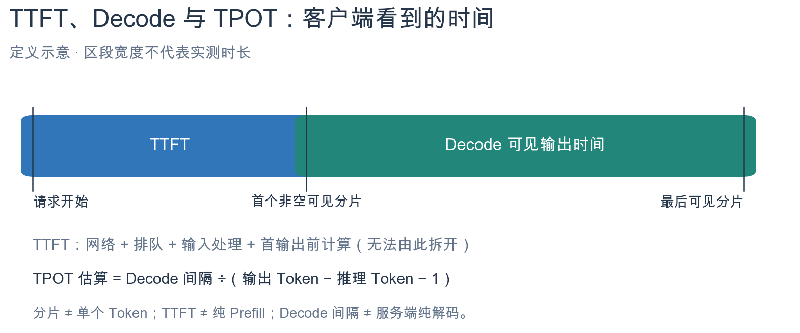
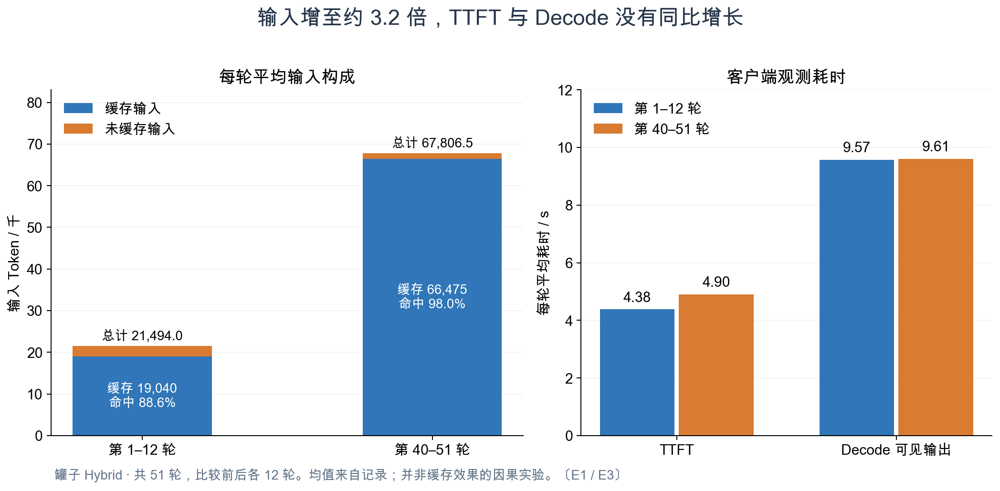
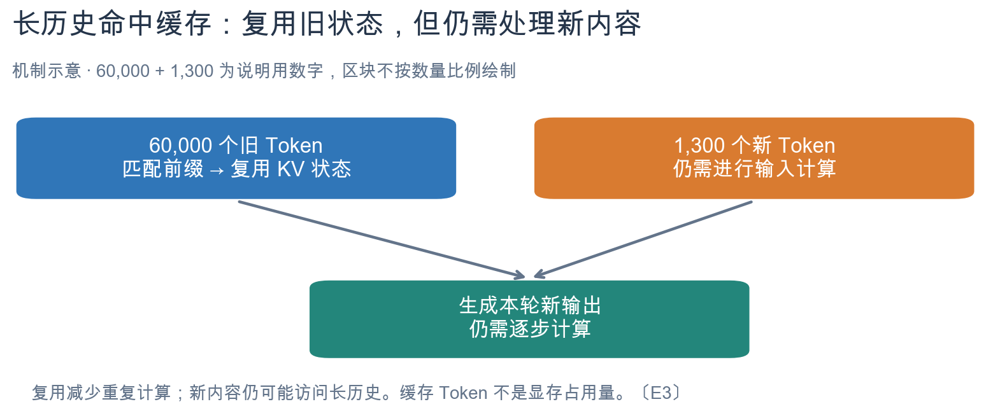
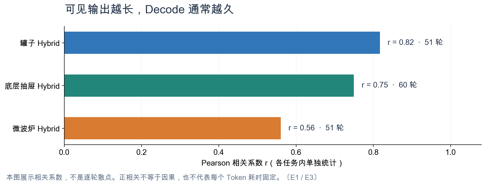

# LIBERO 实验报告补充：模型、动作与性能指标

版本：v1.8 · 日期：2026-09-29

配合逐轮 HTML 阅读，解释模型输入输出、动作执行和性能指标。实验结果以[逐轮决策实录](2026-09-22-LIBERO10-task0-Ori-init0-逐轮决策实录.md)为准；本文只保留理解报告所需的概念、例子和统计发现。

按 HTML 中正在查看的内容查阅：

| HTML 内容 | 对应知识点 |
|---|---|
| 任务、路线、模型输入输出 | [§1 实验范围](#scope)、[§2 模型接口](#interfaces) |
| XYZ、姿态、夹爪、关节角与轨迹表 | [§3 状态与单位](#states) |
| 五步动作、目标误差与夹爪执行 | [§4 动作如何执行](#execution) |
| 时间轴、渲染、通信与墙钟 | [§5 时间统计](#timing) |
| Token、TTFT、Decode 与缓存配图 | [§6 Token 与延迟](#tokens) |
| 成功判据、效果评价和优化方向 | [§7 结果解读](#results)、[§8 优化方向](#optimization) |

证据标识放在段末：〔E1〕为源码或记录依据，〔E2〕为配置事实，〔E3〕为机制解释或推断。待验证的方案不作为已实现收益。

<a id="scope"></a>

## 1. 实验范围与三条路线

当前 HTML 包含三个任务，每个任务比较三条路线，均为 init 0。共 **九个有效回合、610 轮决策、3,008 个控制步，其中 428 轮调用 GPT**。每格只有一个样本，不能据此估计总体成功率。〔E2〕

| 任务 | 实际要求 |
|---|---|
| LIBERO-10 · task 0 · Ori | 把字母汤罐和番茄酱罐都放进篮子 |
| Goal · task 0 · Task | 打开柜子的底层抽屉 |
| LIBERO-10 · task 9 · Ori | 把黄白色杯子放进微波炉，然后关门 |

| 路线 | 决策与执行方式 |
|---|---|
| Student（纯 π0.5） | π 根据观测生成动作，主机执行 |
| GPT Direct | GPT 输出末端目标位姿与夹爪命令，主机转换成控制动作 |
| Hybrid（π + GPT） | π 提出候选，GPT 放行、修改或接管 |

三条路线都采用“观测 → 决策 → 执行 → 新观测”的循环。**控制步**是一次环境控制；**决策轮**是一次模型决策及随后的短段执行；**回合**是从初态到成功、失败或预算结束的完整过程。〔E1〕

旧版 18 格属于另一批实验：两个任务 × 三种扰动 × 三条路线。新版为了完整采集逐轮用量而重跑，协议不同，不能把新版耗时填回旧回合当作原测量值。〔E2〕

<a id="interfaces"></a>

## 2. 模型输入、输出与 Prompt 适配

### 2.1 输入：图像、任务与机器人状态

GPT 收到任务、外部和腕部两视角图像、机械臂状态及历史；Hybrid 还收到 π 的候选动作。**没有直接提供物体真值坐标或原生成功标签**，目标身份与位置需要从图像和上下文判断。末端坐标只说明手在哪里。〔E1〕

π 的本轮请求包含任务、双视角图像和 8D proprio。报告保留原始请求 NPZ、分词结果、mask 和动作输出；服务端没有保存的内部特征不补造。〔E1〕

### 2.2 π 输出：逐步动作序列

本实验 π 一次输出 **10×7 数值数组**：十个预测控制步，每步七个控制量。主机最多执行前五步，然后重新观测、重新预测，剩余后缀丢弃。Hybrid 给 GPT 检查的也是前五步。〔E1〕

```text
每步：[Δx, Δy, Δz, Δrx, Δry, Δrz, gripper]
       平移控制3维   旋转控制3维      夹爪
```

前六维是世界系的归一化末端增量控制量，不是绝对 XYZ，也不是关节角。夹爪正值趋向闭合、负值趋向张开，约定 −1 开、+1 合。〔E1〕

以下为示意，非真实日志：

```text
[0.50, 0.00, -0.20, 0.00, 0.00, 0.00, -1.0]
```

它表示沿正 X、负 Z 方向移动，不主动施加旋转，保持张爪。`0.50` 不是移动 0.5 米，实际位移取决于控制器与物理响应。〔E3〕

π 没有输出文字理由。HTML 中纯 π 的说明是**主机执行摘要**，实际模型输出是动作数组。输入文本可以统计 Token，但十步七维的 70 个动作数值不是 70 个文本 Token，文本 TTFT/TPOT 不适用于这类连续动作输出。〔E1〕

### 2.3 GPT 输出：执行决定与目标

GPT 每轮返回一份 JSON，主机等待完成、收齐用量并校验后才执行。字段需要结合 mode 阅读，不能把填在 JSON 中的所有目标都当作实际动作。〔E1〕

| 字段 | 用途 |
|---|---|
| request_id | 对应本轮输入、回复与轨迹 |
| mode / steps | 决定采用哪种动作、请求执行几步 |
| reason | GPT 对决定的公开解释 |
| edit | 修改 π 候选时使用的修正量 |
| target | 末端接管时使用的目标位姿与夹爪命令 |
| assessment | GPT 对任务进度、上轮执行和下一步意图的自评 |

`mode=student, steps=5` 表示放行 π 的五步候选，此时 edit 和 target 不用于控制。assessment 中的“完成”“恢复”“方向一致”都是**模型判断**，仍需和真实观测、轨迹及环境结果核对。〔E1〕

识别错误与执行错误应分开分析：先看模型是否认对物体，再看目标是否设对，最后看机械臂是否跟上目标。仅凭一次抓错，无法判断是视觉识别、空间定位、抓取点还是控制响应出了问题。〔E3〕

### 2.4 上游 RoboDojo 与本次 LIBERO 的接口对照

这里的“上游”特指本地保留的 GPT-as-Policy **RoboDojo 双臂版本**，不据此认定其就是某机构最初发布的全部提示词。该版本 π 输出 **50×14 的 action chunk**，每步为“左臂六个关节目标角度＋左夹爪开度＋右臂六个关节目标角度＋右夹爪开度”。开度 0 为闭合、1 为张开；这些是目标值，不是电机电流或力矩。程序通过正向运动学（FK）将关节目标转换为双臂末端轨迹，供 GPT 审核。〔E1〕

| 接口 | 模型原始输出 | 下游处理 |
|---|---|---|
| 上游 RoboDojo π | 50×14 双臂关节目标与开度 | FK 得到末端轨迹；student 采纳 1–15 步，edit/eef 为 1–5 步 |
| 本次 LIBERO π | 10×7 单臂末端增量与开合命令 | GPT 看到前 5 步；主机最多执行前 5 步 |
| 本次 GPT Direct／Hybrid eef | 绝对目标 XYZ、目标四元数、夹爪命令与步数 | 主机转换成最多 5 步归一化末端动作 |

**π 与 GPT 最后进入同一个环境动作接口，但原始输出不同。** π 直接给逐步动作；GPT Direct 给目标，再由程序生成动作。Hybrid 选择 student 时，实际执行的是 π 的候选前缀，JSON 中未启用的 target 不参与执行。〔E1〕

### 2.5 初始 Prompt 的适配与已知差异

本次初始 Prompt 也不是整段照抄：机械臂由双臂改为单臂，观测改为两视角与 8D 状态，动作改为世界系 7D 增量、正值闭爪，并采用“每轮一个 JSON，宿主校验后执行”的协议。罐子 Hybrid 保存的初始 Prompt 中，**纠错判断段与上游 gate_prompt.md 逐字一致**：核对上轮执行与下一段意图，只有观察到失败或意图偏离才接管。〔E1〕

本次核对还发现两处口径差异，尚未修改实验：

- 保留的 gate 段仍提到根据 FK 轨迹判断意图，但 LIBERO 实际只给归一化候选动作，没有提供上游的 FK 轨迹。
- 保存的 Prompt 要求目标变化不超过 0.05 m／0.35 rad；当前 LIBERO 转换代码的校验上限为 0.055 m／0.425 rad。提示词更保守，两者不一致。〔E1〕

核对范围与源文件 SHA256 见[接口核对记录](evidence/2026-09-28-prompt-action-interface-audit.json)。这些差异说明本实验属于接口迁移，不能视为原版配置的逐项复刻。〔E3〕

<a id="states"></a>

## 3. 状态、坐标与单位

### 3.1 轨迹表速查：命令与观测分开读

**一行同时记录下发命令与执行后的观测，不能把它们当成同一种量。** “起点”行是本轮执行前状态，没有动作；第 k 步的动作列表示本步下发的命令，位置、姿态和关节列表示执行本步后得到的状态。同一列各行的单位一致，不同列的单位不同。〔E1／记录接口〕

| 报告列 | 单位 | 数值含义与读法 |
|---|---|---|
| 控制步 | 步，计数 | 本实验每步推进 0.05 s 仿真；不是每步墙钟用时 |
| 动作 dpos：Δx、Δy、Δz | 无量纲，归一化控制量 | 世界系平移增量命令；不是实际位移，不是绝对坐标，也不是 m/s |
| 动作 drot：旋转 x、y、z | 无量纲，归一化控制量 | 世界系旋转增量命令；不是直接以 rad 表示的转角，也不是三个关节角 |
| 动作 gripper | 无量纲，开合控制量 | 本接口负值打开、正值闭合；不是以米表示的开口宽度 |
| 末端 XYZ / m | 米 | 执行后末端参考点的世界系位置；相邻两行相减才是该步实际位移 |
| 姿态 xyzw | 无量纲，单位四元数 | 执行后的朝向；与目标字段 wxyz 顺序不同，比较前需重排 |
| 夹爪双指 / m | 米 | 两根手指执行后的关节位置；不是下发的 gripper 命令 |
| 7 关节角 / rad | 弧度 | 七个机械臂关节执行后的角度；不是角速度，也不是动作数组的七个分量 |
| 原生完成 | 无物理单位，布尔值 | 整个任务的原生成功判据；false 不等于本步命令执行失败 |

### 3.2 末端位置、8D proprio 与双指开度

```text
8D proprio= [x, y, z, rx, ry, rz, finger_left, finger_right]
               位置3维   轴角旋转3维       双指位置2维
```

XYZ `[-0.04614927, -0.00356789, 0.7020463]` 是末端参考点在世界系的位置；Z 约 70.20 cm 不等于离桌面 70.20 cm，还需扣除桌面高度。它既不是物体坐标，也不一定是两指的接触点。〔E1/E3〕

同一观测的 8D 状态可拆成：

| 部分 | 数值 | 解释 |
|---|---|---|
| 位置 / m | `[-0.04614927, -0.00356789, 0.70204628]` | 与上面的 XYZ 相同，尾数差来自精度 |
| 旋转向量 / rad | `[3.1406937, -0.00142891, -0.08465231]` | 与四元数描述同一个姿态，不是三个独立的欧拉角 |
| 双指关节位置 / m | `[0.03872318, -0.03872240]` | 两指坐标方向相反，当前处于较大张开状态 |

两指位置差约 0.07745 m（7.74 cm），可作为这里的关节开度参考；精确接触面间距还受几何影响，不能据此认定抓住了物体。〔E3〕

### 3.3 四元数 w、旋转向量与排列顺序

可以把姿态想成“围绕一根轴，从参考方向转过一个角度”。单位四元数满足 `w=cos(θ/2)`、`[x,y,z]=旋转轴单位向量×sin(θ/2)`。w 是标量部分，不是第四个空间方向；后三维共同包含转轴和角度信息。〔E3／数学解释〕

| 绕 X 轴相对参考姿态旋转 | 四元数 `[w,x,y,z]` |
|---|---|
| 0° | `[1,0,0,0]` |
| 90° | `[0.7071,0.7071,0,0]` |
| 180° | `[0,1,0,0]` |

本例四元数约为 `[-0.000121,0.999637,-0.000455,-0.026944]`，接近绕 X 方向转半圈。它描述当前朝向，不是要求现在再翻一次；是否朝下还需结合末端坐标轴定义。q 与 −q 等价，所以不能只凭 w 的正负判断旋转方向。〔E3〕

报告观测常用 `xyzw`，GPT 目标用 `wxyz`。例如观测 `[0.9996,-0.0005,-0.0269,-0.0001]` 重排后为 `[-0.0001,0.9996,-0.0005,-0.0269]`；这是排列差异，不是单位变化。〔E1〕

### 3.4 七个关节角与电机转子角

“7 关节角 / rad”记录仿真中机械臂 `q1～q7` 的实际关节角度，不包含夹爪两根手指，也不是下发的目标角度。角度相对于各关节定义的零位测量，正负表示按该关节轴约定相对零位的转动方向。〔E1／状态接口；E3／坐标解释〕

可以直观理解为“七个关节分别转到了哪里”。但真机若有减速器，电机转子的转角与关节输出端的转角不同，不能把本列直接当成电机转子角度。本列描述的是决定机械臂构型的关节位置。单位换算为 `角度（°）= 弧度（rad）×180/π`，即 `1 rad≈57.3°`。例如起点记录中的第 4 关节 `−2.3817 rad≈−136.5°`，第 6 关节 `2.1704 rad≈124.4°`；它们不是末端整体的旋转角。〔E3〕

**两个“7 维”没有一一对应关系。** 动作是“末端平移 3＋旋转 3＋夹爪 1”，关节状态是“机械臂七个关节角”；末端移动通常需要多个关节协同变化。〔E1/E3〕

<a id="execution"></a>

## 4. 从目标到实际动作

### 4.1 GPT 目标转换成五步命令

以报告中目标约为 `[-0.0062,-0.0036,0.6771] m` 的这一轮为例，相对初始位置的位移约为 X +4 cm、Z −2.5 cm。转换函数先算目标与起始位姿的差，再等分、归一化：〔E1／源码；示例数值按展示精度近似〕

```text
每步 X 控制量 =  0.040 ÷ (5 × 0.011) ≈  0.7273
每步 Z 控制量 = −0.025 ÷ (5 × 0.011) ≈ −0.4545
姿态保持不变 → 旋转控制量为 0
夹爪打开 → gripper = −1

连续 5 步均为：[0.7273, 0, −0.4545, 0, 0, 0, −1]
```

这一步**没有用 IK 反求关节角度**，而是从绝对目标生成末端增量命令，再交给环境底层控制器。IK 通常指“由末端目标求关节配置”；这张表仍是 7D 末端动作，不是各电机或关节的目标表。五行相同来自一次生成并重复相同增量；段内没有用新观测重算误差。旋转有变化时，代码计算相对四元数并转成旋转向量，再按步数和旋转尺度归一化。〔E1〕

换算尺度是近似控制响应，不保证物理执行恰好到位；代码中按几何差值等分与真实机械臂到位是两件事。实现见 [direct_target_to_chunk 与其归一化函数](../../gpt-as-policy-repro/src/gap_repro/libero/actions.py)。〔E1/E3〕

### 4.2 五步命令与实际位移对照

用户提供的轨迹表中，每步 X 命令都是 0.7273；按转换函数参考尺度计算为 `0.7273×0.011 m≈8 mm`，但第一步实测 X 从 −0.0461 m 变为 −0.0426 m，仅移动约 3.5 mm。以下由该表四舍五入后的 XYZ 逐行相减得到，只用于解释读法，不替代原始高精度记录：〔E3／用户提供展示值的算术派生〕

| 控制步 | 实际 X 位移 / mm | 实际 Z 位移 / mm |
|---|---:|---:|
| 1 | +3.5 | −2.4 |
| 2 | +7.3 | −6.2 |
| 3 | +7.7 | −7.2 |
| 4 | +8.0 | −7.3 |
| 5 | +8.2 | −7.4 |
| 合计 | +34.7 | −30.5 |

本轮目标位移约为 X +40 mm、Z −25 mm，因此最终 X 少移动约 5 mm、Z 多下降约 5.5 mm。这里反映的是近似换算与实际控制响应的差异，不是把米误写成归一化值；不能仅凭这张表确定偏差的具体动力学原因。旋转命令为零也不保证观测姿态完全不变。〔E3〕

罐子任务 Direct 的 97 轮中，最终位置误差中位数约 **1.16 cm**；40 轮在 1 cm 内，68 轮在 2 cm 内。这个指标只描述位置跟随，不表示姿态正确或任务成功。当前 HTML 已同时展示初始/最终位置与姿态误差。〔E1〕

满幅单步的实测参考尺度约为平移 0.011 m、旋转 0.085 rad。可用它粗估动作尺度，但不能据此线性外推到达步数；可靠的到位控制需要逐步反馈。〔E1/E3〕

### 4.3 夹爪何时开始开合

Direct 一旦要求闭合，第一步就会同时移动和发闭合命令，没有隐含的“到目标后再夹”。若希望先对齐再抓取，需要明确分阶段。π 的夹爪命令则可逐步变化，应看完整动作序列。〔E1〕

**闭合命令、双指变化、实际抓住物体是三件事。** 需要结合物体是否随抬升移动、是否滑落等证据判断抓取效果。〔E3〕

### 4.4 五步仿真与真机时间

本实验控制频率为 20 Hz，每步推进 0.05 秒仿真，五步为 0.25 秒。提前成功或拒绝时，实际执行步数会更少。〔E1〕

真机即使也按 20 Hz 控制，0.25 秒也只是五个命令周期，不保证到位或夹紧，更不包括等待 GPT 的时间。当前仿真等待模型时没有推进物理时钟，不能直接外推到持续变化的真机环境。〔E3〕

<a id="timing"></a>

## 5. 时间指标的计量范围

### 5.1 三种时间分别回答不同问题

| 时间 | 表示什么 |
|---|---|
| 动作仿真时长 | 模拟世界推进了多久，通常为实际步数×0.05秒 |
| 环境执行墙钟 | 电脑完成 env.step 实际花了多久 |
| 整轮墙钟 | 从这一轮开始到决策与执行收尾的实际时间 |

电脑可能花三秒才算完 0.25 秒的仿真。两者不能相加：仿真时钟已经由物理计算推进。报告因此将仿真轴和墙钟轴分开展示。〔E1〕

### 5.2 分项耗时的含义

以下定义以实际计时代码边界为准。〔E1〕

| 分项 | 包含什么 |
|---|---|
| 物理步进 | sim.step / mj_step 范围内的物理推进 |
| 渲染与像素读回 | sim.render 生成并取回相机像素 |
| 环境其他处理 | env.step 扣除物理与渲染后的剩余时间 |
| 保存观测与轨迹 | 图像、状态、动作的序列化与落盘 |
| 编码 GPT 输入 | 本地读取图片、Base64/JSON 和消息准备 |
| π 推理与同步 | 服务端策略调用及前后设备同步 |
| π 文件交换等 | π 客户端总时间扣除推理与同步，混有排队和读写 |
| GPT 请求总耗时 | 发起请求至回复及用量收齐，含网络、等待和计算 |
| 主机其他 | 整轮中未分配到上述项目的开销 |

```text
环境执行墙钟 = 物理步进 + 渲染与读回 + 环境其他处理
```

这里的渲染不是 Jupyter 页面绘制；保存不是机械臂运动；本地编码也不是服务端视觉编码器计算。π 推理含策略调用及同步，不能当作纯芯片 kernel 时间。〔E1〕

目前没有独立测出纯通信时间。GPT 往返和 π 客户端差值都包含其他处理，不能把残余全部命名为网络传输。〔E1〕

### 5.3 汇总表与真实时间轴

分项表按类别合并耗时，不表示操作只发生一次或按表格顺序执行。真实先后顺序看墙钟时间图；父级与子级打点可能重叠，不能把所有横条相加。〔E1〕

循环均值包含已完成的拒绝轮，排除初始化、模型加载和最终视频编码。应同时看循环总时间、p95、最大值和回合墙钟；实验并发运行，这些不是隔离性能基准。八卡能增加并行回合吞吐，不能消除单回合的等待依赖。〔E1/E3〕

<a id="tokens"></a>

## 6. Token、TTFT、Decode 与缓存

### 6.1 Token 计数与数据来源

每次决策是独立 GPT turn，历史仍保留在同一 thread。用本轮结束累计计数减上轮结束累计计数，得到该轮用量。〔E1〕

```text
实验程序 → 本地桥接 → Codex app-server → 模型服务
```

计数来自 app-server 的 `thread/tokenUsage/updated`。输入包含历史、图像和接口开销，不等于新增文字的分词长度。缓存输入已包含在输入中，推理 Token 已包含在输出中，两者都不能再次加总。〔E1〕

#### 推理 Token 的逐轮计算

**推理 Token 不是根据耗时预测出来的。** 模型服务通过上述接口上报累计 `reasoningOutputTokens`，报告再做逐轮差分；服务端如何统计这一类别不由本地程序决定。〔E1／采集代码〕

```text
本轮推理 Token
= 本轮结束时累计 reasoningOutputTokens
− 上轮结束时累计 reasoningOutputTokens
```

第一轮以程序初始化的零计数为基线。表中的 135、152、43、68 是各轮差分结果，不是四个累计总数。接口提供数量，不代表提供对应的内部推理文本；也不能仅凭数量得到纯推理耗时。〔E1/E3〕

#### 首轮输入的构成

没有历史对话不代表只有一句任务指令：初始规则、机器人接口说明、JSON 输出约束、当前图像、状态和任务都要进入请求，Hybrid 还提供 π 候选。用户看到的约 14,000 是请求级输入总量，不是任务文字长度，也不是隐藏推理量；本节未独立定位该数对应的具体轮次。〔E1／请求构成；E3／对约数的解释〕

目前没有这些部分各自的精确用量，不能认定主要由图像或系统提示贡献。文本可以另外分词作估计，图像及服务端封装开销需单独核验。本次逐轮协议显式关闭工具、传入空 dynamicTools，不能把“加载了大量工具定义”作为未经核实的解释。〔E1/E3〕

### 6.2 推理计算、推理 Token 与公开理由

| 概念 | 含义 |
|---|---|
| 模型推理计算 | 处理输入、生成输出所需的神经网络计算 |
| reasoning Token | 接口统计的隐藏推理 Token 类别 |
| reason / assessment | GPT 在 JSON 中公开生成的解释文本 |

**推理 Token 为零，不代表没有神经网络计算。** 假设接口零值准确反映当轮行为，模型仍可处理观测并逐个生成可见 JSON，只是不先生成额外的隐藏推理序列。〔E3〕

本报告的零是接口计数，不是缺失值填零；缺少用量会报错。具体回合为何报零，尚未独立核验后端原因，不能断言是保护机制清零。reason 和 assessment 虽然在解释判断，仍属于可见输出，不能当作内部思维的逐字记录。〔E1/E3〕

### 6.3 TTFT、Decode 与 TPOT



| 指标 | 本报告的定义 |
|---|---|
| TTFT | 请求开始至客户端收到首个非空可见 JSON 分片 |
| Decode 可见输出时间 | 首个至最后可见分片的到达间隔 |
| TPOT 估算 | Decode 间隔÷（可见 Token 估计数−1） |

```text
可见 Token 估计数 = 输出 Token − 推理 Token
```

这些都是客户端观测指标。TTFT 混有网络、排队、输入处理及首输出前的模型计算，**不等于纯 Prefill**；Decode 混有缓冲与传输，**不等于服务端纯解码**。分片不是单个 Token，因此 TPOT 保留“估算”字样。流重发轮次还可能包含重试等待，应单独标记。〔E1〕

#### 第一轮的计算示例

以两罐入篮、纯 GPT 第 1 轮（控制步 0→5）为例，页面显示输出 264 Token，其中推理 135 Token，Decode 可见输出时间为 4.799 s：〔E3／页面展示值的算术核对〕

```text
可见输出 Token 估计 = 264 − 135 = 129
TPOT 估算 ≈ 4.799 ÷ (129 − 1)
          ≈ 0.03749 s = 37.49 ms
```

这与页面的 37.494 ms 相符；微小尾数差来自显示时对 Decode 秒数的四舍五入。输出 264 已包含推理 135，不能把两者相加。**推理 Token 是接口计数的差分，TPOT 才是用时间和 Token 数计算的估计指标。** 分母中的减 1 对应首个到最后一个 Token 之间的间隔数；实际记录的是分片到达时间，因此仍不是逐 Token 的精确测量。〔E1/E3〕

### 6.4 输入增长与缓存命中：实际统计



罐子 Hybrid 共 51 轮。以下比较最前 12 轮和最后 12 轮的均值：〔E1／记录派生〕

| 指标 | 最前 12 轮 | 最后 12 轮 |
|---|---:|---:|
| 总输入 Token | 21,494 | 67,806.5 |
| 缓存输入 Token | 19,040 | 66,475 |
| 未缓存输入 Token | 2,454 | 1,332 |
| TTFT / s | 4.38 | 4.90 |
| Decode 可见输出 / s | 9.57 | 9.61 |

总输入约增长到 3.2 倍，但大部分历史命中了缓存，未缓存输入反而减少。TTFT 小幅变化，Decode 基本不变。这个现象支持缓存减轻重复处理的解释，但不能证明所有变化都由缓存造成。〔E3〕

### 6.5 长缓存对 Prefill 的影响



Prompt caching 复用匹配前缀的 **KV 中间状态**，避免重新计算相同历史。新输入仍需处理，本轮答案仍需生成。缓存 Token 表示本轮命中了多少输入，不是缓存显存大小，也不保证逐轮增长。〔E3／官方机制说明〕

```text
总输入 = 缓存输入 + 未缓存输入
缓存命中比例 = 缓存输入 ÷ 总输入
```

例如“60,000 个旧 Token 命中缓存 + 1,300 个新 Token”，不必把全部 61,300 个从头重算。但新内容仍可能访问较长的历史状态，增加读取、注意力和内存开销，具体程度取决于实现。〔E3〕

所以，复用更多缓存与保留更长历史是同时存在的。当前没有纯 Prefill 计时，不能因 TTFT 没有明显增长就断言长上下文没有成本，也不能仅凭缓存变大认定它拖慢了 Prefill。

### 6.6 输出长度与 Decode 的关系



按各 Hybrid 回合内全部轮次计算，可见输出 Token 估算数与 Decode 时间的 Pearson 相关系数如下：〔E1／记录派生〕

| 任务 | GPT 轮数 | 相关系数 |
|---|---:|---:|
| 罐子 | 51 | 0.82 |
| 底层抽屉 | 60 | 0.75 |
| 微波炉 | 51 | 0.56 |

这些正相关说明该批数据中输出更长通常花时更久，不代表每个 Token 耗时固定，也不是因果证明。高度缓存历史不会免除本轮约 330 个可见 Token 的生成工作。〔E3〕

统计不跨任务合并；前后段各取 floor(轮数/4)，罐子例子为第 1–12 与第 40–51 轮。完整精度、范围与源文件哈希见[统计文件](evidence/2026-09-28-cache-ttft-decode-analysis.json)。

<a id="results"></a>

## 7. 结果解读与证据边界

### 7.1 跟随目标、模型自评与任务成功

三类证据需要分开阅读：〔E1/E3〕

| 证据 | 可以说明什么 |
|---|---|
| 目标跟随误差 | 机械臂是否接近 GPT 请求的位置和姿态 |
| GPT 自评进度 | 模型认为发生了什么、下一步想做什么 |
| 原生环境结果 | 是否满足程序定义的任务成功条件 |

位置到位或夹爪闭合不能单独证明抓取成功；模型写“恢复”也不等于任务已恢复。抽屉尤其要检查打开的是哪一层，而不是只看有抽屉移动。

本次抽屉三路线均未成功，π 与 Hybrid 打开的是中层；Hybrid 有 13 轮接管，仍未纠正。微波炉中 π 与 Hybrid 成功，但 Hybrid 51 轮全部放行，没有实际修正，不能作为 GPT 纠错收益。〔E1〕

初态哈希配对不等于 π 随机采样配对。证明成功率提升需要多初态、重复运行及实际纠错证据；单次轨迹更短不足以归因。与论文比较时，还需核对任务、扰动和指令协议，特别是 Task 条件是否使用改变后的新指令。〔E2/E3〕

### 7.2 已有数据能补到什么程度

已有轨迹可以补算位移和目标误差，已有分片可以补算 Decode；离线重做分词需要注明是事后计算。没有逐轮边界的总 Token，不能平均分摊冒充逐轮实测；没保存的图像、时间戳和内部特征也不能倒推补造。〔E1〕

当前 HTML 已内嵌视频、图片、决策、轨迹和 π 原始请求，v1.6 图片去重后约 **155 MB**，不依赖原目录查看。完整实验档案仍另存。数据、媒体哈希与页面逻辑已经核验，尚未完成真实浏览器渲染验收。〔E1〕

<a id="optimization"></a>

## 8. 推理效率与效果优化

罐子任务平均整轮为 Direct **14.41 秒**、Hybrid **18.82 秒**、Student **4.20 秒**。前两条路线的 GPT 往返占约四分之三；Hybrid 可见输出约 332 Token，Direct 约 124 Token。现有证据更清楚地指向固定输出成本，而不是“推理 Token 越多就一定越慢”。〔E1/E3〕

| 优化方向 | 重点验证 |
|---|---|
| 按模式精简输出 | 放行时减少不用于执行的字段，检查响应时间与判断质量 |
| 调整审核频率 | 在抓取、释放、目标存疑和持续无进展时重点审核，评估漏检 |
| 持续恢复与反馈控制 | 避免提前闭合、反复对齐或交还 π 后再次偏离 |
| 管理历史上下文 | 对照完整与短历史，同时测缓存、TTFT 和决策质量 |
| 渲染复用、保存优化 | 保持模型输入与证据完整，区分真正减少开销与把等待挪到收尾 |

以上是待验证方向。重写历史可能降低前缀缓存复用；延长开环动作可能增加误操作；删减诊断记录带来的提速也要与模型性能收益分开。每项都应同时看结果、动作步数和完整回合时间。〔E3〕

现阶段仍未确定：推理计数为零的后端原因、纯 Prefill/通信/解码的各自耗时、具体抓错的主要原因，以及 Hybrid 是否能稳定提升成功率。进一步方案见[效率与纠错深挖](2026-09-23-推理效率与纠错效果深挖.md)。

## 附：旧版报告的两处历史说明

- **零步视频：** Goal task 8 / Ori / Hybrid 在零个控制步结束，只有初始帧，20 fps 下约 0.05 秒。复跑仍零步，不能仅凭视频没动认定断网。stop 会结束回合，具体停止原因仍未确认。〔E1/E3〕
- **碗的成功标签：** 最终离线核对中心距约 36.75 mm、阈值30 mm，超出6.75 mm，早先“差0.6 mm”不准确。旧页面按要求显示成功，原始 success=false 保留，展示调整没有改变原生判据。〔E1〕

这两项属于旧18格，不应与当前九回合的原生结果混用。详情见[旧版记录](2026-09-21-init0-18格运行记录.md)。

## 数据与来源

- [逐轮决策实录](2026-09-22-LIBERO10-task0-Ori-init0-逐轮决策实录.md)：当前协议、计时、结果与完整性核验。
- [GPT 决策表现与性能分析](2026-09-22-GPT决策表现与推理性能分析.md)：罐子任务的能力、误差和延迟。
- [Token 与 Prefill/Decoder 分析](2026-09-22-GPT-Token与Prefill-Decoder规律分析.md)：缓存、输出长度和时延关系。
- [记录规范](2026-09-21-LIBERO三路线实验与全链路记录规范.md)、[八卡探测](2026-09-21-八卡并发推理探测.md)：采集边界和并行能力。
- [OpenAI 推理文档](https://developers.openai.com/api/docs/guides/reasoning)、[缓存文档](https://developers.openai.com/api/docs/guides/prompt-caching)：Token 与前缀复用机制。
- [LIBERO-PRO v1](https://arxiv.org/html/2510.03827v1)：论文基线，比较前需核对协议。

本地 HTML：`GPT-as-Policy-repro/data/decision_v2_20260922/index.html`。为保持已有链接可用，本文沿用原文件名“实验报告对话疑问与解答”，内容已改为知识点补充。

配图由[绘图脚本](evidence/2026-09-28-plot-token-timing.py)生成；PNG 用于正文，旁边保留同名 SVG 矢量图。时间与缓存机制图为示意，其余图表读取上述统计文件。
