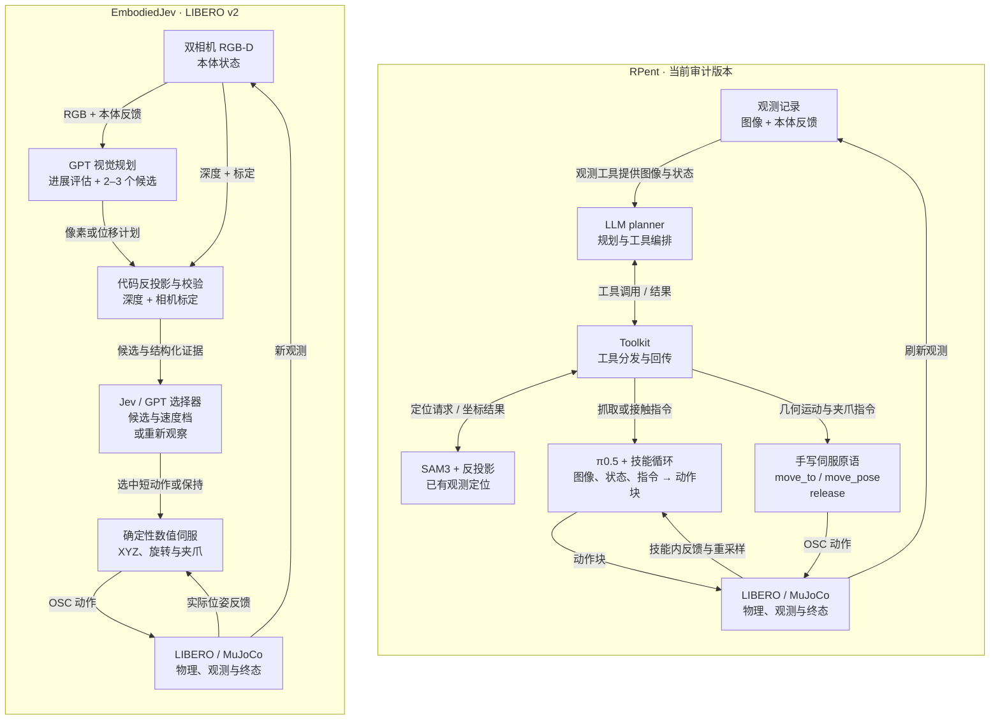

# EmbodiedJev 项目分析与 RPent 对比

版本：v1.1 · 日期：2026-10-13

分析对象：[FBddcz/embodied-jev](https://github.com/FBddcz/embodied-jev)，固定提交 `f08de2e4e20d6cd69fea9c57ac1062c3ef510f1e`。RPent 对照依据为已有的脱敏源码摘录、工具 Schema 和换模型接入审计。本次完成了 EmbodiedJev 源码检查与本地规则基线验证，没有重跑其付费模型实验，也没有启动新的 RPent 评测。

关联：[本周索引](readme.md) · [VLM＋VLA 双脑调研](2026-10-13-VLM-VLA双脑架构与推理优化调研.md) · [DeepSeek 两场景审计](ds-report/README.md)

EmbodiedJev 适合作为具身决策工作台和控制接口的参考。对 RPent 最有用的设计，是有边界的局部执行、前后观测比较，以及把模型选择与数值控制分开。现有小样本成绩还不足以支持更换 RPent 小脑或承诺整集提速。〔E3：本文判断〕

两者的小脑承担不同工作。RPent 的 π0.5 接收图像、本体状态和语言指令，生成动作块；EmbodiedJev 的 Jev 接收结构化文本，在程序提供的候选中选择。其 LIBERO v2 进一步把具体运动交给确定性伺服。把它们都称为“双脑”可以描述分层关系，但比较时必须说明动作由谁生成。〔E1：[RPent 源码摘录 E02、E06–E08][R1]；[候选选择与伺服][J7]〕

本文沿用工作区 E1–E4 定义：E1 为源码行号实证，E2 为配置实证，E3 为文档记载或推断，E4 为未复核的外审转述。作者实验结果和本地验证记录均单列为 E3 记载；代码里存在某个机制，只能证明实现存在，不能证明性能收益。RPent 源码摘录附原文件 SHA-256，覆盖对应审计批次；本文未对远程活动部署做新的全量核验。

## 1. 项目怎样运行

EmbodiedJev 有两条运行路径。Panda 工作台由浏览器操作，Python 后端管理内置任务；LIBERO、Meta-World 评测主要由命令行启动，使用独立模拟器 worker。公开展示站则读取已有实验记录，播放静态回放。〔E1：[工作台服务][J1]、[评测 worker][J8]；E3：[展示站说明][J20]〕

### 1.1 Panda 工作台

| 组件 | 源码位置 | 职责 |
|---|---|---|
| 浏览器界面 | `frontend/main.js`、`robot-scene.js`、`comparison.js` | 参数、Three.js 场景、决策面板和轨迹回放 |
| HTTP 服务 | `server.py` | 接收重置、运行、暂停等请求，返回状态、相机和导出数据 |
| 实验运行时 | `runtime.py:Session` | 持有仿真世界和策略，管理一局实验的循环、预算与取消 |
| 模型适配 | `policies.py:DecisionPolicy` | 对接规则基线、Jev、聊天 API、Claude 和 MiniCPM |
| 物理与感知 | `physics.py`、`perception.py` | MuJoCo 执行、接触和成功判定、相机渲染与视觉观测 |

表内职责均可由源码核对。〔E1：[服务与 Session][J1]、[规则与模型策略][J19]、[模型适配][J4]、[物理][J5]、[感知][J18]、[浏览器场景][J22]〕

`Session` 是一局实验的组织者。它先读取观测、构造问题和候选，再请求策略选择，检查响应并执行动作，最后记录结果和判断是否继续。工作线程在动作执行时推进物理；模型请求期间，这局实验不会在后台持续推进。停止操作可以使迟到的回答作废。〔E1：[Session 初始化][J2]、[执行循环][J16]、[取消检查][J3]〕

浏览器用 HTTP 轮询状态，运行时约每 180 ms 请求一次；MuJoCo 的物理步长为 2 ms，即每仿真秒 500 步。相机在决策和动作边界采样。页面刷新、物理步进与模型决策是三个不同频率，回放动画也不能代替推理计时。〔E1：[前端轮询][J13]、[物理步长][J21]、[物理步进][J5]、[观测采集][J16]〕

工作台把观测和控制方式分开配置：

| 设置 | 模式 | 模型得到或决定的内容 |
|---|---|---|
| 观测 | `privileged` | 模拟器提供的结构化位置和接触状态 |
| 观测 | `rgbd` | 本地检测器根据颜色、深度和标定估计的坐标 |
| 观测 | `vision` | 原始 RGB 与机器人本体反馈，不提供物体真值坐标 |
| 控制 | `skills` | 选择阶段和程序生成的技能候选 |
| 控制 | `incremental` | 从固定 XYZ 位移和夹爪菜单中选择下一步 |
| 控制 | `hierarchical` | 先选子目标，再选 XYZ 与夹爪通道 |

这些模式并非任意组合：直接图像输入目前限于支持图像的 Chat／Claude 逐步模式。RGB-D 检测器利用已知颜色和方块尺寸，适用范围受场景设计限制。技能模式中的阶段筛选、目标生成和安全预演也由代码承担；不能把任务完成全部归为模型能力。〔E1：[模式约束][J2]、[颜色与深度检测][J18]、[技能执行][J16]；E3：能力归因判断〕

MiniCPM 路径读取候选字母的下一 token logits，再在这些候选间做 softmax。这能避免生成长文本，但仍需对输入做前向计算，当前实现也没有跨请求复用 KV cache。候选概率表示相对偏好，不能直接当作动作成功率。〔E1：[MiniCPM 实现][J17]；E3：概率含义判断〕

### 1.2 LIBERO 双脑的 v1 与 v2

v1 中，GPT 根据双相机图像提出短阶段和目标像素，代码用该像素的深度、相机标定得到三维航点。之后由 GPT 或 Jev 选择 XYZ、旋转和夹爪通道；运动幅度由代码根据误差计算。局部模型已经收到带符号的误差和明确的正向、负向、保持规则。〔E1：[v1 局部状态与动作问题][J6]〕

v2 改为 GPT 比较 BEFORE／NOW 画面，提出 2–3 个不同的短动作。选择器从候选及正常／谨慎速度档中选一项，也可以要求重新观察；程序再用共同的数值伺服执行。每个候选最多执行 4 段，每段 5 个环境步，到达航点或连续停滞时提前刷新。〔E1：[v2 协议、选择与执行][J7]〕

v2 增加了进展描述，其可靠性仍需独立验证。`advancing / unchanged / regressing / unknown` 来自 GPT 的视觉判断；执行层的停滞检查仍依据末端平移和旋转变化。这两个信号应分开理解。〔E1：[视觉判断字段][J7]、[停滞刷新逻辑][J14]；E3：能力边界判断〕

评测主进程负责模型调用和预算，另起 Python 子进程运行 LIBERO 或 Meta-World。双方用标准输入、输出传递逐行 JSON，模拟器日志进入单独文件。这种隔离允许各 benchmark 使用自己的依赖环境；配对实验还会核对初态、初始化后状态、模拟器版本和控制参数。〔E1：[worker 通信][J8]、[初态与配置核对][J9]〕

## 2. 已有结果能支持什么

下表是作者在固定提交中公开的开发结果，本次未独立重跑云端模型。〔E3：作者报告〕

| 实验 | 作者记录 | 解释范围 |
|---|---|---|
| Panda 预设技能 | GPT-6 Astra 9/9；同设置规则基线也为 9/9 | 能说明接入和执行链路可用，不能据此证明模型优于规则 |
| Panda 本地 MiniCPM | 最近一组紧凑输入实验 0/3 | 本地推理入口可运行，控制效果尚未达到可靠完成任务 |
| Meta-World 层级 v2 | Jev、GPT-6 Astra 各 5/6；各执行 765 步、312 次请求 | 三任务、各两个种子，使用特权状态；主表采用了超时后的补测结果 |
| LIBERO v1 | 纯 GPT 2/2、GPT＋Jev 1/2 | 两个开发任务、各一个初态；包含重测，不能当作首次尝试成功率 |
| LIBERO v2 | 推盘子测试暂停，尚无完整配对结果 | 不能给出 v2 相对 v1 或 RPent 的成功率、提速结论 |

来源：[Panda 验证记录][J10]、[Meta-World 结果][J11]、[LIBERO v1 结果][J15]、[v2 状态][J12]。〔E3〕

LIBERO 关抽屉一对记录中，作者报告混合组耗时从 609.8 秒降至 319.7 秒，估算费用从 2.15002 美元降至 0.39400 美元，对应 47.6% 与 81.7% 的下降。这个结果值得追查，但两组独立调用视觉规划器，动作数也不同；它比较的是整套系统，尚不能把差异全部归因于 Jev 的单次响应速度。费用采用作者冻结的单价估算，本次未核对账单。〔E3：[逐局数据与协议][J15]、[系统对照说明][J12]〕

失败回合给出了更直接的改进线索：混合组微波炉运行 1120 步、1200 秒后仍未成功。作者诊断称，174/224 次局部动作中，末端移动超过 5 mm，门角变化却不足 0.05°。这说明末端移动与任务推进可能脱节；单纯换一个更快的方向选择器，未必能解决接触位置和高层航点问题。前半句为作者诊断，后半句为本文推断。〔E3：[失败分析][J15]〕

2026-10-13 的本地检查完成了前端构建，以及物理、策略、运行时、层级接口、LIBERO 视觉控制和用量计量六组测试，共 94 项通过。测试文件为 `test_physics.py`、`test_policy.py`、`test_runtime.py`、`test_benchmark_hierarchy.py`、`test_libero_visual_control.py`、`test_evaluation_meter.py`。三个内置任务各跑种子 0、1、2，规则基线 9/9 成功，模型调用为零，使用 `benchmark --provider baseline --seeds 0 1 2 --cameras none`。这里只验证本地基线和所选测试，没有验收 MiniCPM、Jev 或其他云模型的规划能力。〔E3：本次本地验证记录〕

本地基线的 `forbidden_contact_steps` 为零，指标只覆盖代码定义的末端部分连杆／手指与桌面、障碍接触，不代表全机体碰撞检查完备。原始验证结果保留在参考 clone 的 `runs/local-review-20261013/`，未复制进公开报告。〔E1：[检查范围][J5]；E3：本次结果记载〕

## 3. 与当前 RPent 的差别

下图对照 EmbodiedJev LIBERO v2 与 RPent 的现有控制链路。箭头表示调用或数据关系；局部反馈可以在技能内部处理，并不要求每个环境步都调用高层 LLM。〔E1：[v2 选择与执行][J7]、[深度反投影][J6]、[RPent 动作循环 E02–E03][R1]；E2：[RPent 工具 Schema][R2]〕

EmbodiedJev v2 的选择器决定执行哪个候选，数值伺服生成实际运动；RPent 的 π0.5 直接生成动作块，同时保留传统伺服工具。图中的 Jev／GPT 表示两种对照配置，RPent 分支则表示可调用的工具类型。〔E1：[候选选择与伺服][J7]、[π0.5 输入输出 E06–E08][R1]；E2：[工具定义][R2]〕

| 维度 | RPent 当前审计版本 | EmbodiedJev 的对应实现 |
|---|---|---|
| 高层编排 | LLM 通过 Toolkit 调用观察、定位、动作、记忆与结束工具 | Panda 由 Session 驱动；LIBERO 由固定 planner／selector 循环驱动 |
| 学习型动作生成 | π0.5 接收图像、状态、语言指令，生成 7 维动作块；审计配置为 5 步动作块 | Jev 只选择候选；LIBERO v2 的运动由确定性伺服生成 |
| 传统控制 | 已有 `move_to`、`move_pose`、旋转、夹爪与释放工具 | IK 或 OSC 执行航点／短动作，v2 共用数值伺服 |
| 感知 | SAM3 分割既有观测，再结合对应世界坐标映射定位；也可直接选像素反投影 | Panda 可用已知颜色检测；LIBERO 用 GPT 选点或提出视觉候选，再用深度标定定位 |
| 局部闭环 | `pi0_pick` 内部可反复调用 VLA，检查下降、再抬升和夹爪开度 | 短动作按到达、停滞和执行段数刷新；v2 添加前后帧视觉评估 |
| 历史与输入 | 有任务记忆；API planner 已裁剪历史图片 | v2 请求组织为前后画面与近期动作历史，选择器接收结构化证据 |

表内 RPent 动作与感知依据为源码摘录及工具定义，EmbodiedJev 依据为固定提交源码；RPent 记忆和 API 历史处理为既有接入审计转引。〔E1：[RPent 源码 E02–E08、E12][R1]、[EmbodiedJev 运行时][J2]、[v2][J7]；E2：[工具 Schema][R2]；E3：[RPent 接入审计 §1–§2][R3]〕

RPent 的局部控制已经是混合式的。`pi0_pick` 用 π0.5 抓取，搬运和释放则由其他工具承担；π 的局部结果又用末端下降、抬升和夹爪开度判断。这些条件提供抓取迹象，但还需要图像核对，不能等同于始终抓着正确物体。〔E1：[抓取循环 E03][R1]；E2：[工具说明][R2]；E3：判据局限判断〕

因此，Jev 与 π0.5 没有直接替换关系。若要借鉴 Jev 的角色，更合适的位置是技能选择、接近方向选择、恢复方案选择或重新观察决策。保留 π0.5 负责接触动作，保留伺服负责明确的几何运动，再验证便宜的选择器能否减少高层往返。〔E3：迁移建议〕

本次也不能从 Jev 的 API 延迟推算昇腾部署收益。当前项目通过 HTTP 接入 Jev，本地 MiniCPM 是另一套候选评分实现；两者的权重、推理路径和任务效果不能混为一谈。〔E1：[策略分支][J4]、[本地评分][J17]；E3：性能推断边界〕

## 4. 值得借鉴的设计

本节均为待验证方案，未修改 RPent，也未取得新增性能结果。〔E3〕

### 4.1 先扩展有验收条件的复合技能

RPent 已有 `pi0_pick` 的局部循环，可以沿用它的组织方式，把搬运、放置等稳定阶段收进一个有预算、有返回条件的技能。上层只提交对象与目标，内部使用现有 SAM3、π0.5 和伺服工具完成操作；发生目标歧义、抓持丢失或连续无进展时，再把问题交回大脑。

例如，`pick_and_place(object, target)` 的接口至少需要说明以下内容：

| 内容 | 需要表达什么 |
|---|---|
| 前置条件 | 对象与目标定位来自哪一帧，是否仍可见，当前是否已有抓持 |
| 阶段目标 | 接近、抓取、搬运或放置，本段希望看到什么变化 |
| 执行边界 | 环境步预算、动作块预算、允许的局部恢复次数 |
| 返回结果 | 阶段完成、抓持丢失、目标不可见、无进展或预算耗尽，并附观测依据 |

这份接口仍需实现和重放验收。减少高层调用会扩大单个技能覆盖的时间，错误也可能更晚暴露；局部检查必须随技能一起补齐。当前周报告中的“3／4 次高层决策”仍是设计目标，不应写成已经达到的调用数。〔E3：[本周未验证项][R4]〕

### 4.2 把任务进展写进工具返回

EmbodiedJev v2 的 `expected_effect`、前后帧和 `unknown` 状态值得保留。RPent 工具可以在返回“动作已执行”之外，补充子目标是否推进的证据。例如：末端已到位，目标物体未出现预期位移，接触尚无法确认。

进展条件要按阶段定义。接近阶段可检查末端与目标接触位置的关系；搬运阶段应检查目标物体是否随夹爪移动；推门阶段则检查门是否沿预期方向变化。腕部相机自身会移动，不能直接把像素位移当作物体运动。定位与对比应保留相机、帧号和标定对应关系，看不清时返回未知。

这里不应照搬“让 GPT 自报进展”后就宣称监测已可靠。应先用已有轨迹标注一批真正推进、空动和误操作片段，检查漏报、误报及触发后的恢复效果。只用于最终评分的环境成功谓词，也不应悄悄进入模型可见的局部控制输入。

### 4.3 再测试有限候选选择

把局部策略收成候选，可以减少模型编造坐标和动作的自由度。适合的候选包括重新定位、换接近方向、恢复夹持或继续当前技能。候选必须在物理上不同；仅换措辞不构成有效备选。

选择器可以先用规则或现有大脑实现，再与便宜模型比较。若规则能根据已知误差完成方向和夹爪判断，就直接交给数值控制。新增模型应解决存在歧义的选择，收益也要覆盖构造候选与额外请求的成本。

### 4.4 压缩重复上下文，保留判断依据

RPent API planner 已有历史图片裁剪，后续应进一步检查哪些重复输入真正必要。可以把已完成阶段、当前子目标、最近异常和局部恢复次数整理成短状态，配上当前画面及必要的上一检查点。删减历史后仍须检查遮挡恢复、指代和空间定位是否受损。〔E3：方案；[现有历史裁剪审计][R3]〕

EmbodiedJev 的图像哈希、检查点索引和记录导出可以参考。RPent 已有较细的计时账本，新增字段应接到现有调用 ID 和父子区间上。模型、工具、仿真与渲染存在嵌套，不能直接相加；也不能把省略 API 等待的回放速度当作整集加速。〔E1：[检查点记录][J7]；E3：[既有计时规则][R3]、迁移建议〕

## 5. 建议怎样验证

先在已有 t0／t9 场景做开发诊断，冻结接口和参数后，再用未参与调参的初态或任务检验。以下是逐步增加机制的对照设计，尚未执行。〔E3〕

| 组别 | 相比上一组增加什么 | 主要回答什么 |
|---|---|---|
| A | 当前 RPent | 保留基线行为和成本 |
| B | 一个带固定执行预算和验收条件的复合技能 | 技能粒度能否减少高层往返，是否增加失败 |
| C | 明确的阶段进展检查和有界恢复 | 能否减少空动与重复尝试，误触发代价多大 |
| D | 候选选择器，替换该环节原有选择方式 | 选择模型是否比规则／原大脑更划算 |

B 与 A 的差异包含该复合技能的完整接口设计；C 与 B 才用于分析新增进展检查和恢复；D 的选择器需与相同候选、相同输入下的规则及原大脑分别比较。若只比较 D 与 A，就无法单独归因于小模型。〔E3〕

各组固定 LLM、planner 类型、π／SAM 配置、任务资产、记忆、初态和预算，并保留原始失败与基础设施重试。当前 Codex planner 与 API planner 的消息和会话管理不同，历史 120 集不能直接充当新 API 编排的等价基线。〔E3：实验约束；[planner 差异审计][R3]〕

验收同时看官方任务成功、整集耗时与费用、高层逻辑请求数，以及经逐动作标注确认的无进展重复。提前停手造成的低耗时、失败后的低费用都需保留任务状态；TTFT 只能说明首个相应事件的到达时间，完整工具决策仍要等参数接收并校验完成。〔E3：验收方案；[本周计时审计][R5]〕

本轮最适合先落地 B 组：保留现有 π0.5 与 SAM3，用一个可检查的复合技能验证调用粒度。成功率和耗时都通过后，再增加进展恢复和候选选择器。这样每一步都有可解释的对照，也能及时发现省下的请求是否变成了更长的无效执行。〔E3：实施顺序建议〕

## 来源与复核范围

正文的 EmbodiedJev 源码引用均固定到分析提交，实验数据引用作者结果文档。RPent 使用 [带文件哈希的源码摘录][R1]、[工具 Schema][R2] 和已有审计记录；未读取原始会话、凭据或私有运行日志，也未重新审计活动节点。源码锚点为 E1，工具 Schema 为 E2，结果文档与既有审计转引为 E3。

[J1]: https://github.com/FBddcz/embodied-jev/blob/f08de2e4e20d6cd69fea9c57ac1062c3ef510f1e/src/embodied_jev/server.py#L257-L289
[J2]: https://github.com/FBddcz/embodied-jev/blob/f08de2e4e20d6cd69fea9c57ac1062c3ef510f1e/src/embodied_jev/runtime.py#L54-L137
[J3]: https://github.com/FBddcz/embodied-jev/blob/f08de2e4e20d6cd69fea9c57ac1062c3ef510f1e/src/embodied_jev/runtime.py#L608-L635
[J4]: https://github.com/FBddcz/embodied-jev/blob/f08de2e4e20d6cd69fea9c57ac1062c3ef510f1e/src/embodied_jev/policies.py#L277-L313
[J5]: https://github.com/FBddcz/embodied-jev/blob/f08de2e4e20d6cd69fea9c57ac1062c3ef510f1e/src/embodied_jev/physics.py#L158-L219
[J6]: https://github.com/FBddcz/embodied-jev/blob/f08de2e4e20d6cd69fea9c57ac1062c3ef510f1e/src/embodied_jev/libero_policy.py#L89-L224
[J7]: https://github.com/FBddcz/embodied-jev/blob/f08de2e4e20d6cd69fea9c57ac1062c3ef510f1e/src/embodied_jev/libero_supervisor.py#L20-L293
[J8]: https://github.com/FBddcz/embodied-jev/blob/f08de2e4e20d6cd69fea9c57ac1062c3ef510f1e/src/embodied_jev/evaluation.py#L105-L135
[J9]: https://github.com/FBddcz/embodied-jev/blob/f08de2e4e20d6cd69fea9c57ac1062c3ef510f1e/src/embodied_jev/libero_compare.py#L50-L54
[J10]: https://github.com/FBddcz/embodied-jev/blob/f08de2e4e20d6cd69fea9c57ac1062c3ef510f1e/docs/VALIDATION.md
[J11]: https://github.com/FBddcz/embodied-jev/blob/f08de2e4e20d6cd69fea9c57ac1062c3ef510f1e/docs/results/metaworld-hierarchy-v2-2026-09-21/RESULTS.md
[J12]: https://github.com/FBddcz/embodied-jev/blob/f08de2e4e20d6cd69fea9c57ac1062c3ef510f1e/docs/LIBERO_VISION.md
[J13]: https://github.com/FBddcz/embodied-jev/blob/f08de2e4e20d6cd69fea9c57ac1062c3ef510f1e/frontend/main.js#L1763-L1793
[J14]: https://github.com/FBddcz/embodied-jev/blob/f08de2e4e20d6cd69fea9c57ac1062c3ef510f1e/src/embodied_jev/libero_supervisor.py#L269-L288
[J15]: https://github.com/FBddcz/embodied-jev/blob/f08de2e4e20d6cd69fea9c57ac1062c3ef510f1e/docs/results/libero-vision/RESULTS.md
[J16]: https://github.com/FBddcz/embodied-jev/blob/f08de2e4e20d6cd69fea9c57ac1062c3ef510f1e/src/embodied_jev/runtime.py#L237-L384
[J17]: https://github.com/FBddcz/embodied-jev/blob/f08de2e4e20d6cd69fea9c57ac1062c3ef510f1e/src/embodied_jev/policies.py#L505-L534
[J18]: https://github.com/FBddcz/embodied-jev/blob/f08de2e4e20d6cd69fea9c57ac1062c3ef510f1e/src/embodied_jev/perception.py#L1-L120
[J19]: https://github.com/FBddcz/embodied-jev/blob/f08de2e4e20d6cd69fea9c57ac1062c3ef510f1e/src/embodied_jev/policies.py#L149-L168
[J20]: https://github.com/FBddcz/embodied-jev/blob/f08de2e4e20d6cd69fea9c57ac1062c3ef510f1e/site/README.md
[J21]: https://github.com/FBddcz/embodied-jev/blob/f08de2e4e20d6cd69fea9c57ac1062c3ef510f1e/src/embodied_jev/physics.py#L13-L21
[J22]: https://github.com/FBddcz/embodied-jev/blob/f08de2e4e20d6cd69fea9c57ac1062c3ef510f1e/frontend/robot-scene.js#L1-L172
[R1]: ../2026_1005-1011_RPent推理性能分析/evidence/source-evidence.json
[R2]: ../2026_1005-1011_RPent推理性能分析/evidence/robot-tool-schemas.json
[R3]: ../2026_1005-1011_RPent推理性能分析/2026-10-09-RPent更换LLM与启动测试指南.md
[R4]: readme.md
[R5]: ds-report/README.md
