# 具身 RL 图解与训练详表

版本：v1.0｜日期：2026-10-30（Asia/Singapore）

本册配合[重点研究报告](2026-10-30-具身后训练重点研究-RL方法与证据.md)，按研究本身解释架构与训练。覆盖 π_RL、Z-1、DRILL、AtomicRL、TEMPO、DeepThinkVLA、WAM-RL、RECAP、RLT、SyVLA。图为根据原文整理的讲解示意〔E3〕，不是作者原图，也不是逐层实现图。

**阅读方式**：本册保留11段可编辑 Mermaid；若阅读器不支持渲染，可打开[静态图册与 SVG／Mermaid 源文件](assets/rl-training-diagrams/README.md)。

**图例与证据**：实线表示计算或数据传递；虚线表示“由该目标／流程更新参数”，不自动表示梯度穿过全部中间节点。灰色为固定模块，蓝色为可训练模块，橙色为奖励／目标。文献记载为 E3；锁定源码为 E1；静态配置为 E2。未披露指指定版本未提供足够信息，不能用其他论文默认值补齐。

## 0. 先看整个训练版图

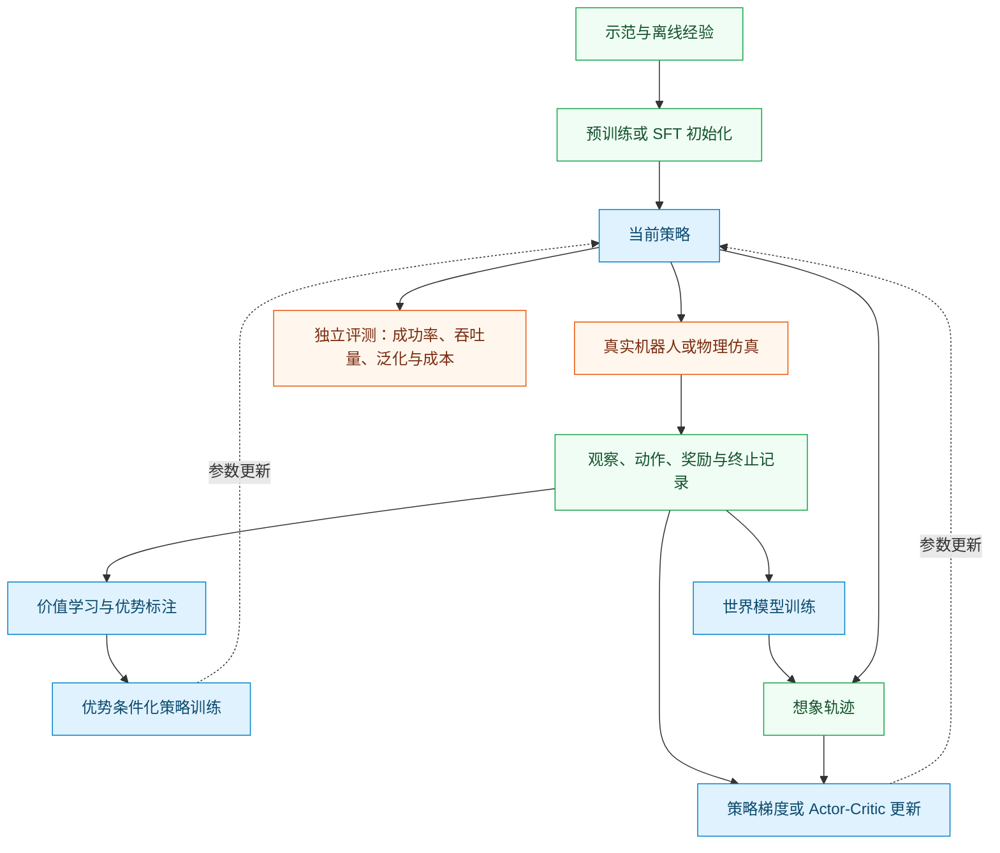

本图汇总多种路线，不表示每篇都包含所有分支。π_RL／Z-1 主要走直接策略更新；RECAP 走优势条件化；RLT 只更新轻量 Actor–Critic；DRILL 将学习世界模型放入想象训练闭环。〔E3：归类；各篇来源见后文〕

### 0.1 指标与计量单位：先统一再读表

| 名称 | 怎样理解 | 常见误读 |
|---|---|---|
| Task Success Rate，SR | 成功评测 Episode／总评测 Episode；多任务平均还需说明权重 | 训练 Reward 均值不一定等于 SR；多任务宏平均不等于直接合并样本 |
| CALVIN SRk | 从链首连续完成前 k 个指令的比例 | 不是任意 k 个子任务的独立成功率 |
| Avg. Len. | 连续完成的前缀长度均值；对五任务链等于 SR1–SR5 的概率值之和 | SR 用百分数时求和后还需除以 100 |
| Throughput | 单位时间完成的成功任务数 | 同时受动作速度、失败／恢复、复位和计时边界影响 |
| Value／Explained Variance／KL | 学习过程诊断 | 单独改善不证明实际任务表现改善 |
| Policy Loss | 特定符号、归一化与目标下的数值 | 不同算法之间的正负与大小通常不能直接排名 |
| Demonstration／Trajectory | 一条演示或轨迹；必须说明是否完整 Episode | 不能与视频帧、滑窗样本、Action Chunks 互换计数 |
| Training Seed | 独立训练的随机重复 | 多个评测初态或 Evaluation Seeds 不等于多次独立训练 |

这些是本文的分析口径〔E3〕；若某论文使用特殊定义，应以其原文为准。尤其是 DRILL 的 CALVIN 汇总 SR 未明确链长度，不能自动改标 SR5。

### 0.2 三个不同的时间尺度

| 符号 | 含义 |
|---|---|
| H | 一次预测的动作长度，Prediction Horizon |
| H′ | 新观察前实际执行的长度，Execution／Replan Horizon，通常 H′≤H |
| K | 一次动作生成内部的去噪步数，Denoising Steps |

长程任务的环境步数、一次预测 H、实际执行 H′、内部去噪 K、Value 的 n-step backup，都是不同量。下文不会把 RECAP 的 n-step＝50写成动作长度50。〔E3：计量说明〕

## 1. π_RL：Flow Policy 怎样用 PPO 学习

来源：[v3 §4、B/C、J Tables 11–13](https://arxiv.org/html/2510.25889v3)；[RLinf 官方训练文档](https://rlinf.readthedocs.io/en/release-v0.3/rst_source/examples/embodied/pi0.html)。下表为论文记载〔E3〕，现行文档配置另行解释。

### 1.1 主图：以 Flow-SDE 为例

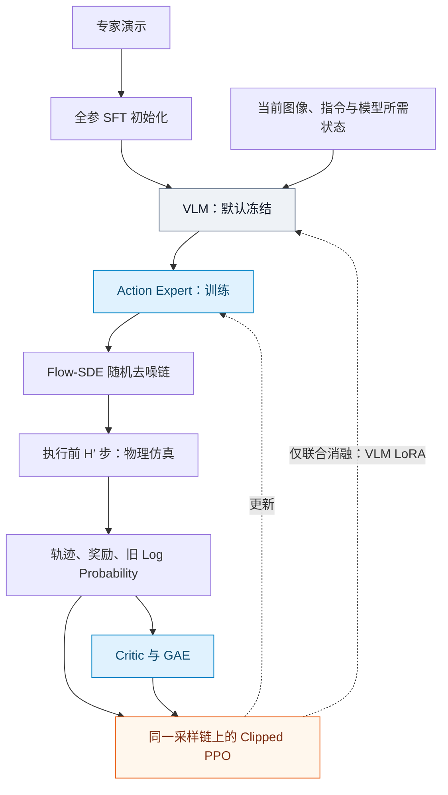

**怎样训练**：先用演示得到可用 Policy，再采集随机策略 Rollouts。保存去噪链与旧概率，更新时对同一链重算新概率，结合 GAE 做 PPO。概率针对扩展采样路径／转移；不能直接当成最终动作边缘密度。Flow-Noise 是另一变体，额外学习噪声网络并同时更新 Velocity，默认冻结的仍是 VLM。〔E3；§4〕

### 1.2 数据、预算与评测

| 项目 | 论文披露 |
|---|---|
| 底座／更新 | π0／π0.5；SFT 全模型，RL 默认训练约300M Action Expert、冻结 VLM；另有 VLM LoRA 消融 |
| LIBERO 数据 | π0 用58条初始化 Spatial／Object／Goal，Long 用208条；π0.5 用40条统一初始化 |
| 其他数据 | ManiSkill：16,384条规划器演示／4,352种任务组合；CALVIN：ABC约24小时／超过20,000条语言标注轨迹，D评测；MT50：2,500条演示 |
| 奖励 | LIBERO／MT50成功0–1；CALVIN完成子任务给1；ManiSkill放置1、抓附0.1 |
| LIBERO RL | 500 Epochs；Global Batch 2048；Actor／Critic LR＝5×10⁻⁶／10⁻⁴；64环境×8 Rollout Epochs；γ＝0.99、λ＝0.95、Clip＝0.2 |
| Horizon | π0预测50；π0.5预测10；两者执行5／5／5／10，按 Spatial／Object／Goal／Long 排列 |
| 硬件 | 8×H100 80GB；总 GPU-hours 未披露 |
| 评测 | 每 LIBERO Suite 为10任务×50初态；CALVIN为1,000条五指令链，报告 SR1–5与 Avg. Len. |
| 效果 | LIBERO 四 Suite 平均：π0.5 SFT77.1%→Flow-SDE97.9%／Flow-Noise98.3% |
| 缺项 | 独立训练重复数、精确 Few-shot 样本ID、完整墙钟成本未披露 |

**讲解重点〔E3：分析〕**：这里的高分来自冻结 VLM 的主配置；F.2 的联合实验需要更保守的优化，不能把主表高分写成 VLM 联训成绩。

## 2. Z-1：前缀分叉与选择性联合 GRPO

来源：[v1 §3、§4、Appendix C/D](https://arxiv.org/html/2606.31846v1)。事实为 E3。

### 2.1 模型与训练流程

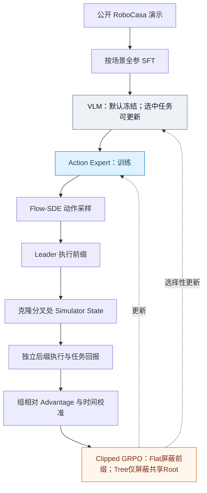

**怎样训练**：按任务进行 GRPO，使用环境成功反馈比较同组后缀。Flat Shared-Prefix 复用的是环境状态并屏蔽整段共享前缀；树形版本允许部分分叉区间参与更新。联合模式只改变可训练参数集合，沿相同 Loss 更新 VLM 与 Expert；不是所有任务都统一解冻。〔E3；§3、D.4〕

### 2.2 训练详表

| 项目 | 论文披露 |
|---|---|
| 模型／数据 | π0.5；1,199条公开 RoboCasa 演示，按 Scene SFT，24任务评测 |
| 初始化选择 | Held-out Loss约0.01选稳定 SFT Checkpoint；验证集数量未披露 |
| RL | Flow-SDE 路径比率＋组相对 Clipped GRPO；无额外 Critic、Reward Model 或 KL |
| 回报校准 | 成功回报乘0.998的首次成功 Chunk 数次幂；全成功组改用 R−min(R)，避免惩罚慢成功 |
| 更新 | 默认 Expert-only；最终评测前按训练诊断固定是否联合 VLM |
| 超参 | AdamW LR5×10⁻⁶、Weight Decay0.01、Grad Clip1；Micro16／Global1024；Group8；64环境；4 Rollout Epochs；Clip0.2 |
| 评测 | SFT：4 Evaluation Seeds×12＝48 Rollouts／任务；RL：8×8＝64／任务；24任务无权平均 |
| 结果 | SFT67.4%→RL80.6%；这是整套流程收益，联合消融主要是 TurnOnStove |
| 缺项 | 硬件、GPU-hours、总更新数、预测／执行 Horizon、独立训练重复数与完整任务模块清单未披露 |

**讲解重点〔E3：分析〕**：Evaluation Seeds 不等于 Training Seeds；同一环境状态分叉能控制后缀比较条件，但被 Mask 的前缀也失去该次更新信号。

## 3. DRILL：World Model 怎样为 Policy 学习而训练

来源：[v1 §3、§5、Appendix D/E](https://arxiv.org/html/2610.30814v1)。事实为 E3。

### 3.1 两种训练路径

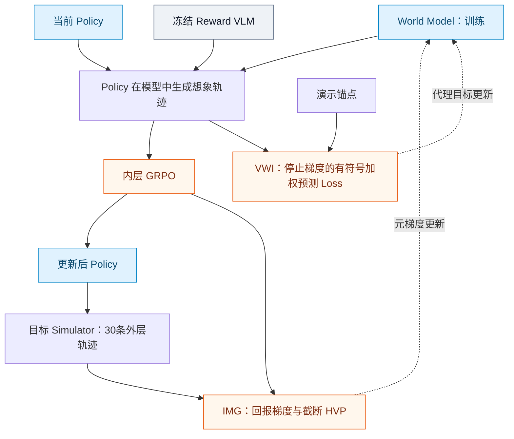

**怎样训练**：内层在想象中更新 Policy；IMG 外层检查这个新 Policy 在目标仿真中的回报，再通过内层更新估计 World Model 元梯度。VWI 则用访问度、优势与置信度对演示预测误差加权，不额外做 IMG 的外层采样。图中 Simulator 输出用于估计，不表示对物理引擎直接反向传播。〔E3；§3、D〕

### 3.2 数据与指标

| 项目 | 论文披露 |
|---|---|
| 模型 | π0-3B；OpenVLA-7B复核；Ctrl-World1.2B；冻结 Qwen3-VL-4B Reward Model |
| 数据／环境 | LIBERO-Long10任务×50演示；CALVIN ABC→D；约20项 RoboCasa 原子任务；MT50；Simpler Bridge V2／Google Robot |
| 默认预算 | IMG每个外层步骤增加30条目标 Simulator Episodes；内层 GRPO Group8；想象 H50、Action Chunk16、截断 K2 |
| LR／Batch | Policy／World LR通常10⁻⁵／5×10⁻⁶；RoboCasa为8×10⁻⁶／4×10⁻⁶；Batch有512／384的分基准设置，须按D.7逐项读取 |
| Seeds | 主结果5次训练随机重复；消融3次 |
| 算力 | 24×H20；17,040 GPU-hours为多基准／骨干／Seed合计，不是单 Run；其中外层3,840 |
| 指标 | 任务 SR；像素 MSE（表中单位10⁻³）；ESNR与 Policy-Utility Residual 为诊断 |
| 结果 | 五列 SR算术均值：WMPO59.40%→IMG72.52%；同时 MSE8.4→9.8 |
| 缺项 | 总外层迭代数、部分数据量／拆分、主评测 Episode 数；Table1 CALVIN SR未明确定义链长度 |

**讲解重点〔E3：分析〕**：不能把 CALVIN83.1%自动标成 SR5。Sim-PPO 对照匹配外部 Simulator Episode 预算，不代表墙钟、GPU计算或更新次数都相同。

## 4. AtomicRL：按语义边界分配长程信用

来源：[v1 §3–4、Appendix A.2–A.4](https://arxiv.org/html/2610.30097v1)。事实为 E3。

### 4.1 训练流程

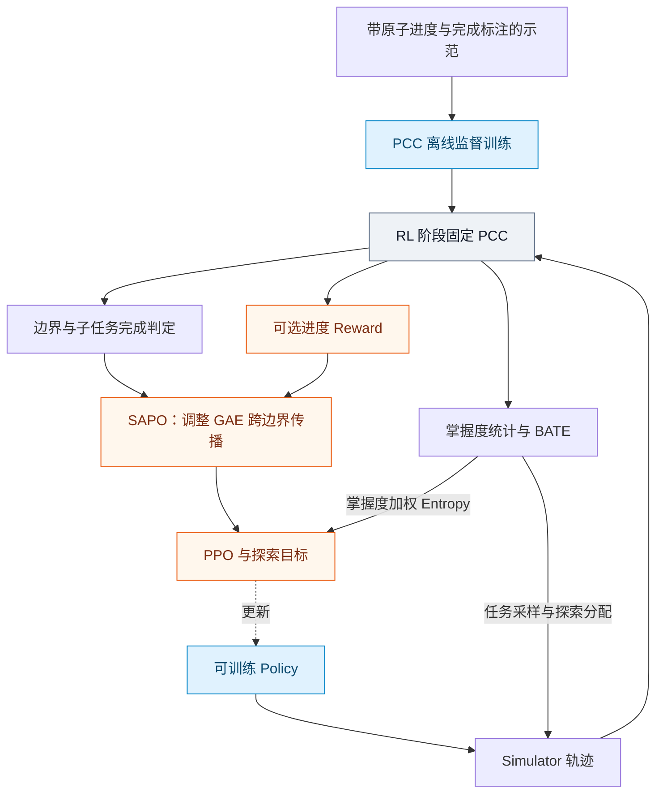

**怎样训练**：先从监督数据训练 PCC，再固定它识别 Rollout 中的边界与完成情况。SAPO 调整 GAE Trace，失败边界可用κ＝0.3衰减，一步 TD／Bootstrap 保留；BATE 将完整任务采样和局部探索偏向未掌握的子任务。PCC 不与 Policy 共同 RL。〔E3；§3〕

### 4.2 数据、预算与评测

| 项目 | 论文披露 |
|---|---|
| 底座 | π0.5／OpenVLA-OFT；Policy 内部冻结清单未披露 |
| PCC | 冻结约400M SigLIP；训练时序／预测模块；进度与完成监督 Loss；RL阶段整体固定 |
| 标注数据 | LIBERO150条轨迹；真机任务各50条 PCC 标注；真机 SFT各100条，二者是否重叠未披露 |
| 环境 | LIBERO-Long、CALVIN ABC→D；真机任务在重建 Simulator 中 RL 后部署评测 |
| 训练 | 每 Run 200个优化迭代；8×H200；推理1×RTX5090 |
| 评测 | LIBERO10任务×50次；CALVIN1,000条链，SR1–5／Avg. Len.；3项真机任务各25次／方法 |
| 结果 | π0.5 Long：PPO95.4%→99.0%；CALVIN SR5：70.6%→80.1%；真机平均61.3%→69.3% |
| 缺项 | LR、Batch、环境交互量、训练 Seed 数、Chunk长度、墙钟成本未披露 |

**讲解重点〔E3：分析〕**：200个优化迭代不等于200次环境交互，每迭代 Optimizer 的实际调用数未披露。PCC 的额外标注与推理开销属于方法成本。弱初始化消融的91.2%不能与主表99.0%直接相减。

## 5. TEMPO：两个 TD3 回路怎样共同学习

来源：[v1 §III–IV](https://arxiv.org/html/2608.07314v1)。事实为 E3。

### 5.1 模型结构与两条更新路径

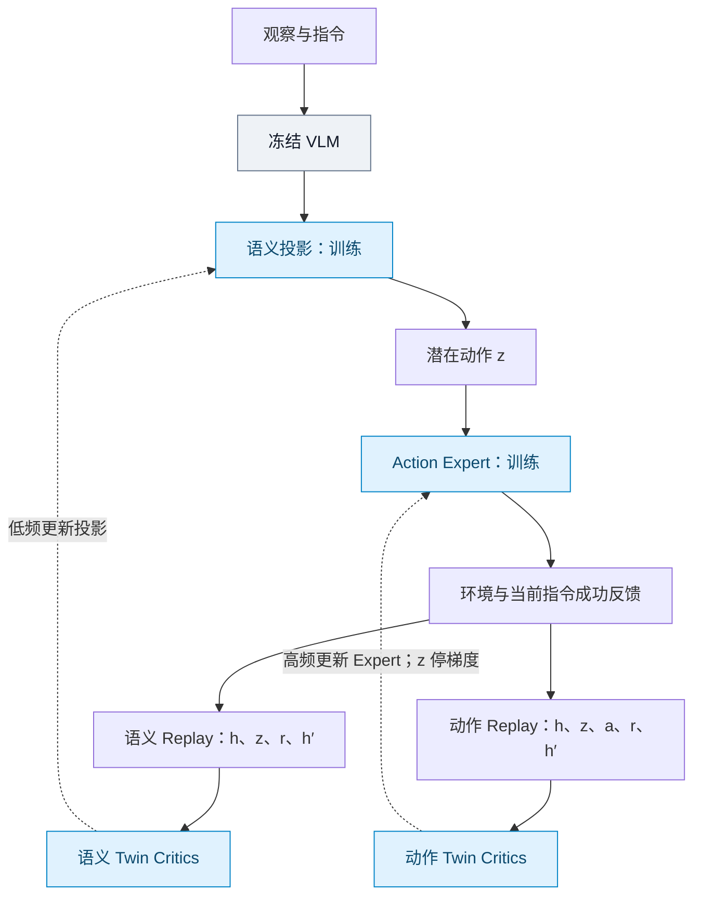

**怎样训练**：同一交互写入两套 Replay。语义 Critic 评价(h,z)，动作 Critic 评价(z,a)；Action Actor 更新时重算并停止投影的梯度，Critic 更新使用回放 latent。两边各自做 TD3，Actor 梯度不穿到另一模块。语义更新较慢，底座始终冻结。〔E3；§III〕

### 5.2 训练详表

| 项目 | 论文披露 |
|---|---|
| 模型 | FLOWER；具体完整底座配置未披露 |
| 数据／划分 | CALVIN ABC训练、D评测，五指令链；真机两任务各60条示范 |
| Reward／终止 | 当前指令成功1，否则0；指令终止停止 Bootstrap，不跨到下个指令 |
| 方法 | 双 TD3；独立 Buffer、Twin Critics、Target Networks、Optimizers |
| 更新频率 | 动作:语义＝5:1效果最好；另比较1:1、10:1；绝对更新次数未披露 |
| CALVIN结果 | FLOWER-RL SR5 78.4%／Avg.Len4.51；TEMPO81.7%／4.59 |
| 真机评测 | 3个独立随机 Seed；每 Checkpoint 每 Seed20次；报告二元成功奖励之和与标准差 |
| 缺项 | 模拟评测次数／训练 Seeds、LR、Batch、总交互、Chunk、GPU与时间未充分披露 |

**讲解重点〔E3：分析〕**：34任务的 Task-set Size 指可用于更新的子任务种类，不是链长。双回路1:1与5:1的差别支持频率值得研究，不能将5:1推广为通用常数。

## 6. DeepThinkVLA：从 CoT 数据到 Reasoning–Action RL

来源：[v3 §3–4、A.2–A.3](https://arxiv.org/html/2511.15669v3)；[官方仓库](https://github.com/OpenBMB/DeepThinkVLA)。文献为 E3；静态脚本另列。

### 6.1 两阶段训练及真机证据的分界

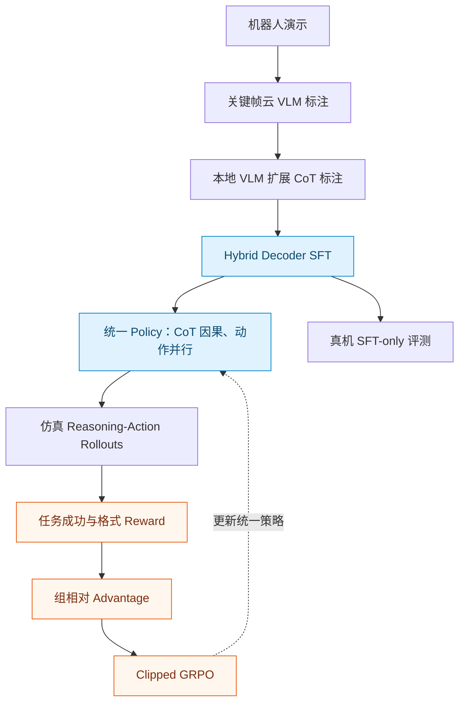

**怎样训练**：先构造图像／指令／CoT／动作监督，再用混合注意力 SFT。之后在仿真中生成完整推理与动作轨迹，让 Outcome Reward 通过组优势驱动策略更新。图中的真机支路直接来自 SFT，不能从 RL 结果连过去宣称已验证真机 RL。〔E3；§3、§4.3〕

### 6.2 论文训练卡〔E3〕

| 项目 | 原文披露 |
|---|---|
| 底座／动作 | π0-FAST初始化、约2.9B；动作2048 Bins；CoT因果生成，Action Slots双向并行 |
| 标注数据 | LIBERO273,465帧、RoboTwin2,847,856帧 CoT；是 Frames，不是 Episodes |
| SFT | Batch128、LR2.5×10⁻⁵、150k Steps；Token CE |
| RL | 仿真 On-policy GRPO；任务成功＋小额格式 Reward；Mini-batch128；Clip Low0.2／High0.28；论文写有 SFT Reference KL |
| Chunk／算力 | LIBERO动作块10×7维；RoboTwin14维；8×A800 |
| 评测 | LIBERO每任务50随机初态；LIBERO-Plus零样本；真机3任务各20次，全部 SFT-only |
| 结果 | LIBERO97.0%；Plus79.0%；RoboTwin59.3%；Long SFT94.2%→RL96.2% |
| 缺项 | 逐层冻结清单、完整数据拆分、独立训练重复数、RL总 Episodes、总墙钟时间未明确披露 |

### 6.3 已发布 Launcher 与论文不能混成一套配置

固定源码 ff271e7c024422581c9875d96250f99dd0b743d1：

| 证据 | 静态配置事实 | 边界 |
|---|---|---|
| [RL脚本](https://github.com/OpenBMB/DeepThinkVLA/blob/ff271e7c024422581c9875d96250f99dd0b743d1/scripts/run_deepthinkvla_rl.sh)〔E2〕 | Batch64、每组8；LR2×10⁻⁶；Mini128；PPO Epochs2；Total Epochs100 | 是公开启动配置，未认定为全部论文实验实际值 |
| [KL Loss开关:67](https://github.com/OpenBMB/DeepThinkVLA/blob/ff271e7c024422581c9875d96250f99dd0b743d1/scripts/run_deepthinkvla_rl.sh#L67)〔E1/E2〕 | use_kl_loss=False，系数0 | 与论文 KL 描述不一致 |
| [Reward KL开关:94](https://github.com/OpenBMB/DeepThinkVLA/blob/ff271e7c024422581c9875d96250f99dd0b743d1/scripts/run_deepthinkvla_rl.sh#L94)〔E1/E2〕 | use_kl_in_reward=False，系数0 | 实际运行是否覆盖参数需另有运行配置证明 |

**讲解重点〔E3：分析〕**：Plus 的 SFT79.1%→RL79.0%，不能把 Plus 相对其他模型的全部优势归给 RL；单个 Launcher 的 Seed 也不构成多次独立训练。

## 7. WAM-RL：两种目标共同适配 World 与 Actor

来源：[v1 §3–4](https://arxiv.org/html/2606.17906v1)。事实为 E3。

### 7.1 架构与数据回流

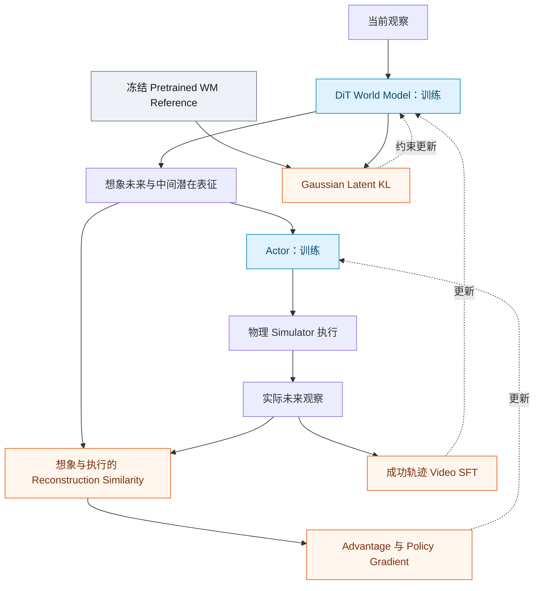

**怎样训练**：Actor 从想象潜在表征产生动作，仿真执行后比较预测与实际未来，作为 Actor 学习信号；成功轨迹另行监督 World。KL 使用冻结预训练 Reference 稳定潜在表征。因此两端共同适配，但 Loss 和更新机制不同，不是同一任务 Policy Gradient 穿透两端。〔E3；§3〕

### 7.2 训练详表

| 项目 | 论文披露 |
|---|---|
| 结构 | Genie Envisioner-ACT；DiT视频 World；Actor消费中间 latent；未声称独立 VLM 也更新 |
| World目标 | 成功 Online Trajectories 的 Video SFT＋λKL×Latent KL |
| KL构造 | Deterministic latent作为Gaussian均值；当前对角协方差用 EMA统计；冻结 Reference 协方差固定 |
| Actor目标 | 重建相似性→Advantage→Policy Gradient；试 Pixel／Flow／DINO／V-JEPA2；具体随机化与似然计算实现未披露 |
| 数据／环境 | LIBERO-Object、RLBench Water Plants；主实验为仿真；未给演示数与划分 |
| 算力 | 8×A800、8小时混合训练；是否覆盖多个 Run 的口径不清 |
| 结果 | Base／Actor-only／完整方法：LIBERO68／78／82%；Water Plants19／18／22% |
| 缺项 | LR、Batch、Steps、Seeds、Chunk、评测 Episodes、Reward数值映射、Advantage估计细节、KL系数及EMA衰减未披露 |

**讲解重点〔E3：分析〕**：Table2 Pixel MSE 的21%与主表22%没有配置解释，不能自行当成 Video SFT 的1点贡献。“实际环境观察”在本文不等于真机证据。

## 8. RECAP／π*0.6：Value 与优势条件化怎样训练

来源：[论文 §III–VI、A-F](https://arxiv.org/html/2511.14759v1)；[官方说明](https://pi.website/blog/pistar06)。事实为 E3。

### 8.1 经验闭环

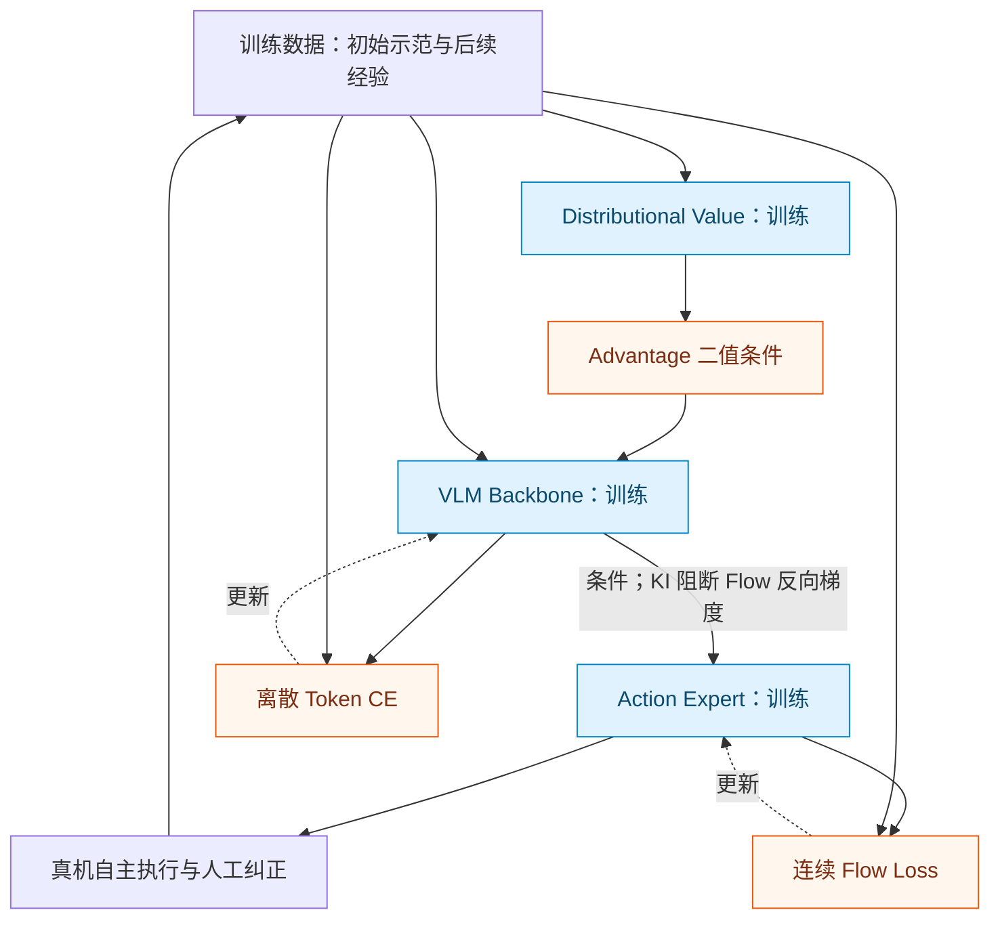

**怎样训练**：先在示范上训练回报分布，再估计 Advantage，为 Policy 输入增加优势条件；收集自主执行与纠正后重新训练 Value／Policy。图中 KI 是前向条件接口处的反向梯度约束，VLM 仍由自身 Token 目标学习。优势条件化可使用 CE／Flow 形式的 Loss，但标签与条件由回报学习产生，不能据 Loss 外形把它当成单纯模仿。〔E3；§IV–V〕

### 8.2 数据、目标与成本

| 项目 | 原文披露 |
|---|---|
| 模型 | Gemma3 4B＋860M Flow Expert；独立 Value 的 VLM约670M；KI不等于冻结底座 |
| 阶段 | 多任务 Offline RL预训练→目标 SFT（正条件）→自主／纠正采样→聚合→从预训练 Checkpoint重新微调 |
| Value | 201-Bin Monte Carlo Return 分类；后训练 Advantage使用 n-step50；不是 Action Chunk50 |
| Reward | 非终点−1，成功终点0，失败终点−C_fail；按最长 Episode归一化；无折扣 |
| Policy | Advantage条件＋离散CE／连续Flow；Indicator Dropout30%；默认推理β＝1；PPO为对照 |
| 数据例子 | 洗衣每轮300自主轨迹／4机器人；咖啡414自主＋429纠正；多样洗衣450评估＋287纠正 |
| 指标 | Throughput＝成功任务／小时；人工任务结果 SR；箱子另报分阶段 SR |
| 效果 | 困难洗衣／咖啡相对 Offline RL＋SFT吞吐量可超过2倍、失败约减半 |
| 缺项 | LR、Batch、训练步数、硬件／训练墙钟、完整拆分与独立训练 Seed 数未披露 |

**原文口径差异〔E3〕**：装箱正文将每轮600条写为自主轨迹，A-F称为 Demonstrations；不无注合并。“30% percentile”与附录“约30%示范为 Positive”也不能直接视为同一阈值定义。连续制作咖啡13小时是部署展示时长，不是训练耗时。

## 9. RLT：紧凑接口与轻量 Off-policy RL

来源：[v1 §III–VI、Appendix B](https://arxiv.org/html/2604.23073v1)；[官方说明](https://www.pi.website/research/rlt)。事实为 E3。

### 9.1 哪些阶段更新，哪些阶段冻结

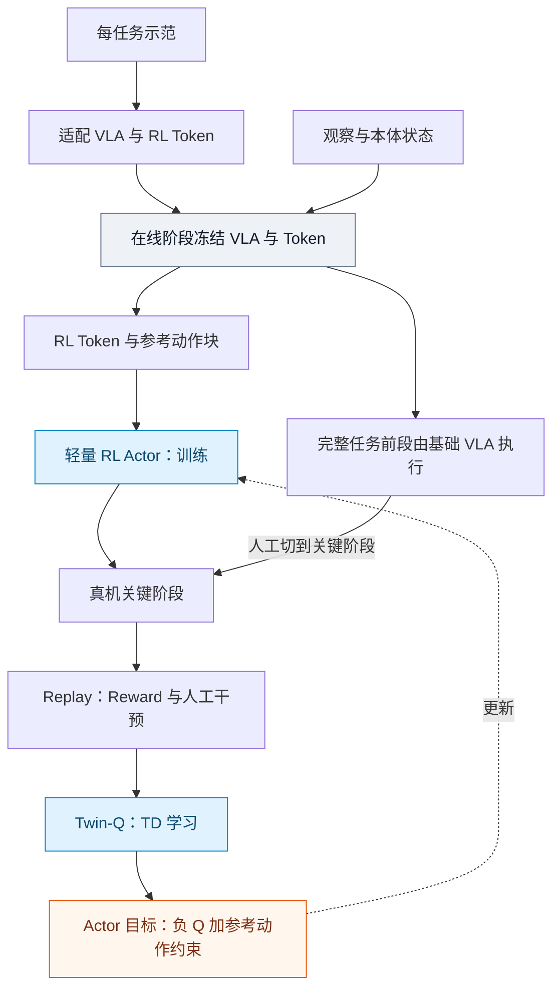

**怎样训练**：先让 RL Token 重构丰富内部表示，形成小型在线策略的状态接口。之后冻结大模型，通过真实交互更新小 Actor／Twin-Q；Actor 输入参考动作而不是从零探索。采用 TD3-style 双 Q Target 与参考动作正则，没有据此认定为 SAC；不需要 PPO 式 Old／New Ratio。〔E3；§IV〕

### 9.2 训练详表

| 项目 | 原文披露 |
|---|---|
| 数据前提 | 每任务1–10小时遥操作示范；先适配 VLA／Token 2,000–10,000 Gradient Steps |
| 在线数据 | 400–1,000 RL Episodes；有效机器人数据约15分钟–5小时，另计示范、Reset与其他开销 |
| Reward／干预 | 人工终局成功＋1，否则0；人工可纠正并负责关键阶段切换 |
| Actor Loss | −Q＋β‖a−aVLA‖²；Twin-Q取较小 Target；Chunk TD Backup |
| 超参 | UTD5；Critic:Actor更新2:1；Reference Dropout50%；通常 MLP2×256，螺丝为3×512 |
| Horizon | VLA预测50；RL Chunk10×14维；控制50Hz；训练采样Stride2 |
| 评测 | 4项精密操作各50次关键阶段评测；完整任务仅螺丝／扎带另测 |
| 指标 | 成功率与成功数／10分钟；关键阶段可约3倍提速，不能推广成完整任务都3倍 |
| 缺项 | LR、Batch、γ、β、Warmup数量、GPU、训练计算时间、独立训练 Seed、完整划分未披露 |

**讲解重点〔E3：分析〕**：有效数据时长、训练墙钟、示范准备时间是三笔账；参考动作条件化也不等于简单相加一个固定比例 Residual。

## 10. SyVLA：共同 Policy 更新与辅助 CoT 监督

来源：[v1 §3–4、Appendix A/C](https://arxiv.org/html/2606.09009v1)；[官方代码](https://github.com/sy-vla/syvla)。事实为 E3；发布配置另列。

### 10.1 模型与训练路径

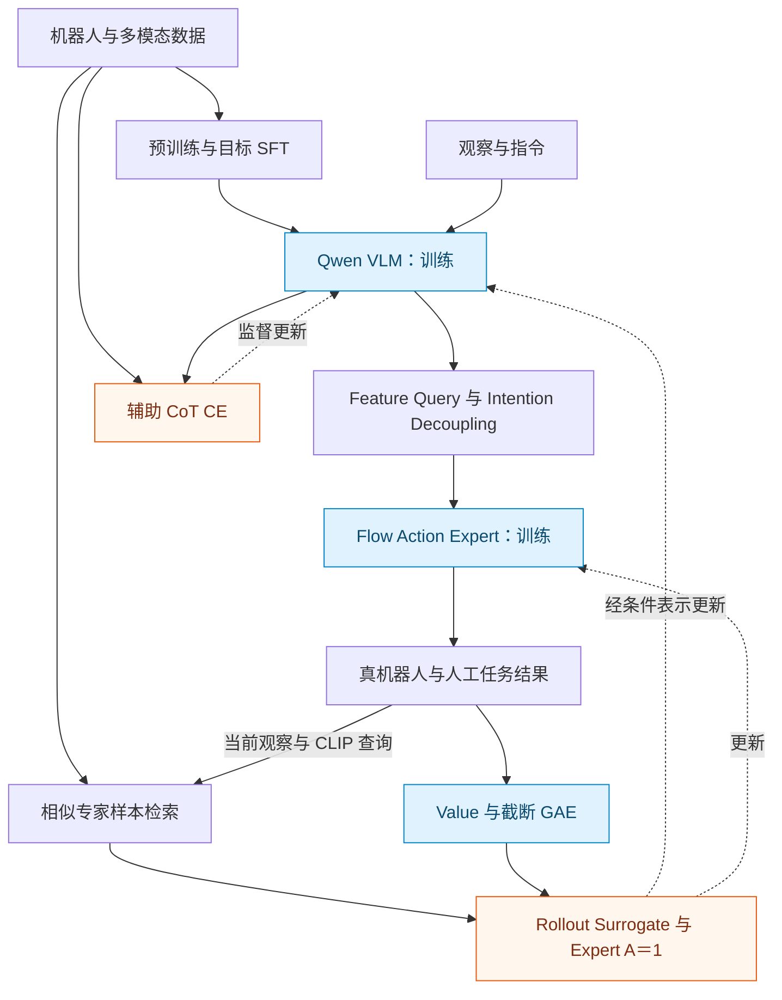

**怎样训练**：大规模机器人／多模态预训练后做任务 SFT；再采真机轨迹，用 Value 与 GAE 学动作，同时混入相似专家样本和 CoT 辅助监督。显式 CoT 的 CE 与任务奖励的动作 Surrogate 是不同目标；不能把图中两条更新路径统称为“所有推理 Token 的共同任务 Policy Gradient”。〔E3；§3与源码〕

### 10.2 论文训练卡〔E3〕

| 项目 | 原文披露 |
|---|---|
| 模型 | Qwen2.5-VL-3B＋约0.69B Flow Expert＋SigLIP；20 Feature Queries；Chunk50 |
| 预训练数据 | 约450小时机器人数据：OXE／RH20T子集＋少量自采；约1%带 CoT；正文／附录混合比口径有差异 |
| 预训／SFT | 32×H200约1.5天／8×H100约6–18小时；Batch512／32；Peak LR10⁻⁴／3×10⁻⁵ |
| 目标任务数据 | 每任务数百演示；精确数、划分未披露 |
| RL | 人工成功0–1；相似 Expert A＝1，Rollout GAE截断±0.8；约100M Value先做 Monte Carlo Warmup |
| RL采样 | 每任务最多10个作者称“RL Episodes”的批次，每批最多20条 Trajectories；不等于仅10条轨迹 |
| 评测 | 三真机任务14／28／14次；报告 ID／OOD；另有5 Random Seeds但未说明是否完整独立重训 |
| 结果／边界 | ID／OOD均值0.73／0.64；LIBERO附录结果是 SFT后评测，不计作 RL 成绩 |
| 缺项 | 论文 RL 的LR、Batch、优化更新数、执行／重规划长度、正式成功阈值未充分披露 |

### 10.3 静态示例配置与实现边界

固定源码 1b4ca0b251f5089752addd299358285e8e140b92：

| 证据 | 已发布内容 | 如何使用 |
|---|---|---|
| [示例 RL JSON](https://github.com/sy-vla/syvla/blob/1b4ca0b251f5089752addd299358285e8e140b92/config/rl_config/fold_shirt_n200.json#L7)〔E2〕 | 更新500；Chunk50；Batch4；Policy／Value LR＝5×10⁻⁵／10⁻⁴；λ0.95；CoT系数0.01；Rollout Batch7 | 是示例配置，不能替代论文实际运行配置 |
| [策略项实现:64](https://github.com/sy-vla/syvla/blob/1b4ca0b251f5089752addd299358285e8e140b92/syvla/models/rl/modeling_rl.py#L64)〔E1〕 | 对当前 Surrogate 的 exp直接裁剪，此处没有显式 Old／New Ratio | 应写作者 PPO 变体；不认定为标准 PPO 或精确最终动作密度 |
| [官方 README](https://github.com/sy-vla/syvla/tree/1b4ca0b251f5089752addd299358285e8e140b92#pretrain)〔E3〕 | 预训写8×8 H100 | 与论文32 H200口径不同，不合并成一套成本 |

## 11. 把不同训练方法放在同一张表里

| 工作 | 核心学习信号 | 更新对象 | 环境／数据主来源 | 最需要检查的训练边界 |
|---|---|---|---|---|
| π_RL | PPO＋随机生成路径概率＋GAE | 主配置 Action Expert；可选 VLM LoRA | 演示＋物理仿真 | 采样路径、H/H′/K、训练／部署差异 |
| Z-1 | 组相对 Clipped GRPO | Expert或选择性 VLM＋Expert | RoboCasa演示与分叉仿真 | Mask前缀、模块选择、评测样本数 |
| DRILL | 想象 GRPO＋World代理／元梯度 | Policy与World | 演示、想象、少量外层Simulator | 额外外层预算与World用途 |
| AtomicRL | PPO＋语义 GAE门控／探索 | Policy；PCC固定 | 标注示范＋物理仿真 | PCC监督成本与跨阶段依赖 |
| TEMPO | 两套 TD3 | 投影与Expert；VLM固定 | 示范＋真实／仿真交互 | 绝对更新量与Stop-Gradient |
| DeepThinkVLA | CoT SFT＋Outcome GRPO | 统一 Reasoning–Action Policy | CoT标注＋仿真 | 真机仅SFT、论文与Launcher KL差别 |
| WAM-RL | Online Video SFT＋Latent KL＋Actor PG | World与Actor不同目标 | 成功轨迹＋仿真执行 | Reward标定、潜在漂移与披露缺项 |
| RECAP | Distributional Value＋Advantage条件化 | Value与VLA，多目标KI隔离 | 示范、自主执行、人工纠正 | 价值误差、数据成本与阈值定义 |
| RLT | Twin-Q Actor–Critic＋参考动作约束 | 小Actor／Critic；VLA固定 | 任务示范＋真机关键阶段 | 数据时长、墙钟、阶段选择 |
| SyVLA | 动作Surrogate＋Value＋辅助CE | VLM与Flow Expert | 大规模多模态＋真机与专家检索 | 非标准Ratio、示例配置与论文差异 |

本表为原文机制的归类〔E3〕，不是性能排名。训练算法、参数规模、数据预算、环境与成功判定不相同，不能只比较主表最高成功率。

## 12. 讲解与复现前应带走的检查单

1. **先解释输入、模块与输出，再解释 Loss。** 区分观察到的状态、预测的未来、真正执行的动作和用于更新的样本。
2. **把数据按单位列清楚。** 示范小时、Episode、Frame、Window、Chunk、有效在线时间分别记录。
3. **先看同初始化对照。** SFT→RL、Action-only→Joint、标准→新Advantage是不同实验问题。
4. **不要替论文补超参。** 写“未披露”比默认为 AdamW／SAC／三次训练更准确。
5. **代码、配置与运行证据分开。** Launcher或JSON只能说明发布配置；要认定论文实际值，还需配置快照或日志。
6. **主指标与诊断分开。** Task SR／Throughput证明行为；KL／Value／Pixel Loss辅助解释；不能互相替代。

以上为本文的审阅口径〔E3：分析〕。所有图都围绕公开研究的机制，没有加入具体项目的迁移方案。
