# 具身 RL 重点研究综合报告：架构、训练方法与实验证据

版本：v1.0｜原始调研：2026-10-30｜整合修订：2026-11-03（Asia/Singapore）

本文将研究分析、训练详表和静态图册整合为同一条阅读路径。每项研究按“研究问题 → 架构与训练 → 数据与配置 → 实验与消融 → 洞察与局限”展开；架构图和训练数字放在对应章节，无需在三份材料之间切换。选篇依据是领域研究价值与证据，不以具体项目或硬件适配性筛选。

**资料边界**：沿用2026-10-30已核验的论文版本、官方文档及锁定源码；本次是编辑整合，没有重新检索11月新增文献，也未开展训练或数值复现。效果为作者报告。E1＝锁定源码行号；E2＝配置；E3＝论文／官方文档／明确标注的分析；E4＝未核转述。下文事实表默认E3，源码／配置单列E1／E2；分析与图示均为E3，不以E4支持结论。

**图的读法**：11张图均为根据原文整理的讲解示意，不是作者原图或逐层实现图。实线表示计算／数据传递，虚线表示参数更新关系，不自动表示梯度穿过沿途全部模块；灰色为固定模块，蓝色为可训练模块，橙色为奖励／目标。正文直接显示PNG，并在图下保留SVG、独立源码和可展开的Mermaid。

## 0. 研究地图与阅读主线

理解当前具身RL，先区分三种Policy Improvement：直接优化生成策略、用Value／Advantage提取更好策略、冻结大模型后训练轻量在线策略。由此再讨论哪些模块共同更新、推理是否影响控制、World Model怎样提供学习信号，以及长程奖励怎样传播。这样可以避免用“是否联合”一个标签覆盖所有方法差异。〔E3：综合分析〕

| 阅读阶段 | 研究 | 核心问题 | 本文位置 |
|---|---|---|---|
| 三条基础路线 | π_RL | Flow Policy怎样做直接RL；联合是否必要 | [§2](#pi-rl) |
| 三条基础路线 | RECAP／π*0.6 | 怎样从自主执行与纠错经验提取改进策略 | [§3](#recap) |
| 三条基础路线 | RLT | 怎样以有限真机交互训练轻量在线策略 | [§4](#rlt) |
| 联合更新 | Z-1 | 什么时候解冻VLM，怎样控制组内比较条件 | [§5](#z1) |
| 联合更新 | SyVLA | VLM与Flow Expert共同优化的实际梯度路径 | [§6](#syvla) |
| 联合更新 | TEMPO | 不同模块怎样用独立Critic与不同频率协调 | [§7](#tempo) |
| 推理与动作 | DeepThinkVLA | CoT是否实际参与控制，怎样做Outcome RL | [§8](#deepthinkvla) |
| 世界模型 | DRILL | World Model应追求预测准确还是下游学习效用 | [§9](#drill) |
| 世界模型 | WAM-RL | 预测表征与Actor怎样用不同目标在线适配 | [§10](#wam-rl) |
| 长程训练 | AtomicRL | Advantage应怎样跨语义边界传播 | [§11](#atomicrl) |

若时间有限，先读π_RL、RECAP、RLT，再根据问题进入后续章节。十项工作解决的问题、数据预算与环境不同，本文不按最高成功率排统一名次。〔E3：阅读建议〕

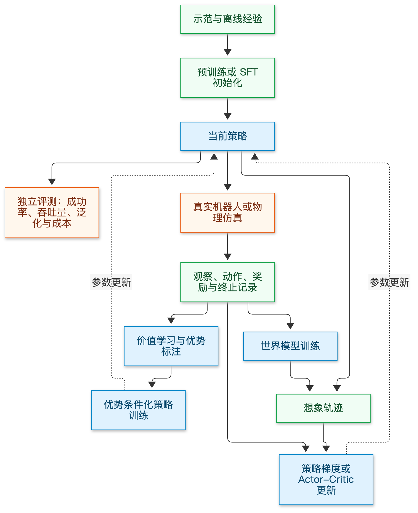

[SVG 矢量图](assets/rl-training-diagrams/00-training-map.svg) · [独立 Mermaid 源文件](assets/rl-training-diagrams/00-training-map.mmd)

展开 Mermaid 源码

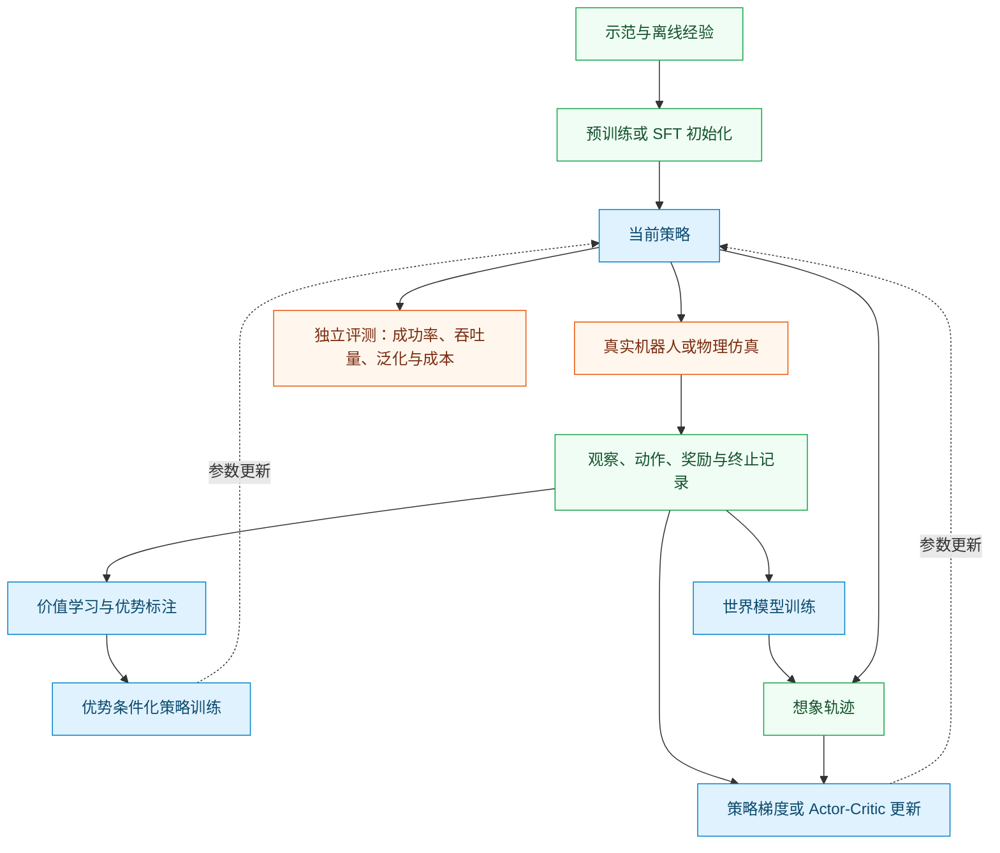

本图汇总多种路线，不表示每篇都包含全部分支。前面三条路线分别落在直接策略更新、优势条件化和轻量Actor–Critic上；DRILL将学习世界模型放入想象训练闭环。〔E3：归类〕

## 1. 比较之前：统一模块、指标与预算口径

### 1.1 “联合”究竟联合了什么

| 符号／对象 | 功能 | 需要单独核查什么 |
|---|---|---|
| VLM／语义表征 | 从观察与指令提取任务相关信息 | 底座是否冻结；Adapter 是否更新；有没有显式 Planner |
| World Model | 提供未来状态／视频／动力学信息 | 作为外部训练环境，还是 Policy 内部的预测分支 |
| Action Policy／Expert | 将条件信息映射为动作或 Action Chunk | 输出形式、探索方式、实际执行长度与学习目标 |
| Critic／Reward／Progress Model | 评估任务收益、价值或进度 | 谁监督它；训练时是否固定；是否额外消耗标注 |

判断一项工作时，依次核查：任务反馈最终改变哪些参数；通过同一Loss、独立Critic、在线SFT还是元梯度更新；数据来自真机、物理仿真还是学习模型；对照是否控制初始化、交互量与计算；结论覆盖单任务、多任务、仿真还是真机。〔E3：分析框架〕

特别注意：DRILL的World Model是Policy的学习环境；WAM-RL的World Model向Actor提供预测表征。两者优化对象的用途不同，Loss不能直接互换。

### 1.2 训练指标与计量单位

| 名称 | 怎样理解 | 常见误读 |
|---|---|---|
| Task Success Rate，SR | 成功评测 Episode／总评测 Episode；多任务平均还需说明权重 | 训练 Reward 均值不一定等于 SR；多任务宏平均不等于直接合并样本 |
| CALVIN SRk | 从链首连续完成前 k 个指令的比例 | 不是任意 k 个子任务的独立成功率 |
| Avg. Len. | 连续完成的前缀长度均值；对五任务链等于 SR1–SR5 的概率值之和 | SR 用百分数时求和后还需除以 100 |
| Throughput | 单位时间完成的成功任务数 | 同时受动作速度、失败／恢复、复位和计时边界影响 |
| Value／Explained Variance／KL | 学习过程诊断 | 单独改善不证明实际任务表现改善 |
| Policy Loss | 特定符号、归一化与目标下的数值 | 不同算法之间的正负与大小通常不能直接排名 |
| Demonstration／Trajectory | 一条演示或轨迹；必须说明是否完整 Episode | 不能与视频帧、滑窗样本、Action Chunks 互换计数 |
| Training Seed | 独立训练的随机重复 | 多个评测初态或 Evaluation Seeds 不等于多次独立训练 |

这些是本文的分析口径〔E3〕；若某论文使用特殊定义，应以其原文为准。尤其是 DRILL 的 CALVIN 汇总 SR 未明确链长度，不能自动改标 SR5。

### 1.3 动作与学习的不同时间尺度

| 符号 | 含义 |
|---|---|
| H | 一次预测的动作长度，Prediction Horizon |
| H′ | 新观察前实际执行的长度，Execution／Replan Horizon，通常 H′≤H |
| K | 一次动作生成内部的去噪步数，Denoising Steps |

长程任务的环境步数、一次预测 H、实际执行 H′、内部去噪 K、Value 的 n-step backup，都是不同量。下文不会把 RECAP 的 n-step＝50写成动作长度50。〔E3：计量说明〕

### 1.4 放回已有Policy RL谱系

直接优化VLA并非从Flow模型才开始。[RIPT-VLA](https://arxiv.org/html/2505.17016)使用稀疏成功奖励、动态采样与Leave-One-Out优势估计；[SimpleVLA-RL](https://arxiv.org/html/2509.09674)将GRPO、交互采样与并行工程用于VLA后训练。它们是直接Policy RL的重要参照；动作表示与π_RL不完全相同，不能将不同模型上的成绩视为同一受控比较。〔E3：原文〕

以下先从π_RL建立生成策略直接优化的参照，再转向不依赖同一路径概率更新的RECAP与RLT。

## 2. π_RL：为Flow Policy建立可计算的RL更新

来源 S1：[论文 v3](https://arxiv.org/html/2510.25889v3)，重点 §4、§5.4、Appendix F.2/G/J；[官方模型训练文档](https://rlinf.readthedocs.io/en/release-v0.3/rst_source/examples/embodied/pi0.html)。

### 2.1 研究问题

Flow Sampler的最终动作密度难以直接用于PPO。π_RL首先解决随机采样路径与策略概率的对应，再检验冻结和联合更新的差异。它提供本报告的直接Policy RL基准。〔E3；S1 §4、F.2〕

### 2.2 架构与训练流程

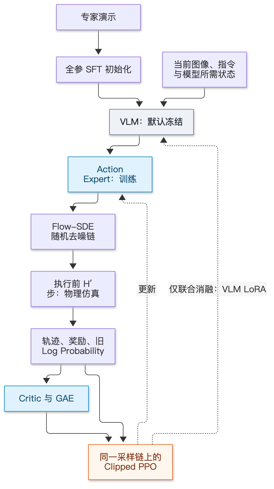

[SVG 矢量图](assets/rl-training-diagrams/01-pi-rl.svg) · [独立 Mermaid 源文件](assets/rl-training-diagrams/01-pi-rl.mmd)

展开 Mermaid 源码

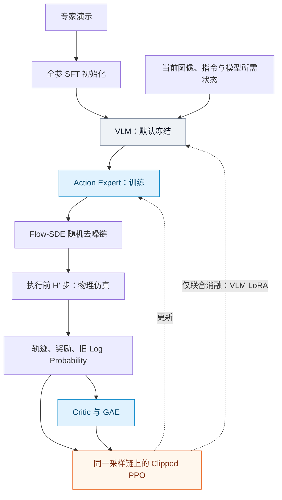

先用演示得到可用 Policy，再采集随机策略 Rollouts。保存去噪链与旧概率，更新时对同一链重算新概率，结合 GAE 做 PPO。概率针对扩展采样路径／转移；不能直接当成最终动作边缘密度。Flow-Noise 是另一变体，额外学习噪声网络并同时更新 Velocity，默认冻结的仍是 VLM。〔E3；§4〕

### 2.3 数据、训练配置与评测协议

| 项目 | 论文披露 |
|---|---|
| 底座／更新 | π0／π0.5；SFT 全模型，RL 默认训练约300M Action Expert、冻结 VLM；另有 VLM LoRA 消融 |
| LIBERO 数据 | π0 用58条初始化 Spatial／Object／Goal，Long 用208条；π0.5 用40条统一初始化 |
| 其他数据 | ManiSkill：16,384条规划器演示／4,352种任务组合；CALVIN：ABC约24小时／超过20,000条语言标注轨迹，D评测；MT50：2,500条演示 |
| 奖励 | LIBERO／MT50成功0–1；CALVIN完成子任务给1；ManiSkill放置1、抓附0.1 |
| LIBERO RL | 500 Epochs；Global Batch 2048；Actor／Critic LR＝5×10⁻⁶／10⁻⁴；64环境×8 Rollout Epochs；γ＝0.99、λ＝0.95、Clip＝0.2 |
| Horizon | π0预测50；π0.5预测10；两者执行5／5／5／10，按 Spatial／Object／Goal／Long 排列 |
| 硬件 | 8×H100 80GB；总 GPU-hours 未披露 |
| 评测 | 每 LIBERO Suite 为10任务×50初态；CALVIN为1,000条五指令链，报告 SR1–5与 Avg. Len. |
| 缺项 | 独立训练重复数、精确 Few-shot 样本ID、完整墙钟成本未披露 |

### 2.4 结果与联合消融〔E3〕

LIBERO四Suite平均：π0.5 SFT77.1%→Flow-SDE97.9%／Flow-Noise98.3%。这是默认冻结VLM的主配置，不能计为VLM联合训练成绩。

F.2另在π0＋Flow-SDE、LIBERO-Long上比较：

| 配置 | VLM | Action Expert | 学习率 | 每 Epoch 更新次数 |
|---|---|---|---:|---:|
| Frozen | 冻结 | 全参训练 | 5×10⁻⁶ | 4 |
| LoRA-I | r＝32，α＝32 | 全参训练 | 5×10⁻⁶ | 4 |
| LoRA-II | r＝32，α＝32 | 全参训练 | 1×10⁻⁶ | 2 |

LoRA-II曲线与冻结组相当，原文未给联合消融精确终值表；它同时改变学习率和更新次数，不能将差别只归于解冻。证据支持联合更新更敏感、该设置收益不明显，不支持联合普遍无效。

### 2.5 怎样理解方法价值〔E3：分析〕

它首先解决的是“如何让连续生成策略的 RL 更新有明确含义”。即使 ODE 从随机噪声开始，最终输出也不会自动拥有易算的 Log Probability。要做 PPO，必须知道 Rollout 采样过程、保存的随机变量、Old Log Probability 与训练时重算的 Current Log Probability 是否描述同一件事。

因此，在讨论“让更多模块一起学”前，至少先把三个对象对应起来：生成过什么动作、机器人实际执行了什么、Loss 正在奖励什么。若执行只取 Chunk 前几步，训练却不加区分地把所有预测维度都算作已执行动作，联合更多参数也不会自动修复这种目标错配。

它的另一个价值是提供强冻结基线。若冻结 VLM 已经能充分表示目标任务，Action Expert 还有很大改进空间，那么联合更新可能只增加方差与成本。只有动作模块持续受限于上游信息，解冻才有清晰动机。这是一种可检验解释，尚非普遍定律。

训练时随机策略的改善也不自动转化为部署时确定性采样的改善，应分别评测。

### 2.6 发布实现的定点核查〔E1／E3〕

锁定 RLinf commit：c50c60b475654a71533e9c5bacf13ef899a10104。该版本是本次代码检查对象，不等同于论文实验时的冻结版本。

| 位置 | 实际观察 | 对复现的意义 |
|---|---|---|
| [openpi 初始化:286](https://github.com/RLinf/RLinf/blob/c50c60b475654a71533e9c5bacf13ef899a10104/rlinf/models/embodiment/openpi/__init__.py#L286) | train_expert_only 为真时调用 freeze_vlm | 冻结范围是显式工程开关 |
| [RL 前缀计算:134](https://github.com/RLinf/RLinf/blob/c50c60b475654a71533e9c5bacf13ef899a10104/rlinf/models/embodiment/openpi/tasks/rl.py#L134) | 冻结时使用 no_grad；联合时保留前缀计算图 | 只加入 Optimizer 不足以保证梯度能穿过前缀 |
| [转移重算:465](https://github.com/RLinf/RLinf/blob/c50c60b475654a71533e9c5bacf13ef899a10104/rlinf/models/embodiment/openpi/tasks/rl.py#L465) | 重算 Velocity，并在 Flow-Noise 下计算 Noise Head | 不能将 Flow-Noise 误写成只训练噪声附件 |
| [Log Probability 汇总:495](https://github.com/RLinf/RLinf/blob/c50c60b475654a71533e9c5bacf13ef899a10104/rlinf/models/embodiment/openpi/tasks/rl.py#L495) | joint_logprob 路径沿去噪维度取 Mean | 论文路径概率的 Sum 表达与当前实现的 Reduction 不能混写 |

最后一项不单独构成“代码错误”的结论；它要求复现记录写清聚合、归一化与对应优化目标。〔E3：实现解读〕

π_RL通过采样路径概率直接更新策略。下一项RECAP保留生成式训练形式，用价值信息改变策略学习的条件。

## 3. RECAP／π*0.6：从真实经验中提取改进策略

来源 S8：[论文 v1](https://arxiv.org/html/2511.14759v1)，重点 §IV–VI；[官方说明](https://pi.website/blog/pistar06)。

### 3.1 研究问题

RECAP研究通用VLA怎样利用示范、自主执行与人工纠错持续改善。它属于迭代离线RL／Policy Extraction路线，不要求每轮使用在线PPO。〔E3；S8 §IV〕

### 3.2 架构与训练流程

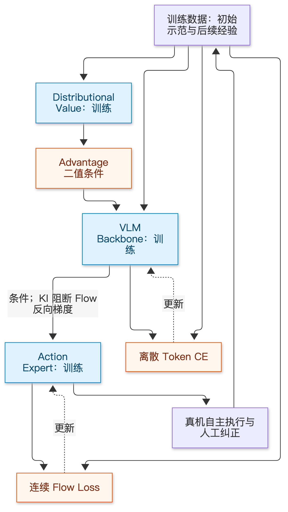

[SVG 矢量图](assets/rl-training-diagrams/08-recap.svg) · [独立 Mermaid 源文件](assets/rl-training-diagrams/08-recap.mmd)

展开 Mermaid 源码

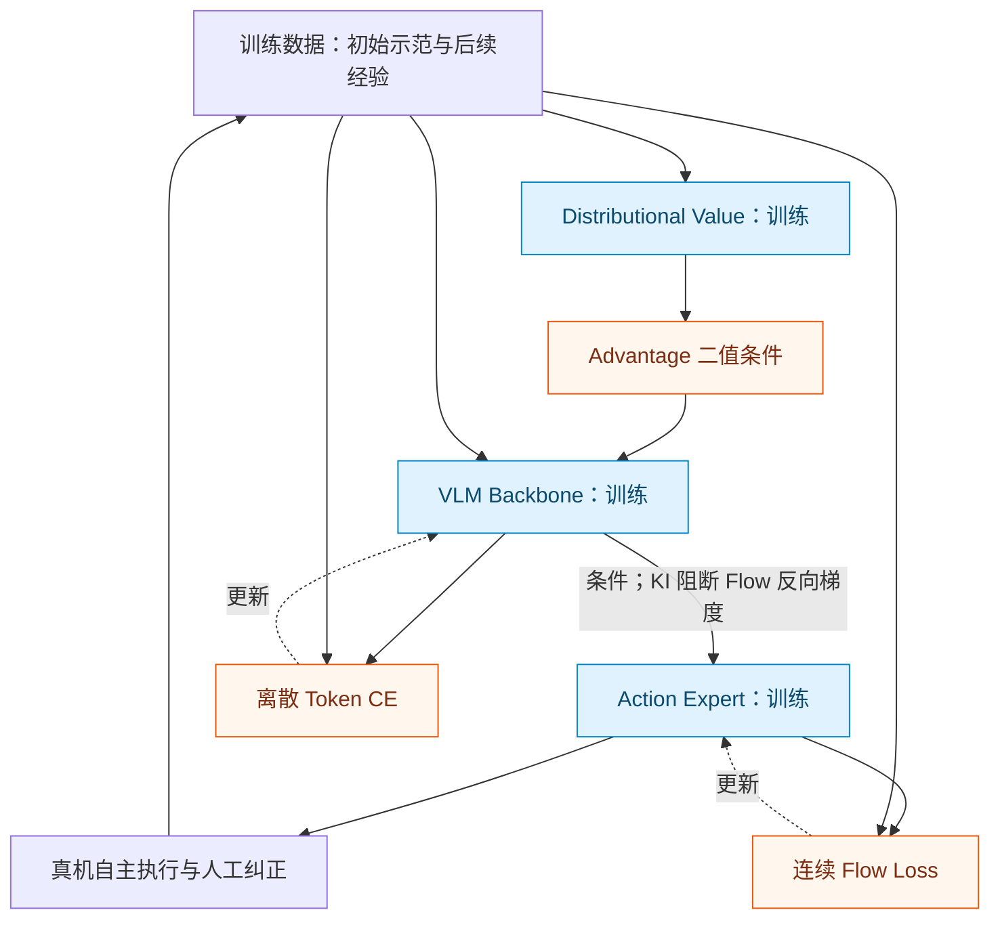

先在示范上训练回报分布，再估计 Advantage，为 Policy 输入增加优势条件；收集自主执行与纠正后重新训练 Value／Policy。图中 KI 是前向条件接口处的反向梯度约束，VLM 仍由自身 Token 目标学习。优势条件化可使用 CE／Flow 形式的 Loss，但标签与条件由回报学习产生，不能据 Loss 外形把它当成单纯模仿。〔E3；§IV–V〕

### 3.3 数据、训练配置与评测协议

| 项目 | 原文披露 |
|---|---|
| 模型 | Gemma3 4B＋860M Flow Expert；独立 Value 的 VLM约670M；KI不等于冻结底座 |
| 阶段 | 多任务 Offline RL预训练→目标 SFT（正条件）→自主／纠正采样→聚合→从预训练 Checkpoint重新微调 |
| Value | 201-Bin Monte Carlo Return 分类；后训练 Advantage使用 n-step50；不是 Action Chunk50 |
| Reward | 非终点−1，成功终点0，失败终点−C_fail；按最长 Episode归一化；无折扣 |
| Policy | Advantage条件＋离散CE／连续Flow；Indicator Dropout30%；默认推理β＝1；PPO为对照 |
| 数据例子 | 洗衣每轮300自主轨迹／4机器人；咖啡414自主＋429纠正；多样洗衣450评估＋287纠正 |
| 指标 | Throughput＝成功任务／小时；人工任务结果 SR；箱子另报分阶段 SR |
| 缺项 | LR、Batch、训练步数、硬件／训练墙钟、完整拆分与独立训练 Seed 数未披露 |

### 3.4 结果与对照〔E3〕

原文包含洗衣、装箱与 espresso 等真实长程操作；困难任务吞吐量可翻倍、失败率约减半。Policy Extraction 对照使用相同在线数据比较 Advantage Conditioning、AWR、PPO。数据规模、模型和训练流程与多数仿真小预算论文不同，不能拿总体效果直接评价算法优劣。〔S8 §VI〕

本轮未确认完整官方 RECAP 训练系统可公开复现。开源基础代码与作者实际使用的模型、数据、Value Training 和部署流水线应分别核验。

### 3.5 洞察与局限〔E3：分析〕

它说明 RL 的关键不一定是直接对每个动作做 Policy Gradient；也可以先用价值信息区分哪些行为更好，再让生成模型有条件地学习这些差别。这样能保留已有大规模生成式训练流程，并利用成功、次优和纠错经验。

其研究重心也从一次实验的成功率，扩展到完整经验闭环：如何采数据、怎样评估数据中的动作、怎样从混合质量的数据提取更好的 Policy。

局限同样来自这一链条。Value 的误差会影响优势标签；人工纠错与额外数据本身可能带来收益；多次迭代的样本、标注与机器人时间都需要计入成本。理论上的策略改进结果，也不能直接等同于有限数据和近似 Value 下的性能保证。

**数据口径提醒〔E3〕**：装箱正文将每轮600条写为自主轨迹，A-F称为 Demonstrations；不无注合并。“30% percentile”与附录“约30%示范为 Positive”也不能直接视为同一阈值定义。连续制作咖啡13小时是部署展示时长，不是训练耗时。

RECAP重组完整经验闭环；RLT进一步追问，能否把昂贵的通用模型固定，仅在线更新少量控制参数。

## 4. RLT：冻结通用VLA，以紧凑接口训练轻量策略

来源 S9：[论文 v1](https://arxiv.org/html/2604.23073v1)，重点 §IV–VI、附录 B；[官方说明](https://www.pi.website/research/rlt)。

### 4.1 研究问题

RLT将通用先验与精密控制适应分开：先适配VLA和RL Token，再冻结二者，以真实交互训练小型Actor–Critic。其价值是在线数据与计算效率。〔E3；S9 §IV〕

### 4.2 架构与训练流程

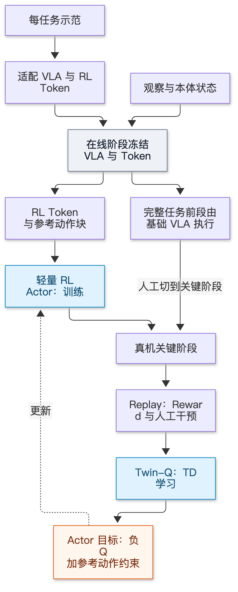

[SVG 矢量图](assets/rl-training-diagrams/09-rlt.svg) · [独立 Mermaid 源文件](assets/rl-training-diagrams/09-rlt.mmd)

展开 Mermaid 源码

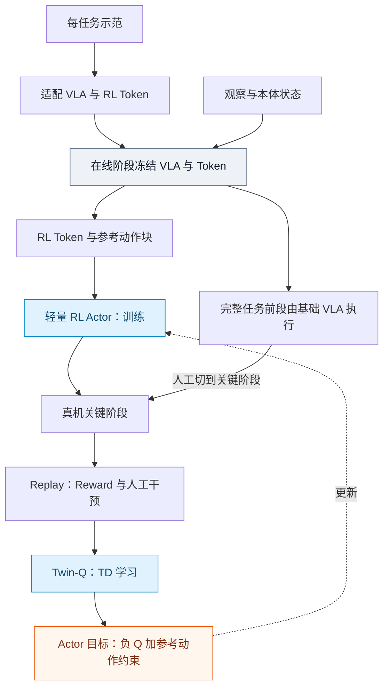

先让 RL Token 重构丰富内部表示，形成小型在线策略的状态接口。之后冻结大模型，通过真实交互更新小 Actor／Twin-Q；Actor 输入参考动作而不是从零探索。采用 TD3-style 双 Q Target 与参考动作正则，没有据此认定为 SAC；不需要 PPO 式 Old／New Ratio。〔E3；§IV〕

### 4.3 数据、训练配置与评测协议

| 项目 | 原文披露 |
|---|---|
| 数据前提 | 每任务1–10小时遥操作示范；先适配 VLA／Token 2,000–10,000 Gradient Steps |
| 在线数据 | 400–1,000 RL Episodes；有效机器人数据约15分钟–5小时，另计示范、Reset与其他开销 |
| Reward／干预 | 人工终局成功＋1，否则0；人工可纠正并负责关键阶段切换 |
| Actor Loss | −Q＋β‖a−aVLA‖²；Twin-Q取较小 Target；Chunk TD Backup |
| 超参 | UTD5；Critic:Actor更新2:1；Reference Dropout50%；通常 MLP2×256，螺丝为3×512 |
| Horizon | VLA预测50；RL Chunk10×14维；控制50Hz；训练采样Stride2 |
| 评测 | 4项精密操作各50次关键阶段评测；完整任务仅螺丝／扎带另测 |
| 指标 | 成功率与成功数／10分钟；关键阶段与完整任务分开评测 |
| 缺项 | LR、Batch、γ、β、Warmup数量、GPU、训练计算时间、独立训练 Seed、完整划分未披露 |

### 4.4 实验结果与时间成本〔E3〕

四项真机精密操作包括螺丝安装、扎带、网线与电源插接；原文报告关键阶段最高约三倍速度改善。先有每任务 1–10 小时示范用于底座与接口适配，随后才做在线 RL。在线有效机器人数据约 15 分钟至 5 小时，不能写成所有实验从零只需 15 分钟。〔S9 §VI〕

官网的网线例子中，15 分钟指有效数据，包含复位等开销的训练约两小时。关键阶段与完整任务也分开评测。本轮未确认完整官方实现发布包。〔S9 官方说明〕

### 4.5 洞察与局限〔E3：分析〕

RLT 把两个需求分开：通用模型保留丰富先验，小型在线策略快速适应精密控制。紧凑接口降低在线更新成本；参考动作约束则把探索限制在已有能力附近。

这项工作的价值不取决于它是否满足最严格的“双端联合”定义。它研究的是具身后训练的另一项核心问题：如何在有限真实交互和计算条件下改善执行。

仍需注意它的适用范围。关键阶段已经有可用的基本行为与进入条件；更好的局部策略不一定解决目标理解或上游计划错误。关键阶段数据效率、完整任务鲁棒性和全流程人工成本，应分别报告。

有效数据时长、训练墙钟和前置示范准备应分别记账；参考动作条件化也不等于按固定比例相加的Residual。

前三项表明，有效后训练可以更新不同规模的参数。接下来转向联合问题本身：什么时候值得改上游表示，怎样证明收益来自共同更新。

## 5. Z-1：选择性解冻与环境前缀分叉

来源 S2：[论文 v1](https://arxiv.org/html/2606.31846v1)，重点 §3.2–3.4、§4.3.2、Appendix C/D。

### 5.1 研究问题

Z-1同时研究两个变量：按任务选择VLM／Expert更新范围，以及让同组尝试从相同环境前缀处分叉。前者改变参数空间，后者改变比较条件，不能把两项收益混为一谈。〔E3；S2 §3〕

### 5.2 架构与训练流程

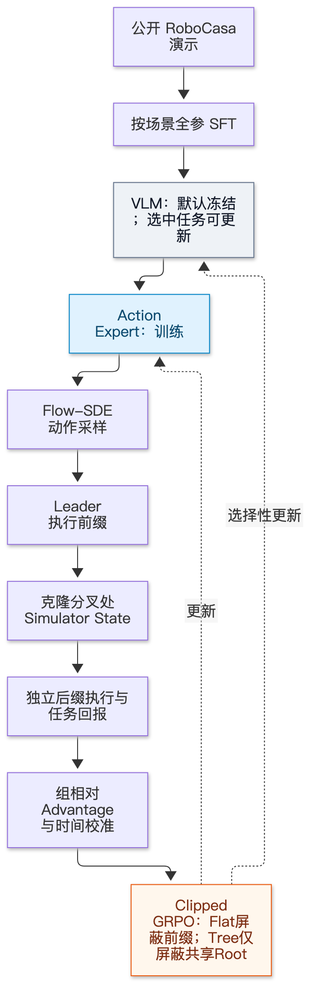

[SVG 矢量图](assets/rl-training-diagrams/02-z1.svg) · [独立 Mermaid 源文件](assets/rl-training-diagrams/02-z1.mmd)

展开 Mermaid 源码

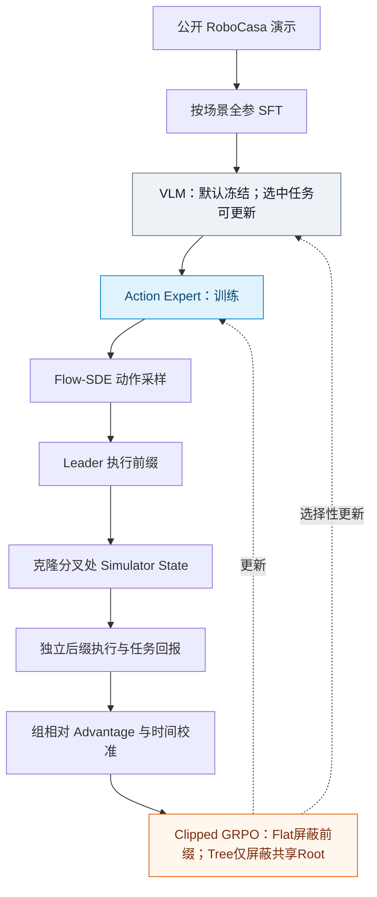

按任务进行 GRPO，使用环境成功反馈比较同组后缀。Flat Shared-Prefix 复用的是环境状态并屏蔽整段共享前缀；树形版本允许部分分叉区间参与更新。联合模式只改变可训练参数集合，沿相同 Loss 更新 VLM 与 Expert；不是所有任务都统一解冻。〔E3；§3、D.4〕

### 5.3 数据、训练配置与评测协议

| 项目 | 论文披露 |
|---|---|
| 模型／数据 | π0.5；1,199条公开 RoboCasa 演示，按 Scene SFT，24任务评测 |
| 初始化选择 | Held-out Loss约0.01选稳定 SFT Checkpoint；验证集数量未披露 |
| RL | Flow-SDE 路径比率＋组相对 Clipped GRPO；无额外 Critic、Reward Model 或 KL |
| 回报校准 | 成功回报乘0.998的首次成功 Chunk 数次幂；全成功组改用 R−min(R)，避免惩罚慢成功 |
| 更新 | 默认 Expert-only；最终评测前按训练诊断固定是否联合 VLM |
| 超参 | AdamW LR5×10⁻⁶、Weight Decay0.01、Grad Clip1；Micro16／Global1024；Group8；64环境；4 Rollout Epochs；Clip0.2 |
| 评测 | SFT：4 Evaluation Seeds×12＝48 Rollouts／任务；RL：8×8＝64／任务；24任务无权平均 |
| 缺项 | 硬件、GPU-hours、总更新数、预测／执行 Horizon、独立训练重复数与完整任务模块清单未披露 |

### 5.4 主结果与联合证据〔E3〕

24任务平均SFT67.4%→RL80.6%，是按场景SFT、按任务训练与选择模块的整套流程收益，并非一个统一模型同时处理24任务。联合消融主要为TurnOnStove曲线，缺少跨任务精确终值统计。

已核对的[Fig.3原图](https://arxiv.org/html/2606.31846v1/two_metrics_comparison_TurnOnStove.png)显示联合组成功率方向较好；右图红色Policy Loss数值多数高于蓝色，与文字“更低”并不完全一致，原文未说明是否指绝对值。不能由此宣称机制已被证明。

基线引用、不同评测样本数，以及Tree版本的Batch／Group调整，也使总体成绩不等于同预算受控重跑。

### 5.5 洞察与局限〔E3：分析〕

GRPO 要从一组尝试的相对成败中得到学习信号。如果一组轨迹在接近目标之前就已经进入完全不同的状态，那么后来成败的差别，可能主要来自前段的运气，而不是需要优化的接触动作。

Shared-Prefix 的价值在于控制比较条件。例如要研究“怎样拧旋钮”，先让不同尝试都从相同的接触前状态开始，再比较后续动作。这能把学习问题局部化，减少无关变化。它与“减少模型前缀计算成本”是不同层面的收益。

代价也随之出现：被屏蔽的接近阶段没有从这次比较中学习。如果接近行为本身有系统性错误，固定前缀可能保留错误。树形分叉可以保留部分可训练区间，但会增加采样和预算比较的复杂性。

它给出了符合直觉的正向信号：某些困难操作的瓶颈可能在上游定位／条件表征，单改 Action Expert 不足。要把这种信号升级为跨任务结论，还需要更多任务与独立训练重复，以及明确的模块选择规则。

与 π_RL 放在一起看，最合理的研究问题是“收益发生的条件”，而不是在两篇中择一宣布联合有效或无效。也不能把 Z-1 主表的 13.2 个百分点都记作解冻贡献。

前缀分叉需要恢复完整Simulator State，包括任务状态与随机性。复现应分别报告前缀成本、被Mask区间与后缀收益。

Z-1提供选择性联合的正向案例，但联合证据集中。SyVLA则提供了可以直接审阅条件表示和优化器路径的公开实现。

## 6. SyVLA：VLM与Flow Expert共同更新的公开案例

来源 S10：[论文](https://arxiv.org/html/2606.09009v1)；[官方项目](https://sy-vla.github.io/)；[官方代码](https://github.com/sy-vla/syvla)。

### 6.1 研究问题

SyVLA通过Feature Query与Intention Decoupling连接VLM和Flow Expert，研究真机任务改进与视觉语言能力保留。判断重点是动作目标能否经条件表示回到VLM，以及CoT监督与动作RL分别承担什么。〔E3；S10 §3〕

### 6.2 架构与训练流程

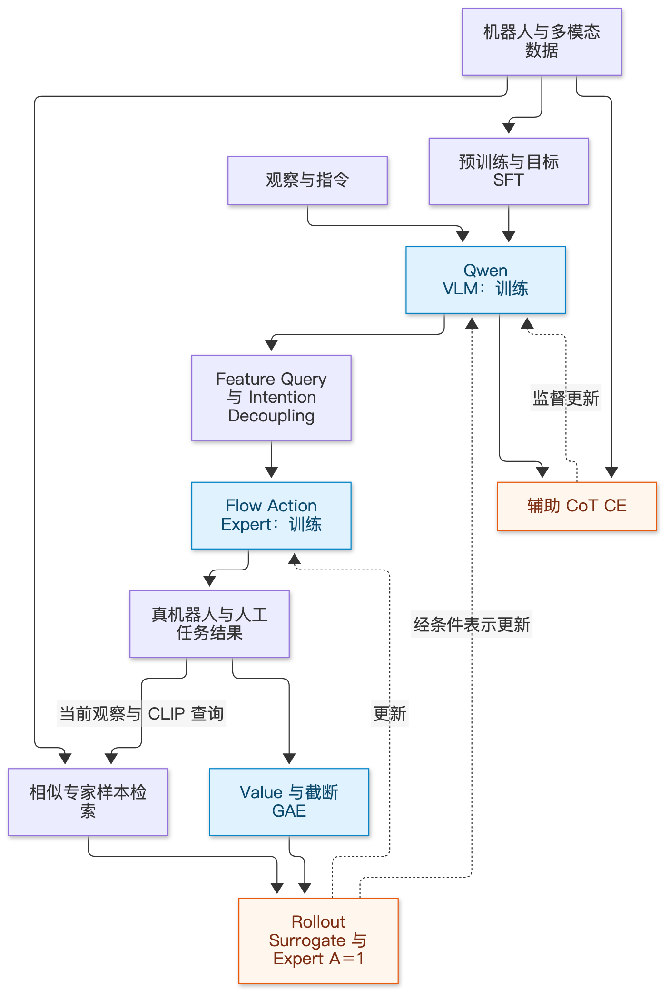

[SVG 矢量图](assets/rl-training-diagrams/10-syvla.svg) · [独立 Mermaid 源文件](assets/rl-training-diagrams/10-syvla.mmd)

展开 Mermaid 源码

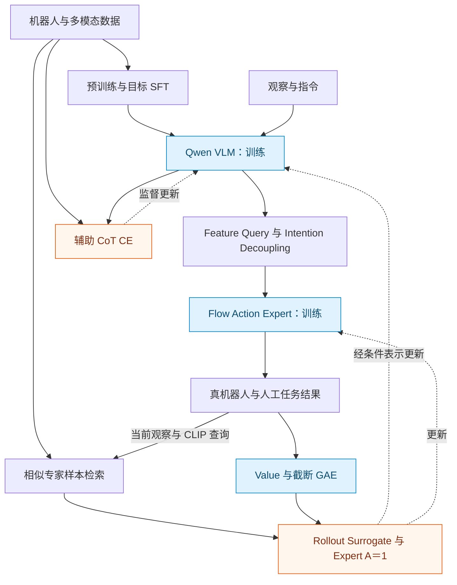

大规模机器人／多模态预训练后做任务 SFT；再采真机轨迹，用 Value 与 GAE 学动作，同时混入相似专家样本和 CoT 辅助监督。显式 CoT 的 CE 与任务奖励的动作 Surrogate 是不同目标；不能把图中两条更新路径统称为“所有推理 Token 的共同任务 Policy Gradient”。〔E3；§3与源码〕

### 6.3 数据、训练配置与评测协议

| 项目 | 原文披露 |
|---|---|
| 模型 | Qwen2.5-VL-3B＋约0.69B Flow Expert＋SigLIP；20 Feature Queries；Chunk50 |
| 预训练数据 | 约450小时机器人数据：OXE／RH20T子集＋少量自采；约1%带 CoT；正文／附录混合比口径有差异 |
| 预训／SFT | 32×H200约1.5天／8×H100约6–18小时；Batch512／32；Peak LR10⁻⁴／3×10⁻⁵ |
| 目标任务数据 | 每任务数百演示；精确数、划分未披露 |
| RL | 人工成功0–1；相似 Expert A＝1，Rollout GAE截断±0.8；约100M Value先做 Monte Carlo Warmup |
| RL采样 | 每任务最多10个作者称“RL Episodes”的批次，每批最多20条 Trajectories；不等于仅10条轨迹 |
| 评测 | 三真机任务14／28／14次；报告 ID／OOD；另有5 Random Seeds但未说明是否完整独立重训 |
| 缺项 | 论文 RL 的LR、Batch、优化更新数、执行／重规划长度、正式成功阈值未充分披露 |

### 6.4 结果及数据边界〔E3〕

三项真机任务报告ID／OOD平均成功率0.73／0.64，评测次数分别为14／28／14。LIBERO附录成绩来自SFT后评测，应与真机RL分开。论文提到5 Random Seeds，但未明确是否每个Seed均完整独立重训。

约450小时预训练数据中的自采占比低于5%；多模态混合比例正文与附录口径不一致。每任务最多10个作者称“RL Episodes”的采样批次、每批最多20条轨迹，是两个上限，不能读成总共10条轨迹。

### 6.5 发布源码与配置〔E1／E2／E3〕

锁定 commit：1b4ca0b251f5089752addd299358285e8e140b92。

- [modeling_rl.py:32](https://github.com/sy-vla/syvla/blob/1b4ca0b251f5089752addd299358285e8e140b92/syvla/models/rl/modeling_rl.py#L32) 启用整个 Policy 的梯度；[rl_trainer.py:90](https://github.com/sy-vla/syvla/blob/1b4ca0b251f5089752addd299358285e8e140b92/syvla/rl/rl_trainer.py#L90) 将 Policy 参数交给 AdamW。
- [rl_syvla.py:25](https://github.com/sy-vla/syvla/blob/1b4ca0b251f5089752addd299358285e8e140b92/syvla/models/rl/rl_syvla.py#L25) 由 Qwen Hidden States 形成条件表示，[同文件:58](https://github.com/sy-vla/syvla/blob/1b4ca0b251f5089752addd299358285e8e140b92/syvla/models/rl/rl_syvla.py#L58) 将其送入动作 Head 后计算 Surrogate；这条路径没有对条件表示做 Detach。
- [modeling_rl.py:62](https://github.com/sy-vla/syvla/blob/1b4ca0b251f5089752addd299358285e8e140b92/syvla/models/rl/modeling_rl.py#L62) 合并动作策略项、Value Loss、辅助 CoT Loss；代码直接裁剪 exp(action_log_prob)，此处没有显式 Old／New Ratio。

| 证据 | 已发布内容 | 如何使用 |
|---|---|---|
| [示例 RL JSON](https://github.com/sy-vla/syvla/blob/1b4ca0b251f5089752addd299358285e8e140b92/config/rl_config/fold_shirt_n200.json#L7)〔E2〕 | 更新500；Chunk50；Batch4；Policy／Value LR＝5×10⁻⁵／10⁻⁴；λ0.95；CoT系数0.01；Rollout Batch7 | 是示例配置，不能替代论文实际运行配置 |
| [官方 README](https://github.com/sy-vla/syvla/tree/1b4ca0b251f5089752addd299358285e8e140b92#pretrain)〔E3〕 | 预训写8×8 H100 | 与论文32 H200口径不同，不合并成一套成本 |

### 6.6 洞察与局限〔E3：分析〕

它是研究共同更新时值得认真看的公开样本：模块范围和梯度连接有代码证据。但“优化器涵盖所有参数”还不等于每个参数实际收到非零梯度；公开 Surrogate 也不能在未经进一步推导和复现时称为标准 PPO。

显式 CoT 的辅助 CE 与任务优势驱动动作 Surrogate 是不同路径。因此，它与 DeepThinkVLA 的整段 Reasoning–Action Token 优化不能用同一句“推理和动作都 RL”概括。

后续评价应分别检查模块梯度、语言能力保留、真机任务收益和 Loss 实现与论文的对应关系。这里的价值是公开了可审阅的共同优化路线，尚不能由此推出跨任务普遍优势。

SyVLA保留共同梯度路径；TEMPO采用另一种协调方式，将语义接口与动作专家交给独立Critic，并让它们以不同速度更新。

## 7. TEMPO：用独立Critic与更新频率协调模块

来源 S5：[论文 v1](https://arxiv.org/html/2608.07314v1)，重点 §III-B–E、Tables I–III；[作者项目页](https://anonymous.4open.science/w/tempo-page/)。

### 7.1 研究问题

TEMPO关注模块同时适应时的接口漂移。它冻结完整VLM，只训练语义投影与Action Expert；因此是模块联合适配案例，不能升级为完整VLM与动作策略双端RL。〔E3；S5 §III〕

### 7.2 架构与训练流程

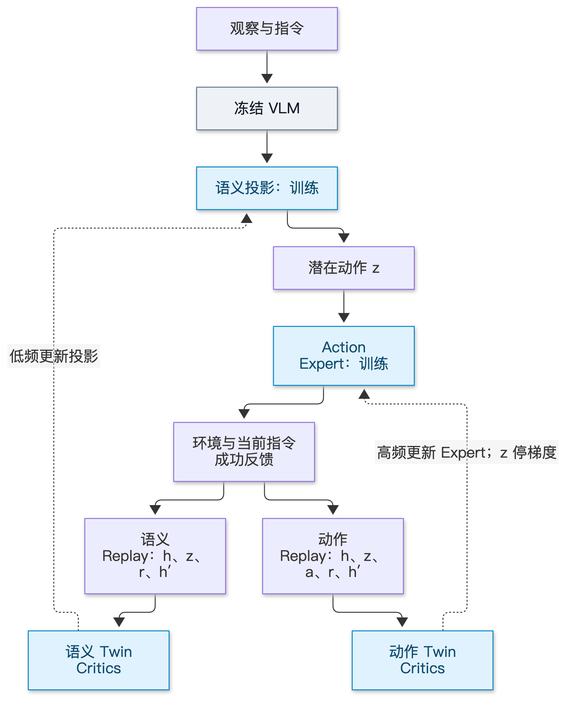

[SVG 矢量图](assets/rl-training-diagrams/05-tempo.svg) · [独立 Mermaid 源文件](assets/rl-training-diagrams/05-tempo.mmd)

展开 Mermaid 源码

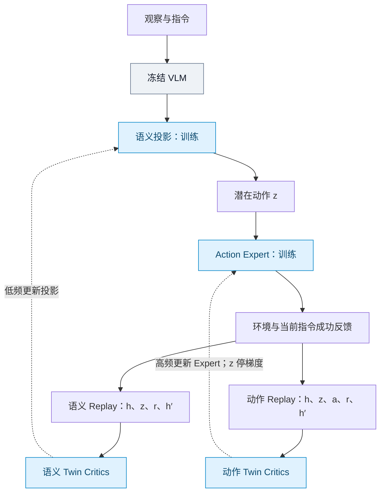

同一交互写入两套 Replay。语义 Critic 评价(h,z)，动作 Critic 评价(z,a)；Action Actor 更新时重算并停止投影的梯度，Critic 更新使用回放 latent。两边各自做 TD3，Actor 梯度不穿到另一模块。语义更新较慢，底座始终冻结。〔E3；§III〕

### 7.3 数据、训练配置与评测协议

| 项目 | 论文披露 |
|---|---|
| 模型 | FLOWER；具体完整底座配置未披露 |
| 数据／划分 | CALVIN ABC训练、D评测，五指令链；真机两任务各60条示范 |
| Reward／终止 | 当前指令成功1，否则0；指令终止停止 Bootstrap，不跨到下个指令 |
| 方法 | 双 TD3；独立 Buffer、Twin Critics、Target Networks、Optimizers |
| 更新频率 | 动作:语义＝5:1效果最好；另比较1:1、10:1；绝对更新次数未披露 |
| 真机评测 | 3个独立随机 Seed；每 Checkpoint 每 Seed20次；报告二元成功奖励之和与标准差 |
| 缺项 | 模拟评测次数／训练 Seeds、LR、Batch、总交互、Chunk、GPU与时间未充分披露 |

### 7.4 模块与频率消融〔E3〕

| CALVIN ABC→D 设置 | 五任务链成功率 SR5 | 平均完成长度 |
|---|---:|---:|
| FLOWER-RL：单回路复合 Actor | 78.4% | 4.51 |
| 双回路 1:1 | 77.7% | 4.46 |
| 双回路 5:1（动作:投影） | 81.7% | 4.59 |
| 双回路 10:1 | 81.2% | 4.57 |

无投影更新／无Expert更新的SR5为79.8%／79.6%。匿名源码入口在原调研时未能读取，不能认定已经具备可复现实现。

### 7.5 为什么更新速度会影响行为〔E3：分析〕

其分解为：

$$
h=\mathrm{VLM}(o,l),\qquad
z=\pi^s_\theta(h),\qquad
a=\pi^a_\phi(z).
$$

语义回路将 h 当作 State、z 当作 Action，由自己的 Critic 评价；动作回路将 z 当作 State、动作块 a 当作 Action。它允许两边都受任务反馈改善，但维持底座知识与接口变化的可控性。

这是一种有意义的“模块联合适配”，无需因 VLM 冻结而否定其研究价值；同时也不能把语义投影层升级描述为整个大脑。

设动作模块已经学会“某类 latent 表示某种接近方向”。若投影层突然改变 latent 的含义，动作模块即使参数没变，行为也可能改变。此时两个模块都在追逐一个移动的目标。

较慢地调整投影，可以给动作模块更多时间适应新接口；相反，动作控制需要及时吸收在线反馈，不宜永远等待语义模块。TEMPO 将这种张力变成更新频率这一可测量变量。

但 5:1 的成功不构成可普遍复制的常数。若减少投影更新同时改变总更新量、有效数据或计算，性能变化也可能来自预算。复现应报告两个模块的绝对更新次数和总交互量，不能只报比例。

另需区分：论文Task-set Size为1／2／4／7／34时，指可用于更新的子任务种类，不是评测链长。

上述联合机制主要围绕表示接口。DeepThinkVLA把问题推进到显式推理：推理文字有没有改变动作，任务结果又怎样改善整条轨迹。

## 8. DeepThinkVLA：推理—动作轨迹的Outcome RL

来源 S6：[论文 v3](https://arxiv.org/html/2511.15669v3)，重点 §3.3、Table 5、Appendix A.5–A.6；[官方代码](https://github.com/OpenBMB/DeepThinkVLA)。

### 8.1 研究问题

DeepThinkVLA使用统一Hybrid Decoder，让CoT因果生成、Action Slots并行生成；研究任务结果能否对齐推理与动作。它不是两个独立Planner／Executor。〔E3；S6 §3〕

### 8.2 架构与训练流程

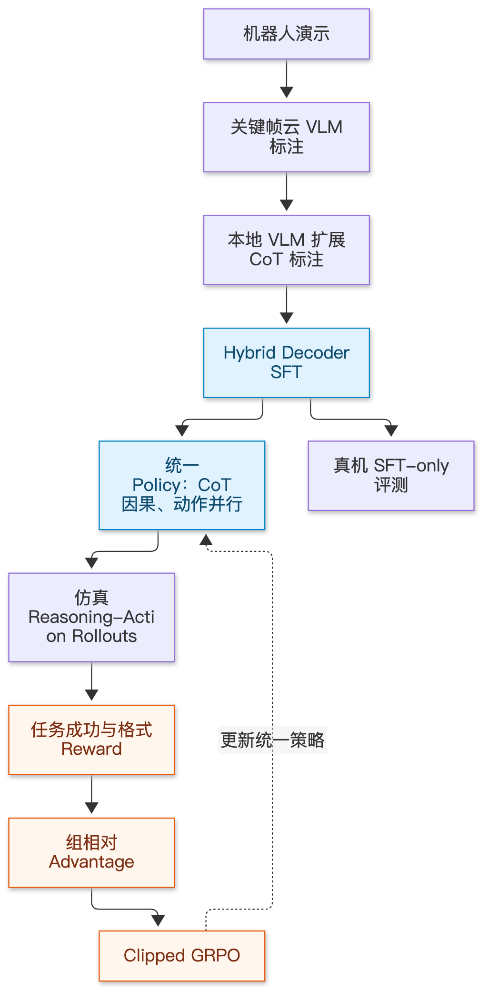

[SVG 矢量图](assets/rl-training-diagrams/06-deepthinkvla.svg) · [独立 Mermaid 源文件](assets/rl-training-diagrams/06-deepthinkvla.mmd)

展开 Mermaid 源码

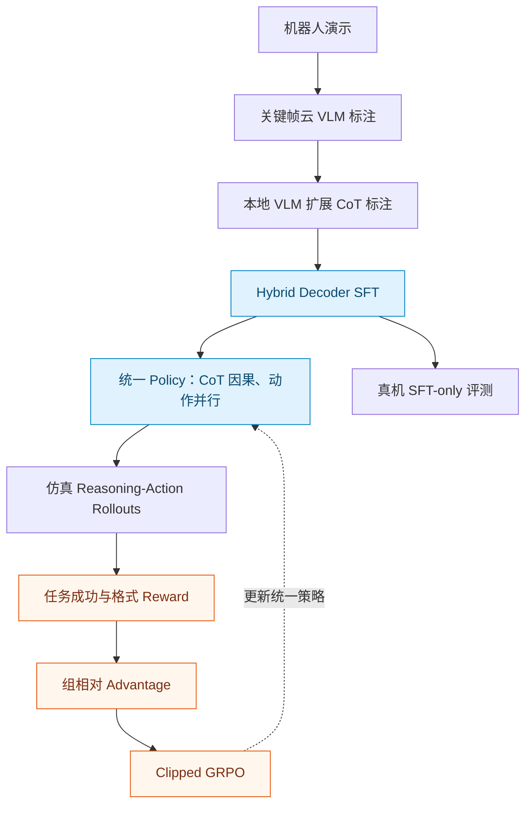

先构造图像／指令／CoT／动作监督，再用混合注意力 SFT。之后在仿真中生成完整推理与动作轨迹，让 Outcome Reward 通过组优势驱动策略更新。图中的真机支路直接来自 SFT，不能从 RL 结果连过去宣称已验证真机 RL。〔E3；§3、§4.3〕

### 8.3 数据、训练配置与评测协议

| 项目 | 原文披露 |
|---|---|
| 底座／动作 | π0-FAST初始化、约2.9B；动作2048 Bins；CoT因果生成，Action Slots双向并行 |
| 标注数据 | LIBERO273,465帧、RoboTwin2,847,856帧 CoT；是 Frames，不是 Episodes |
| SFT | Batch128、LR2.5×10⁻⁵、150k Steps；Token CE |
| RL | 仿真 On-policy GRPO；任务成功＋小额格式 Reward；Mini-batch128；Clip Low0.2／High0.28；论文写有 SFT Reference KL |
| Chunk／算力 | LIBERO动作块10×7维；RoboTwin14维；8×A800 |
| 评测 | LIBERO每任务50随机初态；LIBERO-Plus零样本；真机3任务各20次，全部 SFT-only |
| 缺项 | 逐层冻结清单、完整数据拆分、独立训练重复数、RL总 Episodes、总墙钟时间未明确披露 |

### 8.4 实验与功能性干预〔E3〕

主结果为LIBERO97.0%、LIBERO-Plus79.0%、RoboTwin59.3%；Long由含CoT的SFT94.2%提升至RL96.2%。同架构消融如下：

| 设置 | 平均成功率 | Long |
|---|---:|---:|
| 不含 CoT，SFT | 92.7% | 87.8% |
| 不含 CoT，RL | 93.8% | 90.2% |
| 含 CoT，RL | 97.0% | 96.2% |

Plus的SFT79.1%→RL79.0%，不能将Plus相对其他模型的全部优势归于RL。真机三任务各20次，使用SFT模型，成功率55%／45%／35%，均值45%；这不是RL真机验证。

### 8.5 论文与Launcher配置差异〔E1／E2／E3〕

固定源码 ff271e7c024422581c9875d96250f99dd0b743d1：

| 证据 | 静态配置事实 | 边界 |
|---|---|---|
| [RL脚本](https://github.com/OpenBMB/DeepThinkVLA/blob/ff271e7c024422581c9875d96250f99dd0b743d1/scripts/run_deepthinkvla_rl.sh)〔E2〕 | Batch64、每组8；LR2×10⁻⁶；Mini128；PPO Epochs2；Total Epochs100 | 是公开启动配置，未认定为全部论文实验实际值 |
| [KL Loss开关:67](https://github.com/OpenBMB/DeepThinkVLA/blob/ff271e7c024422581c9875d96250f99dd0b743d1/scripts/run_deepthinkvla_rl.sh#L67)〔E1/E2〕 | use_kl_loss=False，系数0 | 与论文 KL 描述不一致 |
| [Reward KL开关:94](https://github.com/OpenBMB/DeepThinkVLA/blob/ff271e7c024422581c9875d96250f99dd0b743d1/scripts/run_deepthinkvla_rl.sh#L94)〔E1/E2〕 | use_kl_in_reward=False，系数0 | 实际运行是否覆盖参数需另有运行配置证明 |

### 8.6 洞察与局限〔E3：分析〕

可读解释与动作决策之间可能存在距离。一个系统可以说“夹爪没有抓住，需要重试”，随后仍输出与没有这段文字时相同的动作。因此，解释质量只是中间指标。

更有效的检验是改变推理路径，观察行为是否以可预测的方式变化：移除 CoT、打乱 CoT、从训练阶段就去掉 CoT，再检查同一模型在常规任务和执行扰动下的差别。

还应区分两类作用：推理监督在训练中改善了表示；推理输出在部署中持续影响动作。前者存在，不意味着每一步都必须生成长文本。两种作用对应不同的部署成本与实验对照。

同架构对照和功能性干预比跨模型榜单更能解释CoT作用，但移除CoT也可能引入输入分布变化。训练期无CoT对照因此重要。Token动作与连续Flow／Diffusion Expert的策略概率也不同，Loss不能直接互换。

尚需回答显式文本是否优于隐式表征／记忆，以及仿真Outcome Alignment能否延续到真机在线RL。

Reasoning与World Model都能提供动作所需的中间信息，但价值最终要看行为。下面两项分别研究外部想象环境和内部预测表征。

## 9. DRILL：让World Model服务于Policy学习

来源 S3：[论文 v1](https://arxiv.org/html/2610.30814v1)，重点 §3、Table 1、Appendix D/E。

### 9.1 研究问题

若预测误差更低却没有帮助控制，World Model该优化什么？DRILL将目标转为下游Policy更新后的环境回报，并提供VWI代理目标与IMG双层元梯度两种不同实现。〔E3；S3 §3〕

### 9.2 架构与训练流程

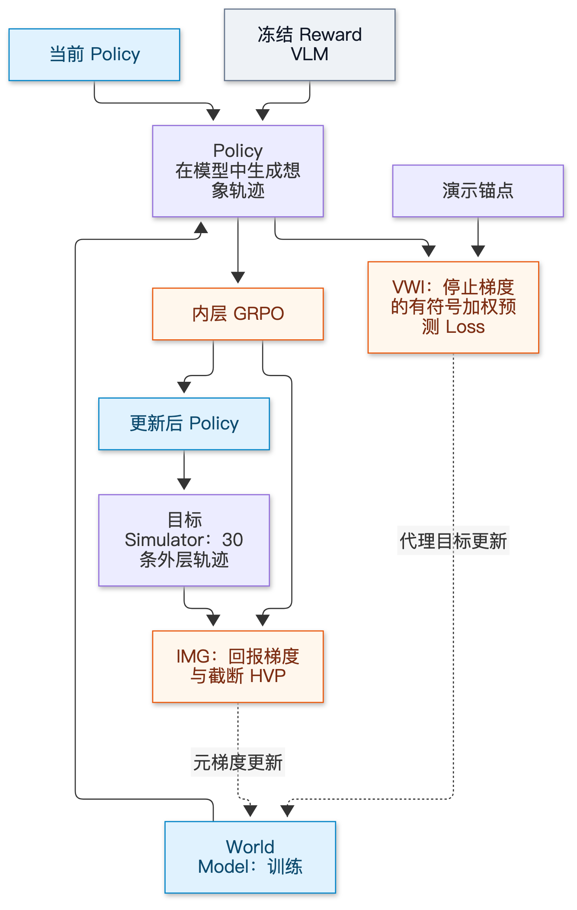

[SVG 矢量图](assets/rl-training-diagrams/03-drill.svg) · [独立 Mermaid 源文件](assets/rl-training-diagrams/03-drill.mmd)

展开 Mermaid 源码

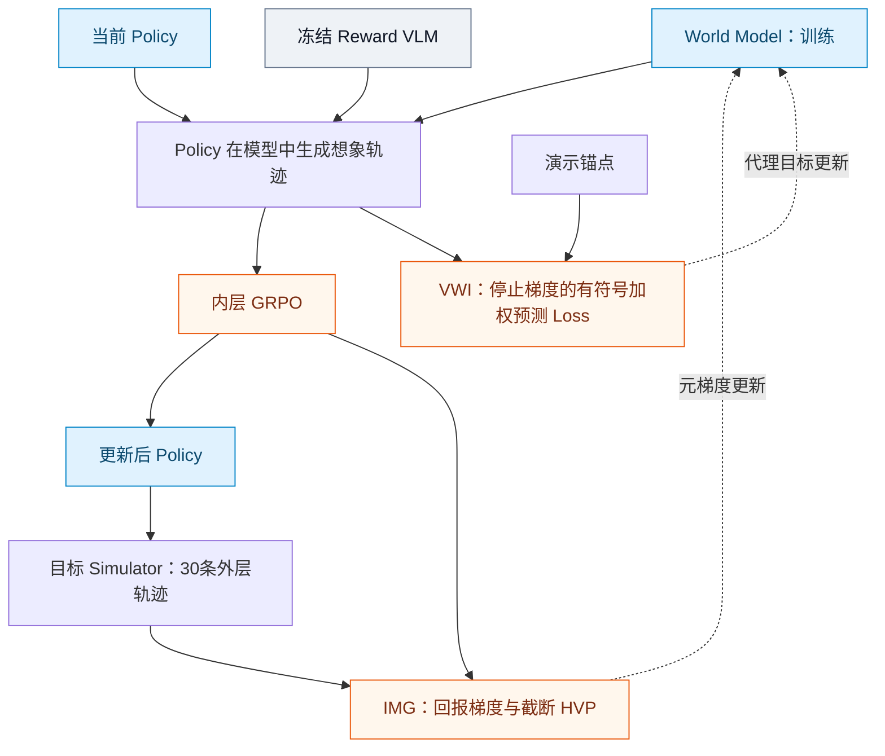

内层在想象中更新 Policy；IMG 外层检查这个新 Policy 在目标仿真中的回报，再通过内层更新估计 World Model 元梯度。VWI 则用访问度、优势与置信度对演示预测误差加权，不额外做 IMG 的外层采样。图中 Simulator 输出用于估计，不表示对物理引擎直接反向传播。〔E3；§3、D〕

### 9.3 数据、训练配置与评测协议

| 项目 | 论文披露 |
|---|---|
| 模型 | π0-3B；OpenVLA-7B复核；Ctrl-World1.2B；冻结 Qwen3-VL-4B Reward Model |
| 数据／环境 | LIBERO-Long10任务×50演示；CALVIN ABC→D；约20项 RoboCasa 原子任务；MT50；Simpler Bridge V2／Google Robot |
| 默认预算 | IMG每个外层步骤增加30条目标 Simulator Episodes；内层 GRPO Group8；想象 H50、Action Chunk16、截断 K2 |
| LR／Batch | Policy／World LR通常10⁻⁵／5×10⁻⁶；RoboCasa为8×10⁻⁶／4×10⁻⁶；Batch有512／384的分基准设置，须按D.7逐项读取 |
| Seeds | 主结果5次训练随机重复；消融3次 |
| 算力 | 24×H20；17,040 GPU-hours为多基准／骨干／Seed合计，不是单 Run；其中外层3,840 |
| 指标 | 任务 SR；像素 MSE（表中单位10⁻³）；ESNR与 Policy-Utility Residual 为诊断 |
| 缺项 | 总外层迭代数、部分数据量／拆分、主评测 Episode 数；Table1 CALVIN SR未明确定义链长度 |

### 9.4 目标函数与两种变体〔E3：公式化解读〕

记 Policy 参数为 θ，World Model 参数为 φ。其核心思想可写为：

$$
\theta^+(\phi)=\theta+\eta_\theta\nabla_\theta
\widehat J_{\mathrm{imagined}}(\theta,\phi),
\qquad
\max_\phi J_{\mathrm{env}}\!\left(\theta^+(\phi)\right).
$$

这里外层问的不是“生成视频像不像”，而是“在这个模型里学习一次以后，Policy 是否更有用”。这是 S3 方法的概念表达，不是可直接替换代码的完整实现。

通用的对照目标是预测误差最小化：

$$
\min_\phi\ \mathbb E\left[\|\widehat o_{t+1}-o_{t+1}\|^2\right].
$$

两个目标会给不同误差分配不同重要性。背景区域大量像素预测准确，可能使 MSE 很低；但在夹爪是否夹住、物体何时滑落、是否真正发生接触这些少量关键状态上出错，会直接误导策略。

VWI 可概念化为对真实数据上的预测误差重新加权：

$$
L_{\mathrm{VWI}}
=\mathbb E\left[\operatorname{sg}(w)\,
\|\widehat o-o\|^2\right].
$$

权重由当前 Policy 的访问、优势和模型置信度形成，允许有符号调整；它仍是代理目标。IMG 则追踪“模型变化→策略更新变化→外部回报变化”的路径，计算更复杂。

这也解释为什么不能简单把“用 Advantage 乘一下 Video Loss”称为 DRILL 的完整复现：权重从哪里来、是否停止梯度、是否保留符号、外部效果怎样估计，都会改变所优化的问题。

### 9.5 成功率、预测误差与预算〔E3〕

| 方法 | 平均成功率 | 像素 MSE（×10⁻³） |
|---|---:|---:|
| WMPO | 59.40% | 8.4 |
| RLVR-World | 64.66% | 7.2 |
| DRILL-VWI | 69.64% | 9.3 |
| DRILL-IMG | 72.52% | 9.8 |

五列SR算术均值由59.40%到72.52%，提高13.12个百分点；MSE同时由8.4增至9.8，增加约16.67%。这是预测质量与下游效用可能分离的实例，不证明任意预测误差变大都有益。CALVIN汇总SR未明确链长度，不能自动标成SR5。

Sim-PPO对照匹配外部Simulator Episode预算，不代表GPU计算、墙钟或更新次数也相同。17,040 H20-hours为多基准／骨干／Seed的实验合计，其中外层3,840；不能写成单Run成本。

### 9.6 洞察与局限〔E3：分析〕

1. **World Model 的用途有边界。** 本文将它当作训练环境；其推导不能直接推广到所有内部联合视频／动作生成架构。
2. **外部约束不可丢。** 若模型和 Policy 仅在自评闭环里互相强化，模型误差可能被当成收益。独立环境评测仍必要。
3. **数字有待澄清的局部口径。** §5.3 对 1.2B 模型的 LIBERO 增益写 13.1 点，Table 1 对应 IMG–WMPO 为 17.1 点；在未澄清前不使用该 Scaling 数字作结论。〔S3 §5.3、Table 1〕

高阶元梯度成本、外部回报方差与真机有效性决定其可复用程度。E.1公开代码表述为计划发布，原调研未找到可访问的官方训练仓库。

DRILL把World Model当训练环境。WAM-RL把World的中间预测表征直接交给Actor，两端更新目标与证据规模均不同。

## 10. WAM-RL：预测与控制的在线共同适配

来源 S7：[论文 v1](https://arxiv.org/html/2606.17906v1)，重点 §3、Tables 1–2、§4.4。

### 10.1 研究问题

WAM-RL研究内部预测表征参与控制时，World与Actor能否一起适应新任务。它将成功轨迹Video SFT与Actor RL组合，未证明独立VLM接受任务Policy Gradient。〔E3；S7 §3〕

### 10.2 架构与训练流程

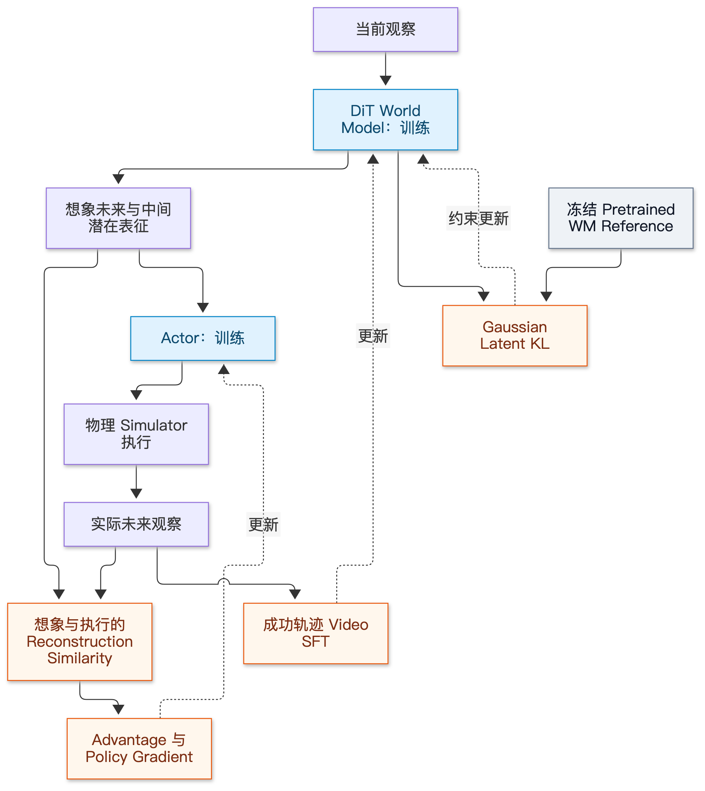

[SVG 矢量图](assets/rl-training-diagrams/07-wam-rl.svg) · [独立 Mermaid 源文件](assets/rl-training-diagrams/07-wam-rl.mmd)

展开 Mermaid 源码

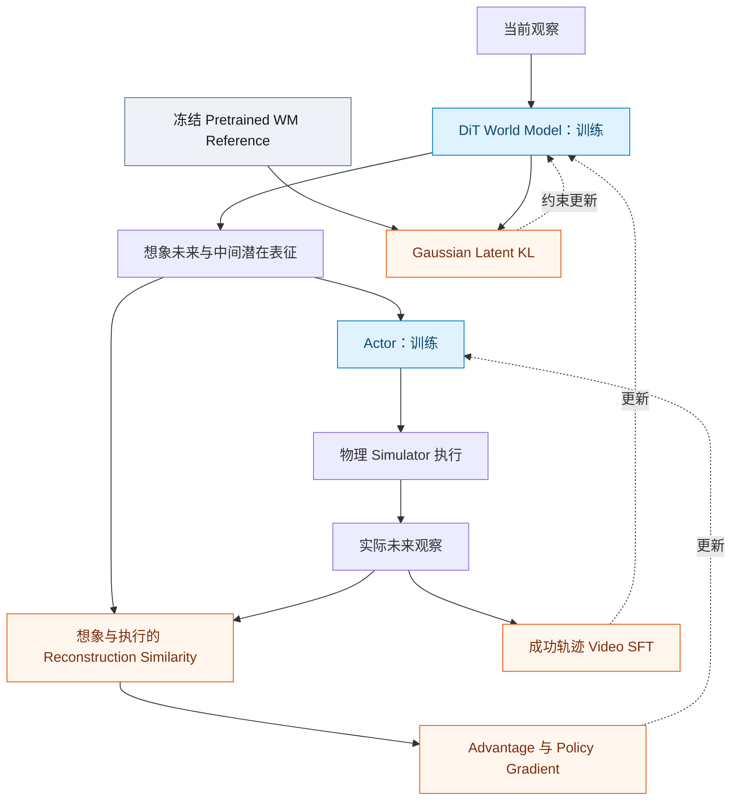

Actor 从想象潜在表征产生动作，仿真执行后比较预测与实际未来，作为 Actor 学习信号；成功轨迹另行监督 World。KL 使用冻结预训练 Reference 稳定潜在表征。因此两端共同适配，但 Loss 和更新机制不同，不是同一任务 Policy Gradient 穿透两端。〔E3；§3〕

### 10.3 数据、训练配置与评测协议

| 项目 | 论文披露 |
|---|---|
| 结构 | Genie Envisioner-ACT；DiT视频 World；Actor消费中间 latent；未声称独立 VLM 也更新 |
| World目标 | 成功 Online Trajectories 的 Video SFT＋λKL×Latent KL |
| KL构造 | Deterministic latent作为Gaussian均值；当前对角协方差用 EMA统计；冻结 Reference 协方差固定 |
| Actor目标 | 重建相似性→Advantage→Policy Gradient；试 Pixel／Flow／DINO／V-JEPA2；具体随机化与似然计算实现未披露 |
| 数据／环境 | LIBERO-Object、RLBench Water Plants；主实验为仿真；未给演示数与划分 |
| 算力 | 8×A800、8小时混合训练；是否覆盖多个 Run 的口径不清 |
| 缺项 | LR、Batch、Steps、Seeds、Chunk、评测 Episodes、Reward数值映射、Advantage估计细节、KL系数及EMA衰减未披露 |

### 10.4 主结果与消融边界〔E3〕

| 方法 | LIBERO-Object | RLBench Water Plants |
|---|---:|---:|
| Base | 68% | 19% |
| Actor-only RL | 78% | 18% |
| WAM-RL | 82% | 22% |

Table2的Pixel MSE Reward为21%，与主表22%差异未解释，不能补写成Video SFT的1点贡献。World SFT消融主要为定性展示，Seed／置信区间和训练配置披露有限；原调研未确认官方训练实现。

### 10.5 洞察与局限〔E3：分析〕

它提醒我们：在预测表征参与控制的系统里，动作适配与表征适配可能互相影响。如果 Actor 已经很擅长执行某种预测，但预测本身不包含正确的恢复轨迹，那么进一步训练 Actor 可能遇到上限。

因此，“在线数据用于控制改进，也用于修复预测”构成一种协同方向。它与将世界模型作为外部 Simulator 的研究互补，代表内部预测表征参与 Policy 的另一类问题设定。

**一致性不是任务完成的充分条件。** 如果想象和执行都停在错误目标上，重建误差仍可能很小。应把独立 Task Success 作为主指标，并检查一致性信号是否鼓励保守、静止或可预测但无效的行为。

只回灌成功轨迹还存在覆盖范围问题：它能提供“成功应该怎样”，但未必覆盖策略实际遭遇的失败状态和恢复过程。世界预测需要理解失败，Policy 则需要知道怎样从失败走向成功，这两个数据需求不能自动合并。

此外，KL 是否真正稳定了控制所用表示，需要在匹配训练预算下做开关对照；不能只凭公式中有 KL 就宣称问题已解决。

前面改变了模块和学习信号，最后一项保持关注点在长程训练本身：即使奖励正确，优势传播方式也可能造成错误归因。

## 11. AtomicRL：在语义边界上调整长程信用

来源 S4：[论文 v1](https://arxiv.org/html/2610.30097v1)，重点 §3、Tables 1/4、Appendix A.4。

### 11.1 研究问题

AtomicRL把“Reward提供多少信息”和“算法怎样传播信息”分开。SAPO调节跨子任务的GAE Trace，BATE分配任务采样与探索；PCC额外监督后固定，不与Policy共同RL。〔E3；S4 §3〕

### 11.2 架构与训练流程

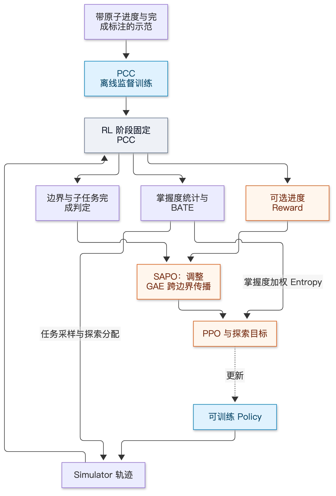

[SVG 矢量图](assets/rl-training-diagrams/04-atomicrl.svg) · [独立 Mermaid 源文件](assets/rl-training-diagrams/04-atomicrl.mmd)

展开 Mermaid 源码

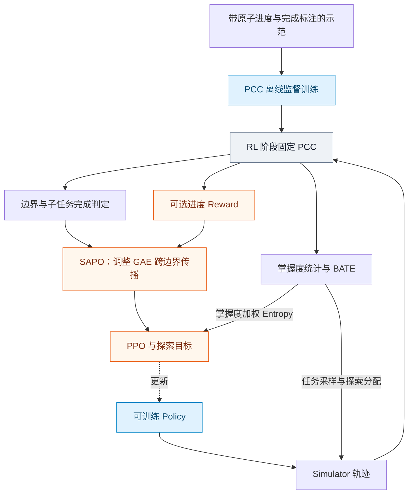

先从监督数据训练 PCC，再固定它识别 Rollout 中的边界与完成情况。SAPO 调整 GAE Trace，失败边界可用κ＝0.3衰减，一步 TD／Bootstrap 保留；BATE 将完整任务采样和局部探索偏向未掌握的子任务。PCC 不与 Policy 共同 RL。〔E3；§3〕

### 11.3 数据、训练配置与评测协议

| 项目 | 论文披露 |
|---|---|
| 底座 | π0.5／OpenVLA-OFT；Policy 内部冻结清单未披露 |
| PCC | 冻结约400M SigLIP；训练时序／预测模块；进度与完成监督 Loss；RL阶段整体固定 |
| 标注数据 | LIBERO150条轨迹；真机任务各50条 PCC 标注；真机 SFT各100条，二者是否重叠未披露 |
| 环境 | LIBERO-Long、CALVIN ABC→D；真机任务在重建 Simulator 中 RL 后部署评测 |
| 训练 | 每 Run 200个优化迭代；8×H200；推理1×RTX5090 |
| 评测 | LIBERO10任务×50次；CALVIN1,000条链，SR1–5／Avg. Len.；3项真机任务各25次／方法 |
| 缺项 | LR、Batch、环境交互量、训练 Seed 数、Chunk长度、墙钟成本未披露 |

### 11.4 主结果与弱初始化消融〔E3〕

| LIBERO-Long | SFT | PPO | AtomicRL |
|---|---:|---:|---:|
| π0.5 | 89.0% | 95.4% | 99.0% |
| OpenVLA-OFT | 86.5% | 94.8% | 98.8% |

CALVIN SR5由PPO70.6%→AtomicRL80.1%，Avg.Len由4.36→4.56；三项真机平均61.3%→69.3%，RL在重建Simulator中进行后部署评测。

弱初始化消融：PPO78.2%→SAPO87.8%→加退火Progress Reward89.6%→加BATE91.2%。它与主表99.0%使用不同初始化，不可直接相减。200个优化迭代也不是200次环境交互；每迭代Optimizer实际调用数未披露。

### 11.5 优势传播的直观表达〔E3：公式化解读〕

设一个任务包含“打开抽屉→拿物体→放到目标”三段。前两段已正确完成，最后放置失败。如果失败相关的 Value 残差不加区分地向前传播，前段有用动作也可能得到不利更新。

为便于理解，可将其 Trace 调节概念化为：

$$
\delta_t=r_t+\gamma(1-d_t)V(s_{t+1})-V(s_t),
$$
$$
\widetilde A_t
=\delta_t+\gamma\lambda(1-d_t)g_t\widetilde A_{t+1}.
$$

更明确地，本节 z 表示子任务编号，令语义边界标记与门控为：

$$
b_t=\mathbf 1[z_{t+1}\ne z_t],\qquad
g_t=1-(1-\kappa_t)b_t.
$$

子任务内部 g 恒为 1；边界之后的子任务成功时 κ＝1，失败时采用衰减系数。递推在末端以零初始化，环境终止由 d 单独处理；语义边界不等于环境终止。这是 S4 的直观递推表达，具体边界与回溯的成功判定仍遵循原文算法。它没有把所有失败轨迹改成成功，也没有移除一步 Value Bootstrap。

### 11.6 洞察与局限〔E3：分析〕

它把两个问题分开：**奖励提供了多少信息，学习算法怎样传播这些信息。** 多加稠密 Reward 不一定解决跨阶段错误归因；边界与 Advantage 的设计可能同样重要。

但成功的前段也未必总是“无辜”：抓取姿态不合适，可能在后段放置时才暴露。若把所有跨阶段影响都截断，也可能丢掉真实的长程依赖。因此需要软衰减、可靠边界，以及能区分前置条件错误的评测，而非简单把每段拆成互不相关的任务。

PCC 也是额外学习系统。边界误报、成功误判以及额外标注成本，应和 Policy 收益一起报告。它不构成“两个大脑共同 RL”的证据，而是可与不同模块更新方案组合的信用分配方法。

PCC标注与推理成本均应计入。原调研未确认官方实现，独立训练Seed数披露不充分。

## 12. 放在一起看：哪些结论成立，哪些仍待验证

### 12.1 十项工作的训练机制对照〔E3：归类〕

| 工作 | 核心学习信号 | 更新对象 | 环境／数据主来源 | 最需要检查的训练边界 |
|---|---|---|---|---|
| π_RL | PPO＋随机生成路径概率＋GAE | 主配置 Action Expert；可选 VLM LoRA | 演示＋物理仿真 | 采样路径、H/H′/K、训练／部署差异 |
| RECAP | Distributional Value＋Advantage条件化 | Value与VLA，多目标KI隔离 | 示范、自主执行、人工纠正 | 价值误差、数据成本与阈值定义 |
| RLT | Twin-Q Actor–Critic＋参考动作约束 | 小Actor／Critic；VLA固定 | 任务示范＋真机关键阶段 | 数据时长、墙钟、阶段选择 |
| Z-1 | 组相对 Clipped GRPO | Expert或选择性 VLM＋Expert | RoboCasa演示与分叉仿真 | Mask前缀、模块选择、评测样本数 |
| SyVLA | 动作Surrogate＋Value＋辅助CE | VLM与Flow Expert | 大规模多模态＋真机与专家检索 | 非标准Ratio、示例配置与论文差异 |
| TEMPO | 两套 TD3 | 投影与Expert；VLM固定 | 示范＋真实／仿真交互 | 绝对更新量与Stop-Gradient |
| DeepThinkVLA | CoT SFT＋Outcome GRPO | 统一 Reasoning–Action Policy | CoT标注＋仿真 | 真机仅SFT、论文与Launcher KL差别 |
| DRILL | 想象 GRPO＋World代理／元梯度 | Policy与World | 演示、想象、少量外层Simulator | 额外外层预算与World用途 |
| WAM-RL | Online Video SFT＋Latent KL＋Actor PG | World与Actor不同目标 | 成功轨迹＋仿真执行 | Reward标定、潜在漂移与披露缺项 |
| AtomicRL | PPO＋语义 GAE门控／探索 | Policy；PCC固定 | 标注示范＋物理仿真 | PCC监督成本与跨阶段依赖 |

### 12.2 共同更新的四个设计轴〔E3：分析〕

| 设计轴 | 关键选择 | 最相关研究 |
|---|---|---|
| 更新范围 | 冻结／Adapter／选层／全参 | π_RL、Z-1 |
| 学习目标 | 策略梯度／优势条件化／预测重建／下游效用 | π_RL、RECAP、WAM-RL、DRILL |
| 更新协调 | 同一梯度／独立 Critic／快慢更新／混合 SFT | TEMPO |
| 信用分配与功能验证 | 子任务边界／轨迹优势／推理干预 | AtomicRL、DeepThinkVLA |

只改变“联合／不联合”一个标签，会掩盖这四个轴。一个收益可能来自更好的采样、更准确的边界或更稳定的接口，而不是来自解冻本身。

### 12.3 当前证据的强度与边界〔E3：分析〕

**直接 Policy RL 已有多种可行路径。**

π_RL、RIPT-VLA、SimpleVLA-RL 等支持策略可以在 SFT 后通过交互进一步改善；RECAP 支持利用混合质量经验做优势条件化提取；RLT 支持在真机精密阶段用轻量在线策略获得收益。它们解决的问题、数据条件和动作表示不同，不能组成统一算法排名。

**“联合”有直接证据，普遍优越性仍缺少充分证明。**

Z-1、SyVLA、TEMPO 展示了不同程度的共同更新；π_RL 提供联合收益不明显的对照。现有证据更支持任务相关的模块选择与协调研究，不支持所有模型、任务都应解冻。

**World Model 与 Reasoning 的价值需要落到行为证据。**

DRILL 将世界模型目标连接到下游学习效果；DeepThinkVLA 通过干预检查推理路径；AtomicRL 研究语义边界上的信用传播。这些工作说明，模型指标、可读输出或更密奖励都不能单独替代行为评测。

### 12.4 跨论文比较必须控制什么〔E3：分析〕

以下是审阅已有论文时，需要分别检查的对照。

| 已有研究中的比较 | 阅读时核查什么 | 对应工作 | 结论边界 |
|---|---|---|---|
| 冻结 vs 联合更新 | 是否同时改变学习率、更新次数与数据 | π_RL、Z-1 | 不能把总体 RL 收益全归给解冻 |
| 单回路 vs 不同频率双回路 | 绝对更新预算与模块范围是否一致 | TEMPO | 频率比例不是普遍常数 |
| World 固定 vs 在线适配 | Actor Loss、外部评测与数据是否受控 | WAM-RL、DRILL | 预测指标与控制收益应分别报告 |
| 标准 vs 边界信用传播 | 初始 SFT、标注与 Reward 是否相同 | AtomicRL | 弱初始化消融不能与主表混算 |
| 有推理 vs 无推理 | 是推理期干预，还是从训练阶段移除 | DeepThinkVLA | 功能干预不等于内部机制已揭示 |
| 全模型 vs 轻量改进 | 前置示范、关键阶段、复位时间是否计入 | RECAP、RLT | 两种论文之间不是同预算直接比较 |

每组都需报告环境交互、模型计算、辅助标注与评测预算。训练步数相同不代表成本相同；Evaluation Seeds 也不等于独立 Training Seeds。

### 12.5 最值得保留的研究洞察〔E3：综合判断〕

1. **先明确学习信号，再决定更新多少参数。** π_RL的问题是生成路径概率；RECAP的问题是价值与优势标签；RLT的问题是在线控制接口。三者都可能有效，却不共享同一训练目标。
2. **联合收益更可能依赖条件与协调方式。** Z-1、SyVLA提供直接共同更新案例；TEMPO强调独立Critic与频率；π_RL提供收益不明显的对照。现有证据支持继续研究任务瓶颈和接口变化，而非默认全部解冻。
3. **中间模型的分数必须落到行为。** DRILL区分预测误差与学习效用，WAM-RL的一致性信号也必须用独立任务成功验证；DeepThinkVLA则要求检查推理干预是否改变动作。
4. **长程改进不只靠增加Reward。** AtomicRL表明信用传播是独立设计维度，但阶段门控不能抹去真实的跨阶段因果依赖。
5. **数据与证据成本决定结论能走多远。** 人工纠错、PCC标注、前置示范、关键阶段选择与复位时间，都会影响“高效”的含义。代码能审阅、配置已发布和结果被独立复现是三件不同的事。

## 13. 原始资料、实现版本与核查边界

| 编号 | 固定版本／官方入口 | 建议优先读的位置 |
|---|---|---|
| S1 | [π_RL，2510.25889v3，2026-01-29](https://arxiv.org/html/2510.25889v3)；[RLinf 训练文档](https://rlinf.readthedocs.io/en/release-v0.3/rst_source/examples/embodied/pi0.html) | §4：随机 Flow 与 Loss；F.2：联合消融；G/J：训练细节 |
| S2 | [Z-1，2606.31846v1，2026-06-30](https://arxiv.org/html/2606.31846v1) | §3.2：环境前缀分叉；§4.3.2：联合对照；D.3/D.4：概率与更新范围 |
| S3 | [DRILL，2610.30814v1，2026-10-22](https://arxiv.org/html/2610.30814v1) | §3：双层目标；Table 1：效果与 MSE；D/E：预算、算法、发布状态 |
| S4 | [AtomicRL，2610.30097v1，2026-10-21](https://arxiv.org/html/2610.30097v1) | §3：SAPO/BATE；§4.4：弱初始化消融；A.4：PCC 监督成本 |
| S5 | [TEMPO，2608.07314v1，2026-08-07](https://arxiv.org/html/2608.07314v1)；[项目页](https://anonymous.4open.science/w/tempo-page/) | §III：两个学习回路与梯度；Tables II/III：模块与频率消融 |
| S6 | [DeepThinkVLA，2511.15669v3，2026-08-05](https://arxiv.org/html/2511.15669v3)；[官方仓库](https://github.com/OpenBMB/DeepThinkVLA) | §3.3：Outcome RL；Table 5：同架构 CoT；A.5/A.6：扰动与干预 |
| S7 | [WAM-RL，2606.17906v1，2026-06-16](https://arxiv.org/html/2606.17906v1) | §3：两种目标；Tables 1/2：主结果与 Reward；§4.4：World SFT 证据 |
| S8 | [RECAP／π*0.6，2511.14759v1](https://arxiv.org/html/2511.14759v1)；[官方说明](https://pi.website/blog/pistar06) | §IV：Value 与优势条件化；§V：KI；§VI：真实经验与对照 |
| S9 | [RLT，2604.23073v1，2026-04-24](https://arxiv.org/html/2604.23073v1)；[官方说明](https://www.pi.website/research/rlt) | §IV：接口与在线 RL；§VI／附录 B：前置示范、关键阶段、数据预算 |
| S10 | [SyVLA，2606.09009v1，2026-06-08](https://arxiv.org/html/2606.09009v1)；[官方代码](https://github.com/sy-vla/syvla) | §3：表示与 RL；附录 A：训练；本文 §6.5 列锁定源码 |

### 13.1 锁定实现版本

| 实现 | 核验commit | 本文定位 |
|---|---|---|
| RLinf／π_RL | c50c60b475654a71533e9c5bacf13ef899a10104 | §2.6：冻结、前缀计算图与路径概率聚合 |
| SyVLA | 1b4ca0b251f5089752addd299358285e8e140b92 | §6.5：参数、条件表示、Surrogate与示例配置 |
| DeepThinkVLA | ff271e7c024422581c9875d96250f99dd0b743d1 | §8.5：Launcher超参与KL开关 |

### 13.2 实际核查与本次整合范围

原调研核查了重点论文的方法、实验与相关附录，直接查看Z-1 Fig.3，重算DRILL表内均值及增益，并定点读取上述锁定源码／配置。未全面验收依赖、权重、数据与训练资产，未开展数值复现。代码和资源发布状态保留原核验日期，不代表2026-11-03重新检查。〔E1／E2／E3〕

本次将原有11张图嵌入相应章节，保留全部训练表中的数据、Reward、超参、评测协议和披露缺项；将主结果、消融与作者原文口径差异移至紧邻的证据段，合并重复解释。图的Mermaid内容及PNG／SVG沿用已渲染版本，并在整合时重新检查文件一致性与链接。

### 13.3 原材料与版本追溯

以下三份保留为历史底稿，日常阅读与后续综合修订优先使用本文：

- [研究分析底稿 v2.1](2026-10-30-具身后训练重点研究-RL方法与证据.md)
- [训练详表底稿 v1.0](2026-10-30-具身RL图解与训练详表.md)
- [静态图册与导出清单](assets/rl-training-diagrams/README.md)

本文仅整合既有资料，没有将未披露超参补成默认值，没有将仿真证据改为真机证据，也没有把所有共同适配都归为同一种Policy Gradient。
