# 具身 RL 静态图册

> 统一阅读入口：[具身RL重点研究综合报告](../../2026-10-30-具身RL重点研究综合报告.md)。全部图已按研究顺序嵌入该报告，本页保留为导出资源索引。

日期：2026-10-30。配套[图解与训练详表](../../2026-10-30-具身RL图解与训练详表.md)。全部为根据论文机制绘制的讲解示意〔E3〕，不是作者原图。

权威 Mermaid 源码在报告内；这里的 `.mmd`、`.svg`、`.png` 是对应导出。PNG 可直接阅读，SVG 可缩放，Mermaid 可继续编辑。图中文字的训练边界与证据说明以报告正文为准。

| 图 | PNG | SVG | Mermaid |
|---|---|---|---|
| 训练版图总览 | [查看](00-training-map.png) | [矢量图](00-training-map.svg) | [源码](00-training-map.mmd) |
| π_RL：Flow-SDE 与 PPO | [查看](01-pi-rl.png) | [矢量图](01-pi-rl.svg) | [源码](01-pi-rl.mmd) |
| Z-1：前缀分叉与选择性联合 GRPO | [查看](02-z1.png) | [矢量图](02-z1.svg) | [源码](02-z1.mmd) |
| DRILL：World Model 的 VWI／IMG | [查看](03-drill.png) | [矢量图](03-drill.svg) | [源码](03-drill.mmd) |
| AtomicRL：语义边界与信用分配 | [查看](04-atomicrl.png) | [矢量图](04-atomicrl.svg) | [源码](04-atomicrl.mmd) |
| TEMPO：双 TD3 更新回路 | [查看](05-tempo.png) | [矢量图](05-tempo.svg) | [源码](05-tempo.mmd) |
| DeepThinkVLA：CoT SFT 与仿真 RL | [查看](06-deepthinkvla.png) | [矢量图](06-deepthinkvla.svg) | [源码](06-deepthinkvla.mmd) |
| WAM-RL：World 与 Actor 的不同目标 | [查看](07-wam-rl.png) | [矢量图](07-wam-rl.svg) | [源码](07-wam-rl.mmd) |
| RECAP：Value 与优势条件化 | [查看](08-recap.png) | [矢量图](08-recap.svg) | [源码](08-recap.mmd) |
| RLT：冻结 VLA 与轻量 RL | [查看](09-rlt.png) | [矢量图](09-rlt.svg) | [源码](09-rlt.mmd) |
| SyVLA：动作 Surrogate 与辅助 CoT | [查看](10-syvla.png) | [矢量图](10-syvla.svg) | [源码](10-syvla.mmd) |

## 训练版图总览

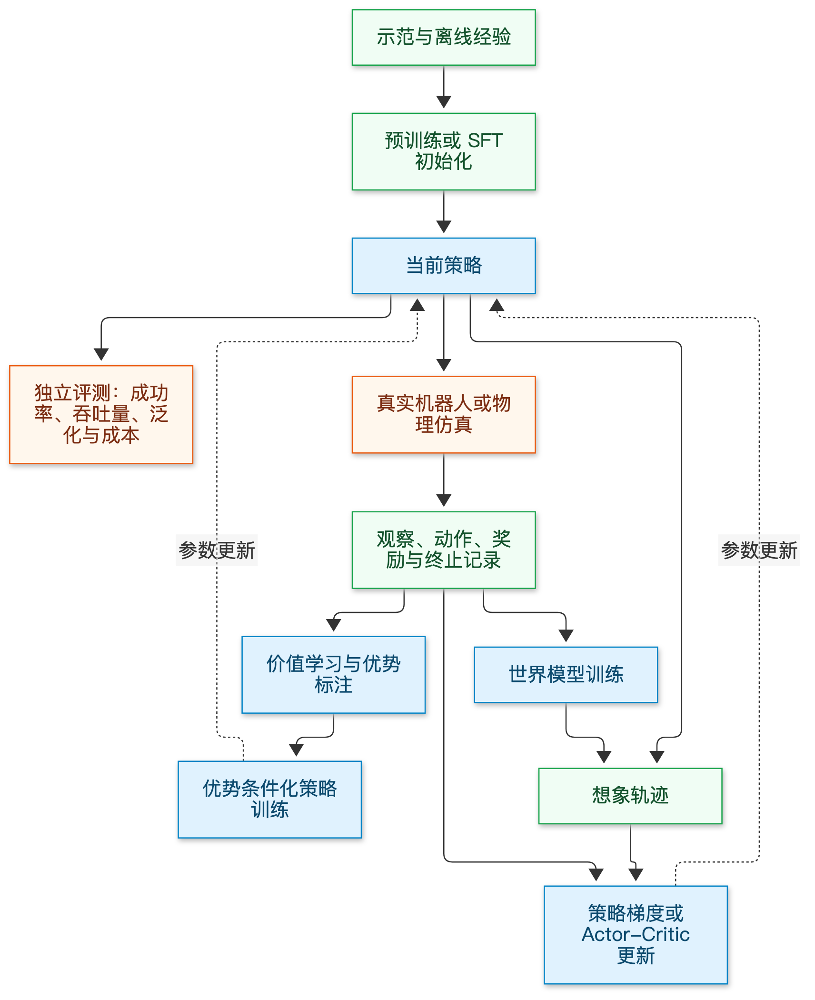

## π_RL：Flow-SDE 与 PPO

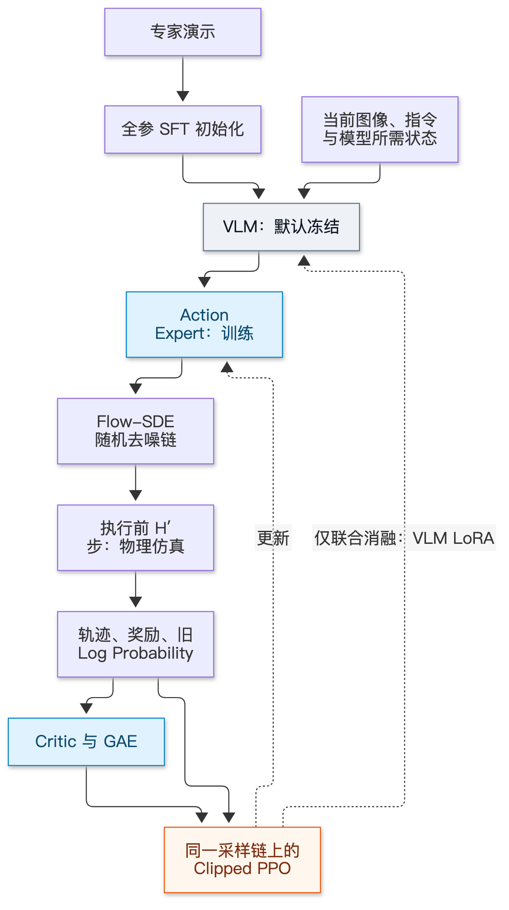

## Z-1：前缀分叉与选择性联合 GRPO

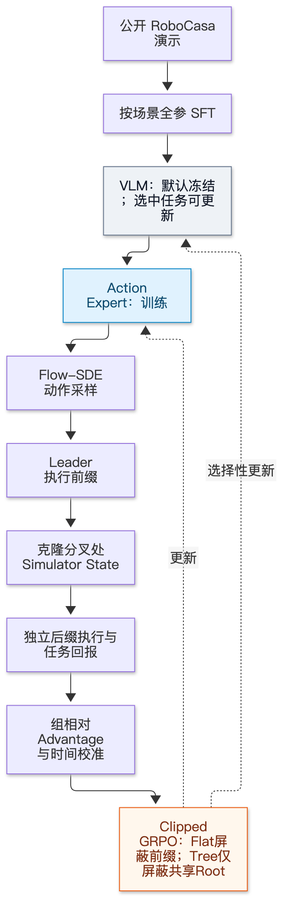

## DRILL：World Model 的 VWI／IMG

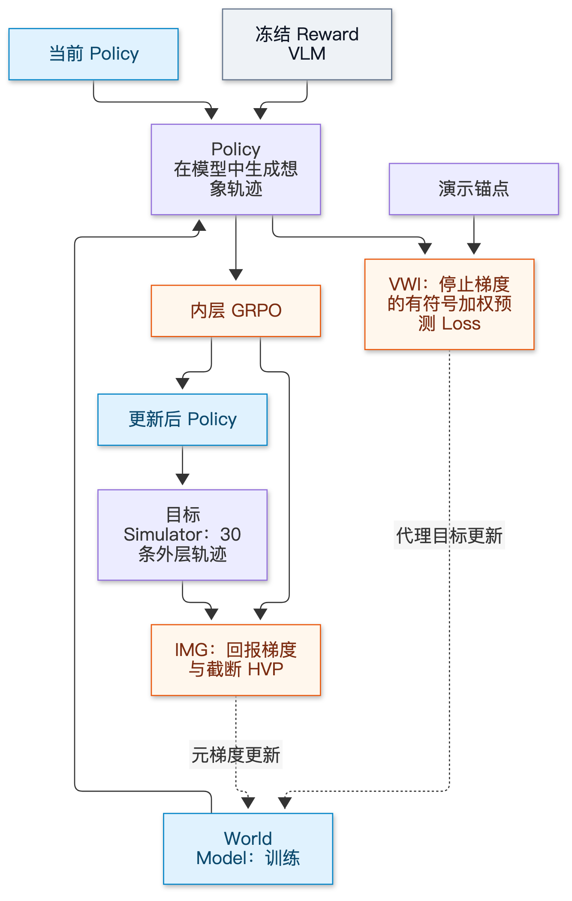

## AtomicRL：语义边界与信用分配

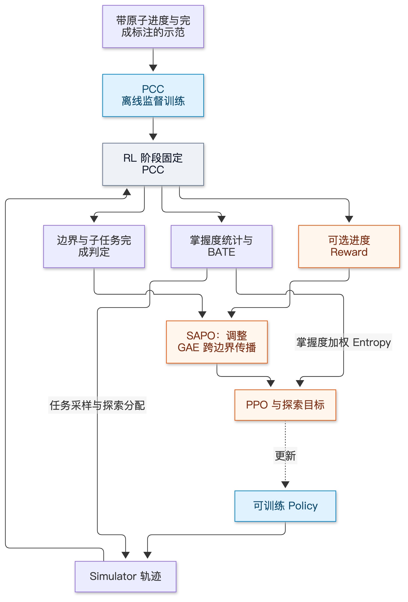

## TEMPO：双 TD3 更新回路

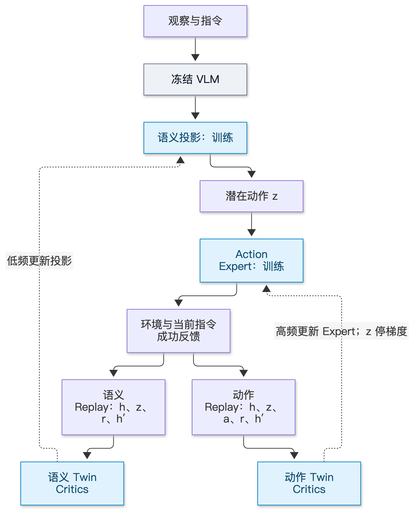

## DeepThinkVLA：CoT SFT 与仿真 RL

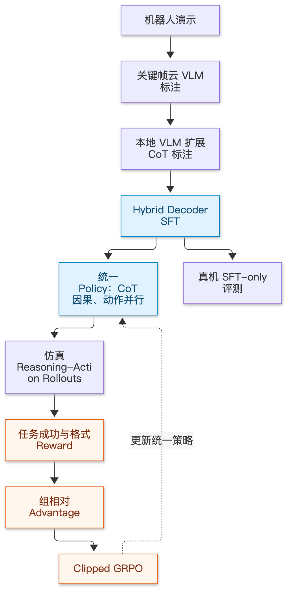

## WAM-RL：World 与 Actor 的不同目标

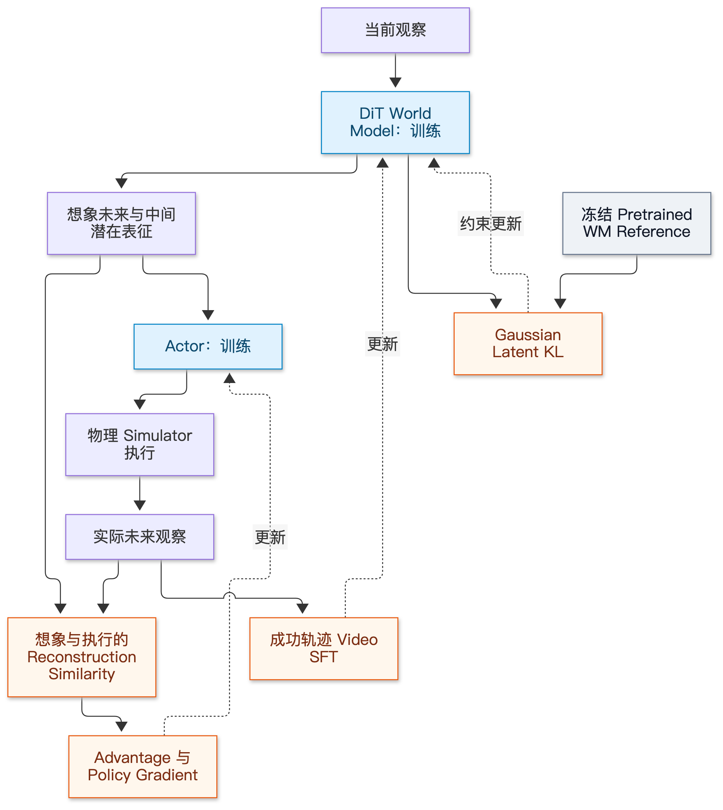

## RECAP：Value 与优势条件化

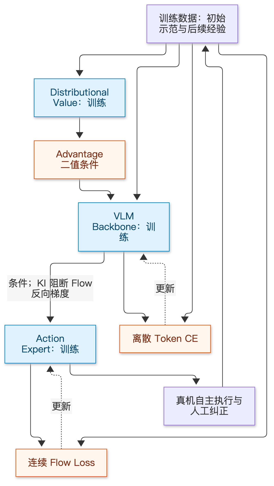

## RLT：冻结 VLA 与轻量 RL

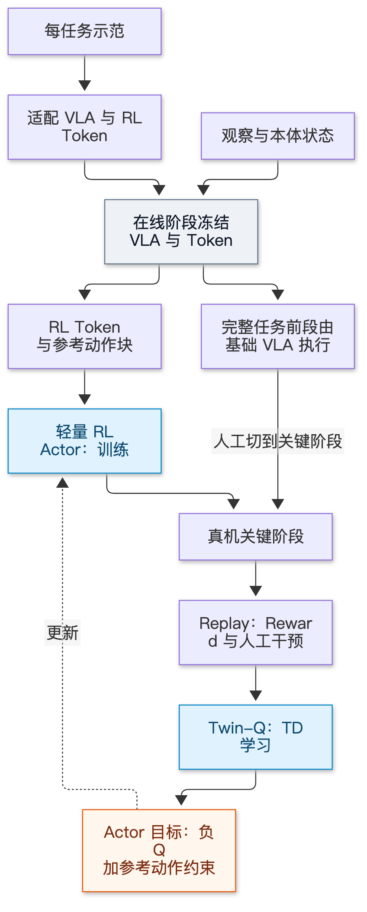

## SyVLA：动作 Surrogate 与辅助 CoT

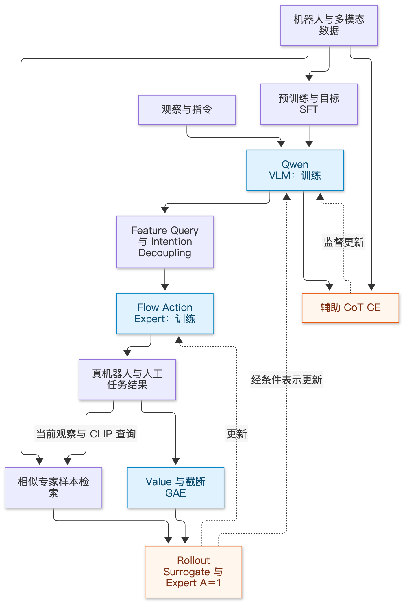

## 导出与验证

使用 `@mermaid-js/mermaid-cli@12.0.0`、Chrome、PingFang SC，白底、`htmlLabels=false` 导出。11段 Mermaid 均通过实际渲染；SVG 均通过 XML 解析；PNG 已逐图视觉检查。文件校验值见 [manifest.json](manifest.json)。

重导出示例（需已安装 Mermaid CLI，并配置本机 Chrome）：

```sh
mmdc -i 01-pi-rl.mmd -o 01-pi-rl.svg -b white --size 1500 --no-font-embed -c mermaid-config.json -p puppeteer-config.json
```

`mermaid-config.json` 示例：`{"theme":"default","htmlLabels":false,"fontFamily":"PingFang SC, Arial, sans-serif","flowchart":{"htmlLabels":false,"curve":"basis","useMaxWidth":true}}`。`puppeteer-config.json` 使用本机浏览器路径，避免把路径作为跨机器固定值。
